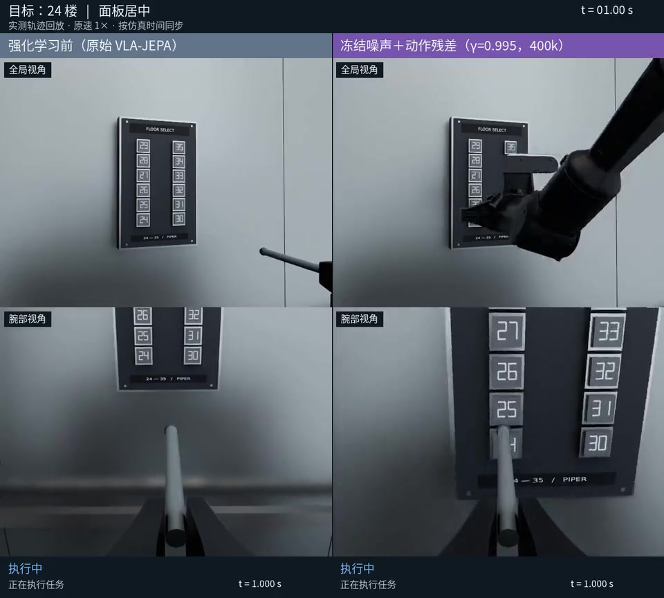

# PressB

**English** | [简体中文](README.zh-CN.md)

A modular framework for robot policy evaluation, data collection, and online reinforcement learning in simulation and on physical robots.

[Documentation](docs/project_framework.md) · [Demos](docs/media/README.md) · [Report an issue](https://github.com/pgq18/PressB/issues)

## About

PressB connects robot environments with vision-language-action (VLA) models to study how pretrained policies can improve through interaction. It uses a **shared runtime, task plugins, model adapters, and experiment configurations**, built with Python, PyTorch, and NVIDIA Isaac Sim.

- **Independent nodes:** inference, training, and simulation or real-robot interaction can run on one machine or across multiple machines.
- **Model support:** Wall-OSS, VLA-JEPA, Diffusion Policy, and LeRobot π₀.₅, with supervised training on LeRobot datasets.
- **Online learning:** frozen-model DSRL and action residuals, plus [DPPO](docs/dppo.md) action-expert updates with versioned weight synchronization.
- **Robot workflows:** parallel simulation, trajectory collection and replay, optional action smoothing, and a PiPER hardware backend with dual RealSense cameras.

### Environments

| Environment | Task |
|---|---|
| [Elevator](docs/scene_details.md) | Press the instructed elevator button |
| [Pick-and-place](docs/piper_pick_place.md) | Pick up a tabletop object and place it in a box |
| [Table buttons](docs/table_buttons.md) | Press a red, yellow, or blue button in randomized layouts |
| [Playground](docs/playground.md) | Calibrated, empty PiPER workbench template for building new tasks |
| [Cube stacking](docs/cube_stack.md) | Place the red cube on the blue cube in the Playground workspace |
| [Tabletop cleanup](docs/tabletop_cleanup.md) | Put two distinct objects into a fixed box in the Playground workspace |

## Demo

Original VLA-JEPA versus a frozen noise policy plus action-residual RL, played at original simulation speed. Click to view the video.

[](docs/media/before-vs-residual.mp4)

[More demos and experiment details →](docs/media/README.md)

## Getting started

Activate a dedicated Python **3.10 or 3.11** environment. Install the core package and list available task/model plugins:

```bash
git clone https://github.com/pgq18/PressB.git
cd PressB
python -m pip install -e .
python scripts/run_experiment.py list
```

Simulation needs an NVIDIA GPU and an Isaac Sim environment; see the [RTX 5090 setup guide](docs/rtx5090_setup.md). Install model and training dependencies separately using the [model setup guide](docs/bundled_models.md). Weights, datasets, and downloaded scene assets are provisioned separately.

## Usage

Start from an [evaluation configuration](configs/experiments/pap_walloss_eval.json), preserving its relative `extends` references. Set local asset/checkpoint paths, devices, and service addresses, then launch the nodes in separate terminals using their respective environments:

```bash
python scripts/run_experiment.py inference --config /path/to/experiment.json
python scripts/run_experiment.py simulation --config /path/to/experiment.json
python scripts/run_experiment.py eval --config /path/to/experiment.json
```

Use `train` for online RL or `collect` for trajectory recording. With a real-robot configuration, use `real_robot` in place of `simulation`. See the guides below for complete examples.

## Documentation

| Guide | Contents |
|---|---|
| [Framework](docs/project_framework.md) | Architecture, configuration, and adding tasks or models |
| [Models](docs/bundled_models.md) | Model adapters and supervised training |
| [π₀.₅ on Ascend](docs/ascend_pi05.md) | Isolated conda setup and multi-NPU supervised training |
| [Demonstration datasets](docs/manipulation_collection.md) | Parallel Stack/Cleanup collection and LeRobot export |
| [Evaluation performance](docs/evaluation_performance.md) | Shared inference, simulation workers, and measured throughput |
| [Online RL](docs/configurable_rl_nodes.md) | Node interfaces, DSRL, action residuals, and checkpoints |
| [DPPO](docs/dppo.md) | Diffusion Policy and stochastic-flow action-expert optimization |
| [Real robots](docs/real_robot.md) | PiPER setup, cameras, and optional human success/failure labels |
| [Experiments](docs/results/) | Evaluation results and validation records |

## Roadmap

- **Real2sim2real:** reconstruct real workspaces with AI agents, improve robustness in simulation, and adapt policies on hardware.
- **Real-robot online RL:** validate learning directly through physical interaction.

These research directions have not yet been experimentally validated end to end.

## Contributing

Issues and pull requests are welcome. See the [framework guide](docs/project_framework.md) for component boundaries and extension conventions.

Third-party sources and licensing information are documented in [THIRD_PARTY.md](THIRD_PARTY.md).
