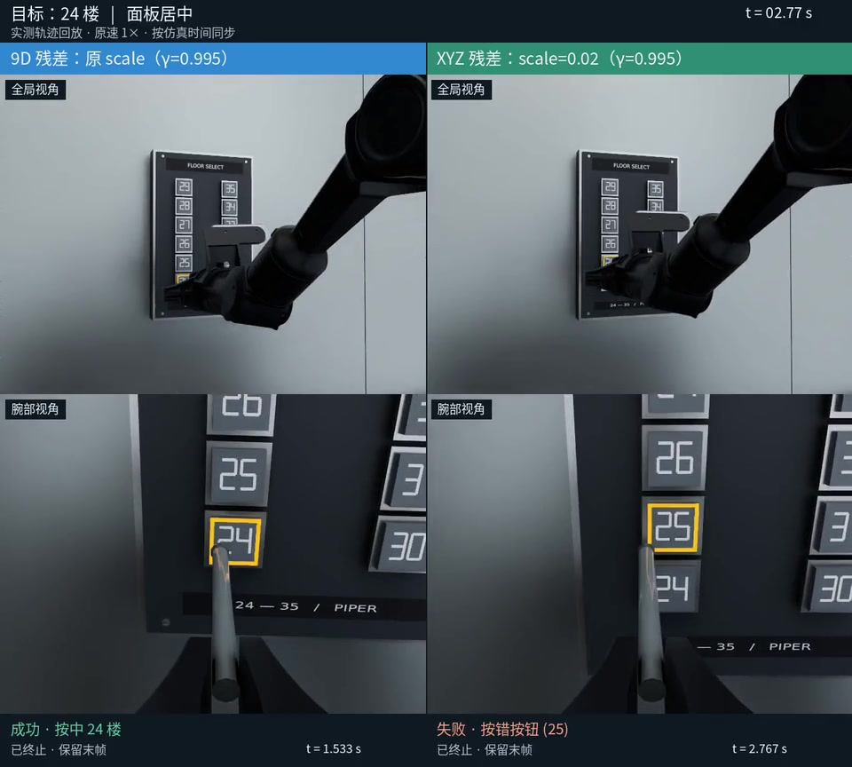
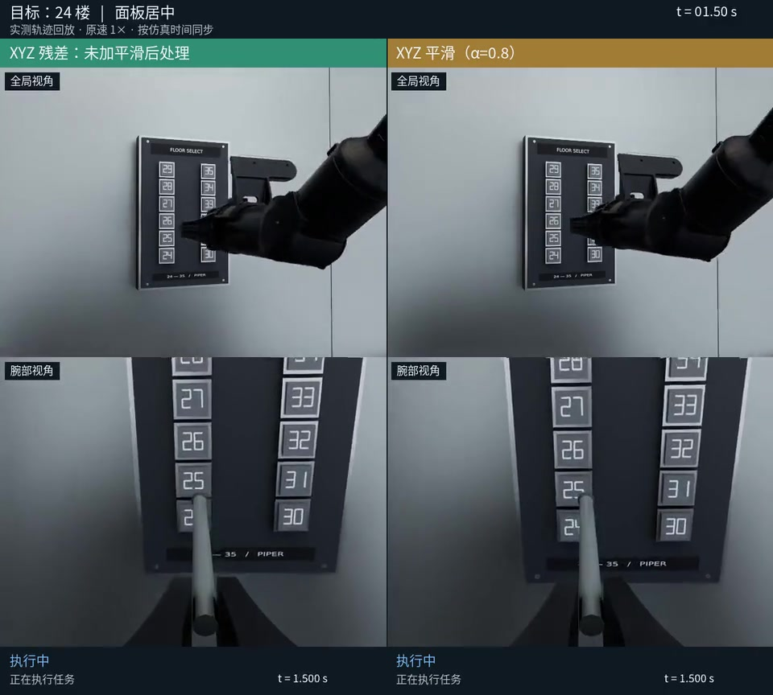
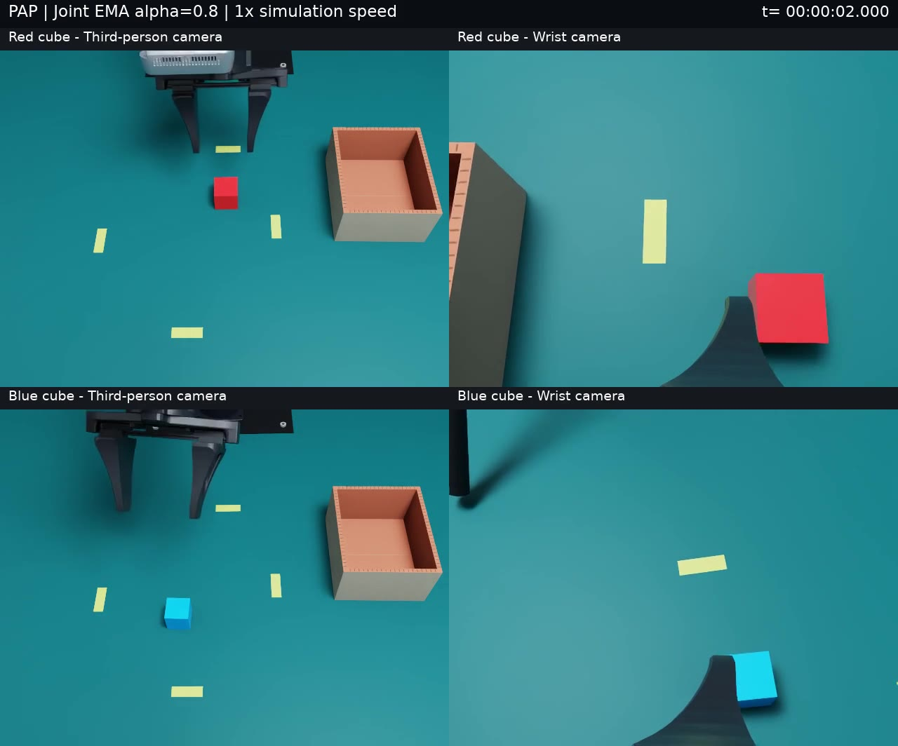
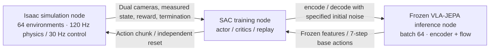

# PressB — PiPER Simulation, VLA Evaluation and Online Residual RL

**English** | [简体中文](README.zh-CN.md)

PressB builds Isaac environments for evaluating robot policies and improving frozen vision-language-action models through online residual reinforcement learning. It connects physical simulation, model inference and policy training, with recorded camera observations and contact-based task outcomes.

**Updated 2026-11-06:** three PiPER tasks are available. Elevator residual RL reached **119/120 (99.17%)** in a fixed evaluation; PAP Wall-X evaluations achieved **65/100** for red cubes and **54/100** for five colors. Tabletop buttons now support single-/multi-task VLA-JEPA evaluation and have completed a new [9,000-episode collection with color-specific approaches](docs/results/table_buttons_target_relative_20261030/README.md), separate from the earlier shared-motion datasets.

[Tasks](#tasks) · [Results](#current-results) · [Videos](#demo-videos) · [Run](#run-the-tasks) · [Three-node RL](#online-reinforcement-learning-three-independent-nodes) · [Handover](docs/HANDOVER.md)

## Shared runtime and plugins

**2026-11-06 framework refactor:** new experiments use **one runtime + task plugins + model adapters + experiment configurations**. The same rollout supports DSRL, action residuals, fixed DSRL with a new residual, evaluation and chunk trajectory recording. Robot/camera setup and PhysX controls are shared; task physics and rewards remain explicit plugins. Existing commands and imports remain compatible.

Start with [the framework guide](docs/project_framework.md) and [`configs/experiments`](configs/experiments). Use `python scripts/run_experiment.py list` to inspect plugins, then `validate`, `inference`, `simulation`, `train`, `eval` or `collect` with one experiment JSON. PAP supports the 64-environment profile; table buttons currently runs one environment per node. Historical frame-aligned LeRobot collection remains available.

[Refactor verification](docs/results/framework_refactor_20261106.json): 2,049 regression tests passed, plus real Isaac replay and three-node training/resume/evaluation/recording checks, including PAP64 with Wall-OSS native batch64. These are functional checks, not new policy success-rate estimates.

**Models are now bundled:** Wall-OSS and VLA-JEPA inference, data readers and supervised training live in PressB. The [model guide](docs/bundled_models.md) covers the new common training launcher and source provenance. [Integration verification](docs/results/model_internalization_20261106.json) includes 2,106 main-project tests across the required environments and real-weight comparisons: Wall-OSS batch 2/8 and VLA-JEPA pose9/joint6/joint7 match their original implementations on the tested inputs.

## Tasks

| Task | Scene and observations | Available workflow |
|---|---|---|
| [Elevator buttons](docs/scene_details.md) | 12 contact-actuated buttons, pressing rod, wrist and table RGB cameras | 1,200 expert episodes, LeRobot export, VLA-JEPA evaluation, three-node SAC residual/noise training |
| [Pick-and-place (PAP)](docs/piper_pick_place.md) | Dataset-fitted green workbench, cardboard box, movable cubes and two cameras | Real-trajectory replay, native Wall-X closed-loop inference, optional joint smoothing, paired position/color evaluation |
| [Tabletop color buttons](docs/table_buttons.md) | Red/yellow/blue spring-loaded buttons on the PAP workbench | Near/medium/far randomized layouts, color-specific IK demonstrations, LeRobot collection/merge, VLA-JEPA training and closed-loop evaluation |

The tasks have separate configurations. PAP reconstructs `piper_pap_20260606_offset` from recorded joints, camera images and scene photos, including a smooth cube, rougher cardboard/tabletop and soft lighting. Red and blue cube replay presets are available; other dataset objects need their own geometry. PAP retains its dataset-fitted cameras. The tabletop button task uses the elevator wrist-camera intrinsics **and optical pose**, while retaining the PAP fixed camera. Tabletop buttons have learned-policy inference and audited closed-loop evaluation. Completed online RL experiments cover the elevator task and PAP/Wall-OSS. PAP training logs and evaluation evidence are recorded in the handover; training recent SR is distinct from independent evaluation. Tabletop buttons have a common task/model interface and functional checks, but have not undergone a long online RL experiment. Tabletop supervised training and model inference are now bundled in PressB; the [historical HTTP evaluation guide](docs/table_buttons_policy_eval.md) retains earlier experiment commands.

The framework can support a future **real2sim2real** workflow: use an AI agent to reconstruct a real workspace, improve policy robustness in simulation, then adapt and validate on the real robot. The current experiments establish simulation feasibility; real2sim2real transfer and direct real-robot validation of the RL policies remain future work.

The current RTX 5090 environment uses **Isaac Sim 5.0 / Isaac Lab 2.2 / Python 3.11**. Historical Isaac Sim 4.5 / Isaac Lab 2.0.2 scripts remain available. Source, configurations, [result summaries](docs/results/) and [selected demos](docs/media/README.md) are included in Git; full datasets, weights, downloaded assets, Conda environments and raw recordings are local dependencies.

## Current results

### Elevator: frozen VLA-JEPA with residual RL

The base VLA-JEPA was fine-tuned on 1,200 expert episodes with varied panel positions, using the fixed **step 10600** checkpoint. VLA remains frozen throughout the online stage. Action-output residuals and flow initial noise are first learned independently; the trained noise policy is then held fixed while a new action residual is trained from random initialization. The noise method directly selects the flow's initial noise without backpropagating into VLA.

The table reports a fixed-condition evaluation under the same fast simulation setup: **12 buttons × 5 panel positions (center and four corners) × 2 repeats = 120 trials**, with seed=20260930. Success requires actual button contact, and evaluation does not update parameters. The 400k budget applies to the newly trained action residual; the preceding 1M noise-policy training is separate. Repeated runs are not guaranteed to be bitwise identical, and a single result does not establish generalization across seeds.

| Method | Online training | Successful trials | Success rate |
|---|---|---:|---:|
| Base VLA-JEPA | No RL | 25/120 | 20.83% |
| Independent action residual | 1M | 81/120 | 67.50% |
| Independent initial-noise policy | 1M | 81/120 | 67.50% |
| Combination of the two independently trained policies | Two 1M checkpoints; no joint retraining | 96/120 | 80.00% |
| Fixed noise, retrained 9D residual, γ=0.99 | 400k | 114/120 | 95.00% |
| Fixed noise, retrained 9D residual, γ=0.995 | 400k | 118/120 | 98.33% |
| Previous configuration with residual scale halved | 400k | 87/120 | 72.50% |
| **Fixed noise, retrained XYZ residual, γ=0.995** | **400k** | **119/120** | **99.17%** |

The latest XYZ actor outputs only **7×3=21 residual dimensions**, with position scale **[0.02, 0.02, 0.02] m**; rotation and gripper commands retain the frozen model's outputs. The 400k run took approximately **7 hours 25 minutes** and completed 398k SAC updates. Button 24 succeeded in 9/10 trials, and buttons 25–35 each succeeded in 10/10. The full 9D comparison uses scales of 0.03 m per XYZ component and 0.1 per rotation6D component; the half-scale setting uses 0.015 m per XYZ component and 0.05 per rotation6D component. The discount γ applies to each 30 Hz control step, giving `γ**7` for a 7-step chunk.

**Smoothing experiments (1,320 evaluations completed):** XYZ exponential smoothing with α=0.8 reduced median measured joint jerk by about 14% and end-effector position jerk by about 30% on tasks that succeeded in both conditions, while increasing task duration by about 0.7%–2.7%. It achieved 119/120 during screening (concurrent baseline: 117) and 117/120 in an independent-seed check (baseline: 116). Position-plus-orientation smoothing and the lighter α=0.9 setting also failed to meet all predefined success-rate thresholds. The default therefore remains **no additional postprocessing**; the best screening result for a smoothing candidate is not treated as a stable finding.

Downloadable [results and per-button statistics](docs/results/online_rl_20261009.json) and the [CSV results table](docs/results/online_rl_20261009.csv) retain source log references and SHA-256 hashes. The [smoothing summary](docs/results/smoothing_20261009.csv) includes every candidate. See [residual training over frozen noise](docs/residual_on_frozen_noise.md) for reproduction instructions, freeze checks, and experiment configurations.

### PAP: Wall-X randomized evaluation

The supplied `piper_pap_20260606` checkpoint runs in a separate Conda environment, predicting 32-step chunks of **six absolute joint angles plus gripper width** over native Wall-X WebSocket (degrees and centimetres on the wire). Simulation applies targets at 30 Hz with 120 Hz physics. Optional `joint_ema` smoothing filters the six arm joints and preserves the gripper command; it is **off by default**, and the following evaluation explicitly selects **α=0.8**.

The four green tape markers define the **four edges** of a **27.02 × 22.31 cm** rectangle. Keeping the entire 3 cm cube inside yields a **24.02 × 19.31 cm** centre-sampling region. Two groups share 100 uniformly sampled positions; the second uses 20 cubes of each color in shuffled order. Each episode allows 20 simulated seconds. Success requires a physical lift, release inside the box and stable placement, with contact evidence from both fingers.

| Evaluation, 2026-10-23 | Success | Rate | Wilson 95% interval |
|---|---:|---:|---:|
| Random position, fixed red | 65/100 | **65%** | 55.3–73.6% |
| Random position and five colors | 54/100 | **54%** | 44.3–63.4% |

Second-group successes: **red 13/20, green 9/20, blue 12/20, white 8/20, yellow 12/20**. All 200 saved physics/contact traces passed outcome verification. Model diffusion draws are not paired between groups, so this result does not establish that color caused the 11-point difference. The earlier **88% / 85%** results used an incorrect, smaller marker-centre hull and do not describe this rectangle.

See the published [evaluation report](docs/results/pap_rectangle_20261023/README.md), [episode CSV](docs/results/pap_rectangle_20261023/episodes.csv), [success-rate plot](docs/results/pap_rectangle_20261023/success_rates.png) and [failure-location plot](docs/results/pap_rectangle_20261023/failure_locations.png). The [PAP guide](docs/piper_pick_place.md#randomized-policy-evaluation) documents sampling, evaluation and physical success criteria.

### Tabletop buttons: datasets and policy experiments

The original shared-motion collections contain nine 100-episode datasets and nine expanded 1,000-episode datasets. Merging colors within each spacing profile produces three multi-task datasets, with 300 or 3,000 episodes each. VLA-JEPA experiments cover single-/multi-task policies and six-joint prediction with a fixed gripper. The [policy evaluation guide](docs/table_buttons_policy_eval.md) records the initial 1,800-rollout evaluation and distinguishes physical task success from the stricter collector metric; training schedules are in the [red-task joint6 guide](docs/table_buttons_joint6_1000_training.md) and [multi-task joint6 guide](docs/table_buttons_multitask_joint6_3000_training.md).

A separate **`target_relative_v2` collection completed on 2026-11-01**: near/medium/far × red/yellow/blue, **1,000 fresh episodes per group, 9,000 total**, with **1,286,591 observation/action rows**. Red approaches directly; yellow rises while advancing and then approaches directly; blue reaches above the target before descending. All nine exports and physical/video audits passed, and all 3,000 profile/layout indices match across colors. These are scripted generator demonstrations, not a learned-policy success rate. Model training on this new collection has not been performed. See the [committed result report](docs/results/table_buttons_target_relative_20261030/README.md) and [motion/collection guide](docs/table_buttons_color_templates.md).

## Demo videos

Click a preview to play or download the MP4. The three elevator videos cover all 12 buttons in the center layout at **1× simulation time**, with the global view above the wrist view. A labeled terminal freeze-frame appears when each task ends. These samples differ from the 120-trial evaluation, which includes panel offsets.

| Base VLA → fixed noise + 9D residual | 9D residual → XYZ-only residual | XYZ smoothing experiment (not adopted) |
|---|---|---|
| [](https://github.com/pgq18/PressB/raw/refs/heads/main/docs/media/before-vs-residual.mp4) | [](https://github.com/pgq18/PressB/raw/refs/heads/main/docs/media/pose9-vs-xyz.mp4) | [](https://github.com/pgq18/PressB/raw/refs/heads/main/docs/media/xyz-smoothing-experimental.mp4) |
| Left: 4/12; right: 12/12. Right uses γ=0.995 and 400k training. | Left: 12/12; right: 11/12. The XYZ demo includes one 24→25 wrong press. | Both sides: 12/12. The full concurrent evaluations scored 116/120 and 117/120. |

**PAP — Wall-X with joint EMA (α=0.8):** red cube above, blue cube below; fixed camera on the left, wrist camera on the right, at **1× simulation time**. These two successful demonstrations are separate from the randomized evaluation.

[](https://github.com/pgq18/PressB/raw/refs/heads/main/docs/media/pap-wallx-smoothed.mp4)

See the [media notes](docs/media/README.md) for original video sources, compression settings, actual frame counts and audit records. Videos preserve recorded simulation timing; playback acceleration and frame interpolation are not used to create differences.

## Repository roles and reproduction scope

| Component | Role | Location |
|---|---|---|
| PressB runtime | Isaac services, online RL, experiments, evaluation and recording | `src/pressb/runtime`, `tasks`, `models`, `experiments` |
| VLA-JEPA | Model, pose9/joint6/joint7 inference, single-/multi-task supervised training | Bundled in `src/pressb/model_sources/vlajepa` |
| Wall-OSS | Model, native batches, noise/context APIs, supervised trainer, data readers and CUDA kernels | Bundled in `src/pressb/model_sources/walloss` |
| [ZPRL-PressB](https://github.com/pgq18/ZPRL-PressB) | Original residual SAC / initial-noise reference | Optional `src/ZPRL`; PressB runs its own implementation |

**Model code is included in PressB.** New experiments do not require separate
Wall-X or VLA-JEPA clones. See [bundled models and supervised training](docs/bundled_models.md)
for environments, CUDA builds and `scripts/train_model.py`. Source revisions and
file hashes are preserved in the bundles' manifests and [repository lock](repos.lock.json).
Weights, datasets and third-party software packages remain separate inputs.

Historical `src/VLA-JEPA` and `ref/wall-x` clones remain optional explicit source
overrides for old experiments. They are ignored, not submodules. Unmigrated
elevator RL checkpoints still bind the original VLA-JEPA runtime commit
`9c9dc71c8e199c7428b25d103ab666395832c001`; switching implementation requires
verified checkpoint migration rather than bypassing identity checks.

A clean clone includes source code, selected media, and statistical summaries. It **does not include** VLA/RL weights, scene snapshots, collection metadata, or model caches. The three general-purpose nodes accept explicit paths. In contrast, `run_residual_on_noise_experiment.py` and the smoothing and video experiment supervisors are reproduction entry points for this workspace: they depend on the existing `outputs/` assets and identity manifests documented here and cannot run directly in an empty directory. See the [high-throughput run guide](docs/online_rl_fast.md) and [5090 environment guide](docs/rtx5090_setup.md) for deployment.

## Installation

**RTX 5090 workstation:** Use the validated Python 3.11 / Isaac Sim 5.0 / Isaac Lab 2.2 configuration, installed through `scripts/setup_env_5090.sh`. See the [RTX 5090 run guide](docs/rtx5090_setup.md) for steps and measured results. The legacy `scripts/setup_env.sh` targets the original Python 3.10 configuration.

Requirements: Linux x86_64, Conda, an Isaac Sim-compatible NVIDIA RTX GPU and driver, Vulkan, and system installations of `git`, `ffmpeg`, `ffprobe` (FFmpeg must include `libx264`), and DejaVu / Noto Sans CJK fonts. Headless runs still require GPU rendering. VRAM requirements increase with the number of parallel environments; start by validating one environment on one GPU.

```bash
git clone https://github.com/pgq18/PressB.git
cd PressB

# Ubuntu / Debian system dependencies; install as needed on your machine
sudo apt-get install ffmpeg fonts-dejavu-core fonts-noto-cjk

# Current 5090 Isaac environment: Python 3.11, default path .conda/envs/pressb
# Set CONDA_BIN=/path/to/conda to select Conda explicitly
bash scripts/setup_env_5090.sh

# Download pinned assets and verify SHA-256; conflicting files are not overwritten
.conda/envs/pressb/bin/python scripts/fetch_assets.py

# Extract the official bracket and D435 meshes unchanged using isolated OpenUSD 24.11
PYTHONPATH=.cache/usd-inspect .conda/envs/pressb/bin/python scripts/prepare_wrist_asset.py

# LeRobot conversion environment: separate Python 3.12 / CPU PyTorch
bash scripts/setup_dataset_env.sh
```

Keep environments separate: simulation uses `.conda/envs/pressb`, LeRobot export uses `.conda/envs/lerobot`, and native Wall-X inference uses `.conda/envs/wallx-inference`. Do not install the full dataset/training requirements into Isaac. PAP's small data/client dependency set is installed separately below. The setup script sets `OMNI_KIT_ACCEPT_EULA=YES`; NVIDIA software and assets remain subject to their licenses. Sources are listed in [THIRD_PARTY.md](THIRD_PARTY.md).

## Run the tasks

### Elevator: generate and validate the scene

```bash
# Press all 12 buttons in sequence, returning to the folded initial pose after each
bash scripts/run.sh --headless --gpu 0 --video --output outputs/edge_feedback

.conda/envs/pressb/bin/python scripts/audit_episode.py outputs/edge_feedback
.conda/envs/pressb/bin/python scripts/check_results.py outputs/edge_feedback
.conda/envs/pressb/bin/python scripts/audit_global_camera.py outputs/edge_feedback

# With a display / remote desktop
# bash scripts/run.sh --gpu 0 --hold --output outputs/gui
```

The generated `outputs/edge_feedback/scene.usda`, along with `wrist_camera/intrinsics.json` and `global_camera/intrinsics.json` in the same output directory, supplies the inputs for subsequent collection; these files do not exist in a clean clone. `--gpu` selects an Isaac/Vulkan device index; choose a device with available VRAM. The demo defaults to 10 Hz images and 120 Hz physics; batch collection sets the sampling rate independently through `--fps`.

### PAP: historical Wall-X server and closed-loop inference

For new deployments, use the [bundled model guide](docs/bundled_models.md) and the common experiment entrypoint. The following commands retain the original separate-clone deployment for reproducing historical results.

Provide the real dataset and trained model locally. Prepare the initial joint state from the dataset before launching the simulator; policy mode uses subsequent model predictions, while `--mode replay` follows the recorded trajectory. See the [Wall-X deployment guide](https://github.com/pgq18/wall-x/blob/base/inference/README_rtx5090.md) for CUDA 12.8 requirements, model/config overrides and the checkpoint-matched normalization file.

```bash
.conda/envs/pressb/bin/python -m pip install -e '.[pap]'
.conda/envs/pressb/bin/python scripts/analyze_pap_dataset.py \
  --dataset /path/to/piper_pap_20260606_offset --episodes 0 461 \
  --output outputs/pap_dataset_audit

# Install once; run the inference service in its own terminal on GPU 0.
bash ref/wall-x/inference/install_rtx5090.sh
WALLX_MODEL=/path/to/piper_pap_20260606 \
  WALLX_CONFIG=/path/to/config_qact.yml \
  CUDA_VISIBLE_DEVICES=0 bash ref/wall-x/inference/launch_server_piper_local.sh

# Run Isaac on GPU 1. Omit --policy-smoothing to keep the default unfiltered targets.
OMP_NUM_THREADS=1 OPENBLAS_NUM_THREADS=1 MKL_NUM_THREADS=1 env -u PYTHONPATH \
  .conda/envs/pressb/bin/python scripts/run_pap_scene.py \
  --mode policy --config configs/piper_pick_place.json \
  --trajectory outputs/pap_dataset_audit/episode_000000.npz \
  --policy-endpoint ws://127.0.0.1:8094 --policy-execute-steps 32 \
  --policy-smoothing joint_ema --policy-smoothing-alpha 0.8 \
  --headless --gpu 1 --duration 12 --output outputs/pap_wallx_demo
```

Use the [randomized evaluation commands](docs/piper_pick_place.md#randomized-policy-evaluation) to prepare, run and summarize paired 100-episode groups. The simulator saves progress, per-episode reports, measured trajectories and raw policy responses; interrupted evaluations can resume the same plan.

### Tabletop buttons: random layout and scripted pressing

```bash
.conda/envs/pressb/bin/python -m pip install -e '.[table-buttons]'
env -u PYTHONPATH .conda/envs/pressb/bin/python scripts/run_table_buttons.py \
  --headless --gpu 1 --mode demo --target all --seed 73 \
  --output outputs/table_buttons_demo
```

Use `--instruction 'Press the blue button.'` instead of `--target all` for one color, or `--mode snapshot --hold` for interactive inspection. The [task guide](docs/table_buttons.md) explains reachable-space sampling and contact-based success. This entry point uses scripted IK and an instruction parser; it does not call a VLA.

For random layouts, add `--seed 73` and one of `--spacing near`, `--spacing medium` or `--spacing far` to constrain every pair of button centres to 6–10, 10–18 or 18–30 cm respectively. Each spacing option requires a seed. Omitting the profile preserves the original minimum-only spacing; the bands are adjustable in `configs/piper_table_buttons.json`.

The [dataset collection guide](docs/table_buttons.md#collect-separate-lerobot-datasets) describes collecting nine separate LeRobot v3 datasets (three spacing profiles × three target colors), with contact-verified successful demonstrations, two 640×480 RGB streams at 30 Hz, and PAP-compatible 7D joint/gripper state and action. Instructions stay identical for the same color across spacing profiles.

The 2026-10-23 collection is complete: **900 successful demonstrations, 100 per group**, exported and audited under `/home/pengguanqi/Datasets/piper_table_buttons_20261023`. See the [collection results](docs/table_buttons.md#completed-collection--2026-10-23) for counts, semantics and validation records.

The shared-motion expansion contains **1,000 episodes per group, 9,000 total**, with a complete audit. The [red-button joint6 training runs](docs/table_buttons_joint6_1000_training.md) and [3,000-episode multi-task runs](docs/table_buttons_multitask_joint6_3000_training.md) have completed on H200. They predict six arm joints, retain a fixed gripper during execution, and keep best/final model weights. The earlier 300-episode multi-task merges remain available; merging preserves the original single-task datasets.

For the latest **separate collection with three color-specific paths**, use [the color-template configuration and collection supervisor](docs/table_buttons_color_templates.md#collect). Its nine datasets are stored at `/home/pengguanqi/Datasets/piper_table_buttons_target_relative_1000_20261030`; the [portable result summary](docs/results/table_buttons_target_relative_20261030/README.md) is included in Git. These fresh data do not replace the shared-motion datasets used by the existing models.

## Elevator data collection and export

The elevator dataset contains **12 floors × 100 episodes**, with 10×10 stratified panel offsets (±25 mm left/right and ±10 mm forward/backward). Export keeps each episode from the folded initial pose through the first successful button light. Both RGB cameras record at 640×480; state/action timestamps are synchronized at 30 Hz. See [collection records](docs/dataset_panel_stratified.md) and [first-light export semantics](docs/dataset_press_only.md).

<details>
<summary>Collection, LeRobot v3 export and validation commands</summary>

```bash
# --gpus 0 selects one GPU; multiple devices such as 0,1 are also supported
.conda/envs/pressb/bin/python scripts/collect_parallel.py \
  --config configs/dataset_panel_stratified_1200.json \
  --snapshot outputs/edge_feedback/scene.usda \
  --output datasets/piper_elevator_raw_panel_stratified_30hz \
  --gpus 0 --num-envs 3 --fps 30 \
  --episodes-per-task 100 --seed 20260930

.conda/envs/pressb/bin/python scripts/audit_raw_dataset.py \
  datasets/piper_elevator_raw_panel_stratified_30hz --episodes-per-task 100

.conda/envs/pressb/bin/python scripts/audit_panel_coverage.py \
  datasets/piper_elevator_raw_panel_stratified_30hz \
  --report outputs/panel_stratified_1200/coverage.json
```

The 10×10 grid for each floor requires `--episodes-per-task 100`, and the collection seed must match `grid_seed` in the configuration. For a small preflight run, use `collect_dataset.sh --max-episodes 2`, retaining these configuration parameters and using a separate output directory. After every panel repositioning, check that the global camera captures the entire panel, all buttons remain reachable, and the recorded presses, collisions, and return motions are correct. Parallel scenes retain only one active Dome environment light.

The sampling rate must divide the 120 Hz physics rate evenly, for example 10, 20, 30, or 60 Hz. Use a separate data directory when changing the rate. The first-light export example below targets 30 Hz data. Collection metadata and code fingerprints prevent mixing different sources; do not rewrite metadata to bypass resume checks.

### Export first-light prefixes to LeRobot v3

```bash
PYTHONPATH=src .conda/envs/pressb/bin/python -m pressb.press_prefix \
  --raw datasets/piper_elevator_raw_panel_stratified_30hz \
  --output outputs/panel_stratified_1200/cut_plan.json \
  --episodes-per-floor 100

.conda/envs/lerobot/bin/python scripts/export_press_dataset.py \
  --raw datasets/piper_elevator_raw_panel_stratified_30hz \
  --cut-plan outputs/panel_stratified_1200/cut_plan.json \
  --output datasets/piper_elevator_lerobot_panel_stratified_press_30hz \
  --parts datasets/piper_elevator_parts_panel_stratified_press_30hz \
  --episodes-per-task 100 --part-size 25 --workers 4

.conda/envs/lerobot/bin/python scripts/confirm_press_dataset_reader.py \
  datasets/piper_elevator_lerobot_panel_stratified_press_30hz \
  --expected-episodes 1200 \
  --report outputs/panel_stratified_1200/readback.json
```

The exporter checks numerical values, video decoding, and first-light endpoints for both shards and the final dataset. The official reader check provides additional validation. If an output path already exists, follow the script's recovery/consistency checks or use a new directory; do not overwrite validated batches.

</details>

Data conventions:

| Field | Meaning |
|---|---|
| task | `Press 24 floor.` … `Press 35 floor.` |
| state | Actual gripper TCP pose and measured gripper opening |
| action | Absolute TCP target pose at the next sampling time and fixed gripper opening |
| pose | `[x, y, z, qw, qx, qy, qz, gripper_width]`, in the `base_link` frame, with positions and width in meters |
| cameras | Synchronized RGB: `observation.images.global`, `observation.images.wrist` |
| metadata | Panel XY offsets, random seed, source, and collection fingerprints |

The gripper TCP is at local Z=0.1358 m in `link6`; the pressing-rod tip is at Z=0.24 m, a different point. The VLA-JEPA training adapter converts rotation to a 6D representation by flattening the first two rows of the rotation matrix, leaves XYZ unchanged, and excludes the fixed gripper opening from learning. Training and inference service code is in [pgq18/VLA-JEPA](https://github.com/pgq18/VLA-JEPA/tree/base).

## Elevator replay and policy evaluation

- [Recorded action replay](docs/replay.md): execute LeRobot actions through IK and check actual contact.
- [Closed-loop policy evaluation](docs/policy_eval.md): provide current dual-camera images, measured TCP state, and task text, then execute the model's absolute targets.
- [Action smoothing](docs/policy_smoothing.md): a 3-point causal mean filter is applied by default after 120 Hz joint interpolation.

Evaluation must explicitly specify the configuration, scene snapshot, checkpoint step, and SHA-256 matching the training data. `--panel-layouts center_corners` covers the training configuration's center and four boundary corners. Success depends on actual button travel, contact force, and the absence of wrong presses or abnormal collisions; proximity to a button or successful IK is insufficient. Simulation pauses during remote inference, so this test does not measure real-time deployment latency.

A previous fixed 60-trial evaluation of step 10600 on the old collection machine and controller yielded **5/60 successes, 27 wrong presses, and 28 timeouts**. This is a diagnostic result from the old environment and must not be mixed with the current fast simulation baseline of 25/120. Current RL results appear at the start of this README. Full raw recordings and reports remain in local `outputs/`; selected demos are linked above.

## Online reinforcement learning: three independent nodes

**Checkpoint policy (2026-11-05):** new RL runs save every **100,000 transitions and retain all numbered checkpoints**. The configurable trainer uses `checkpoint.interval=100000` and `checkpoint.keep=null`; normal completion also saves the final state. The legacy fast runner retains its 100k milestones plus a separate rolling `last.pt`. See [checkpoint and log configuration](docs/configurable_rl_nodes.md).

**Configurable API (2026-11-04):** the new [three-node guide](docs/configurable_rl_nodes.md) and [JSON examples](configs/rl_nodes/) separate model capabilities, task execution and learning. They add external-noise Wall-OSS encoding/decoding, PAP process-parallel `reset/step`, and shape-aware DSRL/action-residual SAC with asynchronous updates, optional smoothing/action projection, replay and retained checkpoints. State/action units and latent dimensions are negotiated at startup. CPU socket/process/learning tests and full-checkpoint GPU integration pass: two real Isaac environments completed 24 transitions and 22 SAC updates for each RL method. These short checks do not establish a PAP RL success rate. Existing elevator experiments below retain their original entry points.

PAP also has a [shared-World simulation backend](docs/pap_parallel_capacity.md): **64 environments and 128 native 640×480 camera streams** passed a single-RTX-5090 capacity test, and all 64 environments completed a recorded grasp-and-place replay. [Wall-OSS now supports native batch-64 inference on H200](docs/walloss_batch_inference.md): **16.11 observation chunks/s**, **6.35×** the measured singleton throughput, with **11.64 GiB** peak PyTorch allocation. Real cross-machine WebSocket encode/decode/infer checks also passed. BF16 outputs vary with batch size; measured action differences and the slower FP32 option are documented. The initial [400k-budget PAP DSRL run](outputs/pap_dsrl_h200_bf16_64env_400k_20261104/README.md) was stopped at the user’s request at 3,520 transitions and 1,532 updates to optimize its throughput. Its full checkpoint and W&B history are preserved. The [optimized PAP pipeline](docs/pap_dsrl_pipeline_optimization.md) subsequently completed a 10,048-transition validation with native 640×480 cameras, 10 flow steps and UTD 1. Measured post-warmup throughput increased **1.44 → 12.55 transitions/s (8.71×)**; projected 400k/1M times are **8.85/22.14 hours**, not completed long-run durations. The 15/s performance target remains unmet. This was the pre-training validation; completed local training runs are listed below. Learning effectiveness still requires independent evaluation.

The [online RL run guide](docs/online_rl.md) provides three elevator-task nodes for simulation, frozen VLA-JEPA inference and SAC training, deployable across three machines. The [high-throughput version](docs/online_rl_fast.md) adds independent episode resets, batched inference and overlapping sampling and gradient updates. It supports colocating simulation and inference on local GPU 1 with training on GPU 0, and retains a cross-node configuration for H200 inference.

**Local inference comparison (2026-11-05):** Wall-OSS is now also deployed on RTX 5090. Two complete 10,048-transition trials measured **12.91 transitions/s** with inference and SAC sharing GPU 1, and **13.34/s** with simulation and inference sharing GPU 0 while SAC uses GPU 1. The latter is **6.33% faster** than the optimized H200 deployment; projected 400k/1M durations are **8.33/20.82 hours**. The 15/s target is still unmet. Both runs passed checkpoint/replay audits. All associated services are now stopped following the November 6 refactor checks. Cross-deployment BF16 outputs differ, so task success still needs separate evaluation. See the [deployment and timing report](docs/pap_dsrl_local_inference.md).

**Training status (2026-11-06):** local PAP DSRL and the subsequent frozen-DSRL action residual each completed **400,000 transitions**. A fresh DSRL run with a 100k budget completed **100,022 transitions in 2h 05m** (the final parallel batch exceeded the budget by 22). The subsequent 200k-budget residual run was paused by request at **16,704 transitions** for the refactor; its full checkpoint and source DSRL are preserved. Verified compatibility copies and a validated resume configuration are ready, but training has not resumed. See the [handover](docs/HANDOVER.md) and [migration verification](docs/results/framework_refactor_20261106.json). Training recent SR is not an independent evaluation result.

Inference defaults to **WebSocket/MessagePack**, using a backward-compatible extension to Wall-X's existing WebSocket transport. PressB supplies the VLA-JEPA-specific `encode`, explicit-noise `decode`, `release` and `health` operations needed by RL. Simulation remains **HTTP**; legacy HTTP inference is selectable with `--transport http` and an `http://` client URL. The original PAP client continues to use ordinary Wall-X observation/action prediction. The new configurable path adds a dedicated Wall-OSS model adapter; the transport extension alone is insufficient. See the [PressB protocol](docs/online_rl_protocol.md) and [Wall-X interface notes](https://github.com/pgq18/wall-x/blob/base/inference/README_pressb.md).



Current training uses **64 environments and batch-64 inference**, resetting episodes independently without waiting for the entire group to finish. One transition is an action chunk of up to 7 steps in one environment, **not an episode**. Measured training times for the two 1M experiments were approximately **19.81 h (action residual) / 15.16 h (initial noise)**, including sampling, gradient updates, and saving. Earlier extrapolations from short windows were not the final runtimes. The latest XYZ 400k run took approximately 7.43 h. Videos show simulation time and do not represent deployment latency on a physical robot.

Two methods from ZPRL are supported: action-output residuals and initial flow noise selection. Current configurations are `configs/online_rl_fast_action_residual.json` and `configs/online_rl_fast_initial_noise.json`; entry points are `scripts/serve_rl_fast_simulation.py`, `scripts/serve_rl_inference.py`, and `scripts/run_fast_online_rl.py`. Model weights remain frozen, while the training node independently saves replay, actor/critics, optimizer, and resume state. Evaluation uses fixed center/corner conditions. The original `serve_rl_simulation.py` / `run_online_rl.py` are retained to reproduce the old scheduling behavior. See the [protocol](docs/online_rl_protocol.md) for exact communication and transition semantics.

## Checks and directory layout

```bash
.conda/envs/pressb/bin/python scripts/fetch_assets.py --check-only
.conda/envs/pressb/bin/python -m pytest -q

# Explicitly select a snapshot for USD scene integration tests
PRESSB_TEST_SNAPSHOT=outputs/edge_feedback/scene.usda \
  PYTHONPATH=.cache/usd-inspect:src \
  .conda/envs/pressb/bin/python -m pytest -q tests/test_dataset_scene.py

# Run data/video audit tests in the separate LeRobot environment
.conda/envs/lerobot/bin/python -m pip install pytest
.conda/envs/lerobot/bin/python -m pytest -q \
  tests/test_press_dataset_audit.py tests/test_press_export.py \
  tests/test_dataset_provenance.py tests/test_export_fps.py \
  tests/test_camera_timing.py tests/test_collection_timing.py \
  tests/test_feedback_panel_offsets.py tests/test_replay_audit.py \
  tests/test_panel_metadata.py tests/test_panel_coverage_audit.py
```

A clone without a scene snapshot skips USD integration tests that require one; explicitly selecting a nonexistent snapshot raises an error. Kinematics tests that depend on assets must run after asset download. If the Isaac environment lacks PyAV, the relevant video tests are explicitly skipped. The LeRobot environment commands above run these additional checks without installing dataset dependencies into the Isaac environment.

| Directory | Contents |
|---|---|
| `src/pressb/` | Scene, robot kinematics, planning, cameras, data semantics, and policy control |
| `src/pressb/runtime/` | Common services, rollout/SAC/replay, checkpoints, robot/camera assembly and shared USD workbench components |
| `src/pressb/tasks/` | Task plugins and their scene, outcomes, sampling, planning, collection and evaluation implementations |
| `src/pressb/models/`, `src/pressb/model_sources/` | Model adapters and bundled Wall-OSS/VLA-JEPA inference, data and supervised-training sources |
| `src/pressb/experiments/`, `src/pressb/training/` | Experiment commands/configuration and supervised-training launcher |
| `src/pressb/compat/` | Historical Wall-X WebSocket and table-button HTTP policy clients |
| `src/pressb/pick_place/`, `src/pressb/table_buttons/` | Thin compatibility aliases to canonical task implementations; no second copy of task logic |
| `src/pressb/online_rl/`, `src/pressb/rl_nodes/` | Historical entrypoints and remaining elevator helpers; generic modules forward to the common runtime |
| `scripts/` | Entry points for setup, asset preparation, collection, conversion, replay, evaluation, and audits |
| `configs/` | Configurations for fixed scenes, randomized positions, and 1,200-episode stratified collection |
| `tests/` | CPU unit tests and optional USD scene integration tests |
| `assets/*.json` | Pinned asset sources, checksums, and installation alignment metadata |
| `docs/` | Current workflow guides and historical experiment records with their scope identified |
| `docs/results/`, `docs/media/` | Small result summaries and selected compressed videos distributed with the repository |
| `src/VLA-JEPA/`, `src/ZPRL/`, `ref/wall-x/` | Optional historical/reference clones; default model inference and training use bundled sources (ignored here) |
| `vendor/`, `assets/generated/`, `assets/isaac/` | Locally downloaded or generated dependencies and assets (ignored) |
| `datasets/`, `outputs/`, `logs/`, `.conda/`, `.cache/` | Local data, results, environments, and caches (ignored) |

Further reading: [30 Hz data](docs/dataset_30hz.md) · [First-light trimming](docs/dataset_press_only.md) · [Position randomization](docs/dataset_panel_randomization.md) · [Stratified coverage records](docs/dataset_panel_stratified.md).
