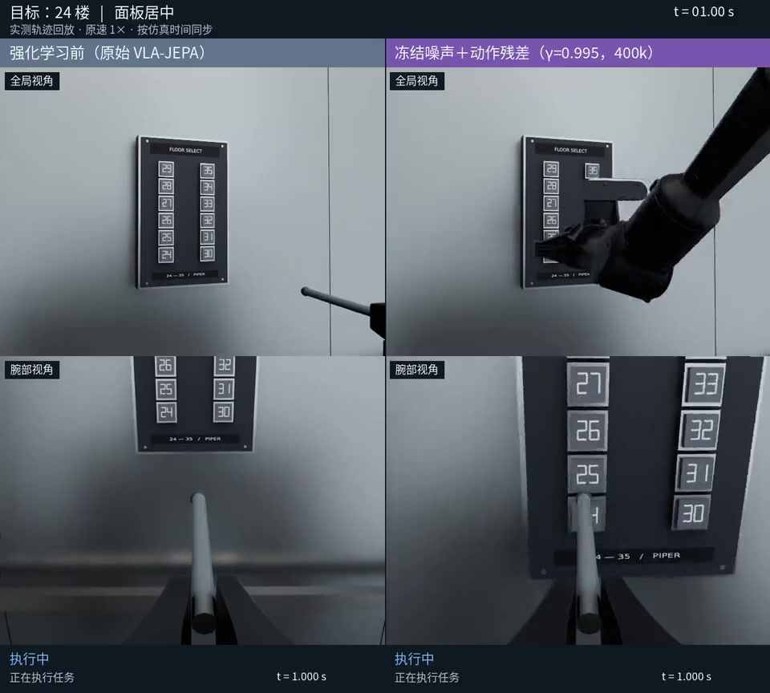

# PressB

[English](README.md) | **简体中文**

面向仿真和真实机器人环境的模块化框架，用于策略评估、数据采集与在线强化学习。

[项目文档](docs/project_framework.md) · [演示视频](docs/media/README.md) · [反馈问题](https://github.com/pgq18/PressB/issues)

## 项目简介

PressB 将机器人环境与视觉语言动作模型（VLA）连接起来，研究如何通过环境交互改善预训练策略。框架采用 **通用运行核心＋任务插件＋模型适配器＋实验配置**，基于 Python、PyTorch 和 NVIDIA Isaac Sim 构建。

- **独立节点：** 推理端、训练端以及仿真或真机交互端，可在单机或多机上部署。
- **模型支持：** Wall-OSS、VLA-JEPA、Diffusion Policy 和 LeRobot π₀.₅，支持 LeRobot 数据集监督训练。
- **在线学习：** 支持冻结模型的 DSRL、动作残差，以及直接更新动作专家并同步权重版本的 [DPPO](docs/dppo.md)。
- **机器人工作流：** 支持并行仿真、轨迹采集与回放、可选动作平滑，以及搭配双 RealSense 相机的 PiPER 真机后端。

### 任务环境

| 环境 | 任务 |
|---|---|
| [电梯按键](docs/scene_details.md) | 按指令按下指定楼层按键 |
| [抓取放置（PAP）](docs/piper_pick_place.md) | 将桌面物体夹入纸盒 |
| [桌面按键](docs/table_buttons.md) | 在随机布局下按红、黄、蓝指定颜色按键 |
| [Playground](docs/playground.md) | 经过标定的空桌 PiPER 工作台，作为新任务的基础模板 |
| [方块堆叠](docs/cube_stack.md) | 在 Playground 工作台上将红色方块叠到蓝色方块上 |
| [桌面收纳](docs/tabletop_cleanup.md) | 在 Playground 工作台上将两个不同物品放入固定收纳盒 |

## 演示

原始 VLA-JEPA 与冻结噪声策略叠加动作残差 RL 的执行对比，按原始仿真速度播放。点击图片观看视频。

[](docs/media/before-vs-residual.mp4)

[更多演示与实验说明 →](docs/media/README.md)

## 快速开始

激活独立的 Python **3.10 或 3.11** 环境，安装核心包并查看可用的任务与模型插件：

```bash
git clone https://github.com/pgq18/PressB.git
cd PressB
python -m pip install -e .
python scripts/run_experiment.py list
```

仿真需要 NVIDIA GPU 和 Isaac Sim 环境，见 [RTX 5090 部署指南](docs/rtx5090_setup.md)。模型与训练依赖按[模型配置指南](docs/bundled_models.md)单独安装。模型权重、数据集和下载的场景资产需另行准备。

## 使用方法

以[评估配置](configs/experiments/pap_walloss_eval.json)为起点，保留其 `extends` 引用的相对路径关系。设置本地资产与权重路径、设备和服务地址后，在独立终端中使用各节点对应的环境启动：

```bash
python scripts/run_experiment.py inference --config /path/to/experiment.json
python scripts/run_experiment.py simulation --config /path/to/experiment.json
python scripts/run_experiment.py eval --config /path/to/experiment.json
```

使用 `train` 进行在线强化学习，使用 `collect` 记录轨迹。选择真机配置时，以 `real_robot` 替代 `simulation`。完整示例见下方文档。

## 文档

| 指南 | 内容 |
|---|---|
| [框架说明](docs/project_framework.md) | 架构、配置方式与任务／模型扩展 |
| [模型接入](docs/bundled_models.md) | 模型适配器与监督训练 |
| [Ascend π₀.₅ 训练](docs/ascend_pi05.md) | 独立 Conda 环境与多 NPU 监督训练 |
| [示范数据集](docs/manipulation_collection.md) | Stack／Cleanup 并行采集与 LeRobot 导出 |
| [评估性能](docs/evaluation_performance.md) | 共享推理、多仿真进程与实测吞吐 |
| [在线强化学习](docs/configurable_rl_nodes.md) | 节点接口、DSRL、动作残差与检查点 |
| [DPPO](docs/dppo.md) | Diffusion Policy 与随机 flow 动作专家优化 |
| [真机交互](docs/real_robot.md) | PiPER、相机配置及可选的人类成功／失败标注 |
| [实验结果](docs/results/) | 评估结果与验证记录 |

## 后续方向

- **Real2sim2real：** 利用 AI agent 复刻真实工作空间，在仿真中强化策略鲁棒性，再迁移到真机进行适配。
- **真机在线强化学习：** 直接通过真实环境交互验证学习算法。

上述研究方向尚未完成端到端实验验证。

## 参与贡献

欢迎提交 Issue 或 Pull Request。组件边界与扩展约定见[框架说明](docs/project_framework.md)。

第三方代码、资产来源与许可说明见 [THIRD_PARTY.md](THIRD_PARTY.md)。
