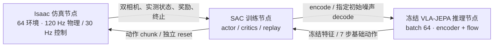

# PressB — PiPER 仿真、VLA 评估与在线残差强化学习

[English](README.md) | **简体中文**

PressB 利用 Isaac 仿真评估机器人策略，并通过在线残差强化学习改善冻结的视觉语言动作模型。项目连接物理仿真、模型推理与策略训练，记录相机观测，并依据真实接触和物体运动判定任务结果。

**更新于 2026-11-07：** 现有三个 PiPER 任务。电梯残差 RL 在固定条件评估中达到 **119/120（99.17%）**；PAP 的 Wall-X 随机评估分别为红色方块 **65/100**、五色方块 **54/100**。桌面按键已支持单／多任务 VLA-JEPA 评估，并完成一轮[三色不同路径的 9,000 条全新示范采集](docs/results/table_buttons_target_relative_20261030/README.md)，与旧的共享路径数据集分开保存。

[任务](#任务概览) · [结果](#当前结果) · [视频](#演示视频) · [运行](#运行三个任务) · [三节点 RL](#在线强化学习独立三节点) · [工作交接](docs/HANDOVER.md)

## 通用运行核心与插件

**2026-11-07 代码归属整理：** 新实验采用 **通用运行核心＋任务插件＋模型适配器＋实验配置**。DSRL、动作残差、固定 DSRL 后训练残差、评估和 chunk 轨迹记录共用执行流程；机械臂／相机装配和 PhysX 控制复用，场景、随机化、奖励和成功条件由任务插件定义。任务专用实现归入 `tasks/{elevator,pap,table_buttons}`，共享能力归入 `runtime`、`control`、`sensors` 和 `robots/piper`。历史命令保留，已删除的 Python 路径不再设置别名占位。

包根目录的 Python 文件只有 `__init__.py` 和 `registry.py`。任务与模型适配器使用共享契约，共享层不反向导入具体任务、模型实现、上游模型源码或历史流程；`models` 负责接入保留上游结构与来源的 `model_sources`，`compat` 负责历史客户端及电梯 RL 编排。扩展框架或更新外部脚本时，参见[代码归属与路径迁移表](docs/project_framework.md#code-ownership)。`configs/rl_nodes/` 仍保存配置模板，但 `pressb.rl_nodes`、`pressb.online_rl` 两个 Python 包已经移除。

**本轮归属整理已验收：** 2,210 项独立测试全部通过且无未解决跳过，安装包的 68 项规范导入、50 项 CLI／配置检查、三个任务的物理重放、真实 Wall 两环境完整流程和原生 batch64 联调均通过；169 个内置模型／训练文件保持不变。[验收摘要](docs/results/component_ownership_20261107.json)记录功能范围与源码身份，不将短测作为新的策略成功率或吞吐结论。检查点迁移及严格恢复通过，当前恢复配置（本地产物 `outputs/component_ownership_20261107/checkpoint_migration/resume_experiment.json`）已验证但未启动，正式 PAP 残差仍暂停在 16,704 transitions。

入口为 `python scripts/run_experiment.py`，提供 `list / validate / inference / simulation / train / eval / collect`。参见[框架说明](docs/project_framework.md)和[实验配置](configs/experiments)。PAP 保留 64 环境配置；桌面按键新插件目前每个节点运行 1 个环境。原逐帧对齐的示范采集和 LeRobot 导出流程仍保留。

[此前框架重构验收](docs/results/framework_refactor_20261106.json)：2,049 项回归测试通过，并完成真实 Isaac 回放、三端训练／恢复／评估／记录验证，包括 PAP64 与 Wall-OSS 原生 batch64。这些是功能验证，不是新的策略成功率评估。

**模型代码已内置：** Wall-OSS 和 VLA-JEPA 的推理、数据读取与监督训练已纳入 PressB；统一训练入口和来源说明见[模型指南](docs/bundled_models.md)。[内化验收](docs/results/model_internalization_20261106.json)覆盖主项目在所需环境中的 2,106 项测试，以及真实权重对照：Wall-OSS batch 2／8、VLA-JEPA pose9／joint6／joint7 在所测输入下与原实现输出一致。

## 任务概览

| 任务 | 场景与观测 | 已有能力 |
|---|---|---|
| [电梯按键](docs/scene_details.md) | 12 个接触驱动按钮、按压杆、腕部与桌面 RGB 相机 | 1,200 条专家轨迹、LeRobot 导出、VLA-JEPA 评估、三节点 SAC 残差／噪声训练 |
| [桌面抓取入盒（PAP）](docs/piper_pick_place.md) | 对齐数据集的绿色工作台、纸盒、自由方块及双相机 | 真机轨迹回放、原生 Wall-X 闭环推理、可选关节平滑、配对的位置／颜色随机评估 |
| [桌面彩色按键](docs/table_buttons.md) | PAP 工作台上的红／黄／蓝弹簧按键 | 近／中／远随机布局、三色不同路径的 IK 示范、LeRobot 采集／合并、VLA-JEPA 训练与闭环评估 |

三个任务使用独立配置。PAP 依据 `piper_pap_20260606_offset` 中的关节、相机图像及实拍照片复刻，包含光滑方块、较粗糙纸盒／桌面和柔和光照，已有红、蓝正方体回放配置；数据集内其他物体还需各自的几何模型。PAP 保留对齐数据集的相机；桌面按键的腕部相机**内参和光心位姿**与电梯任务一致，固定相机沿用 PAP。桌面按键已接入学习策略推理与带物理审核的闭环评估。电梯和 PAP／Wall-OSS 均已完成在线 RL 训练，PAP 训练日志与评估证据见交接文档；训练 recent SR 与独立评估分开统计。桌面按键已接入通用任务／模型接口并完成功能验证，尚未开展长程在线 RL 训练。桌面按键监督训练与模型推理已内置于 PressB；[历史 HTTP 评估说明](docs/table_buttons_policy_eval.md)保留原实验命令。

后续可用于 **real2sim2real**：利用 AI agent 复刻真机场景，在仿真中增强策略鲁棒性，再迁移到真机做适配和验证。目前实验验证的是仿真中的算法可行性；real2sim2real 迁移，以及直接在真机上验证 RL 策略，均尚未开展。

当前 RTX 5090 环境使用 **Isaac Sim 5.0 / Isaac Lab 2.2 / Python 3.11**，保留原 Isaac Sim 4.5 / Isaac Lab 2.0.2 历史脚本。源码、配置、[结果摘要](docs/results/)和[精选演示](docs/media/README.md)随 Git 发布；完整数据集、权重、下载素材、Conda 环境和原始录像作为本地依赖保留。

## 当前结果

### 电梯：冻结 VLA-JEPA 的残差强化学习

原始 VLA-JEPA 以 1,200 条带面板位置变化的专家 episode 微调，使用固定的 **step 10600** checkpoint。在线阶段始终冻结 VLA；先分别学习动作输出残差和 flow 初始噪声，再固定已训练的噪声策略，从随机初始化重新训练动作残差。噪声方法直接选择 flow 的初始噪声，不反向更新 VLA。

下表为同一 fast 仿真约定下的 **12 按键 × 5 个面板位置（中心、四角）× 2 次，共 120 次**固定条件评估，seed=20260930。记录的是真实按钮接触任务成功率，评估不更新参数。表中的 400k 是新增动作残差的训练预算，之前的 1M 噪声训练另计；多次运行不保证逐位相同，也不能把单次结果解释为多种子泛化保证。

| 方法 | 在线训练 | 成功次数 | 成功率 |
|---|---|---:|---:|
| 原始 VLA-JEPA | 无 RL | 25/120 | 20.83% |
| 独立动作残差 | 1M | 81/120 | 67.50% |
| 独立初始噪声策略 | 1M | 81/120 | 67.50% |
| 叠加两份独立训练的策略 | 两份 1M 权重，无联合重训 | 96/120 | 80.00% |
| 固定噪声，重训 9D 残差，γ=0.99 | 400k | 114/120 | 95.00% |
| 固定噪声，重训 9D 残差，γ=0.995 | 400k | 118/120 | 98.33% |
| 上一设置的残差 scale 减半 | 400k | 87/120 | 72.50% |
| **固定噪声，重训 XYZ 残差，γ=0.995** | **400k** | **119/120** | **99.17%** |

最新 XYZ actor 只输出 **7×3=21 维**残差，位置 scale 为 **[0.02, 0.02, 0.02] m**，旋转和夹爪沿用冻结模型输出。400k 训练约 **7 小时 25 分钟**，完成 398k 次 SAC 更新；24 键为 9/10，25–35 键均为 10/10。对照的完整 9D scale 是 XYZ 各 0.03 m、rotation6D 各 0.1；半 scale 为 XYZ 各 0.015 m、rotation6D 各 0.05。折扣 γ 以每个 30 Hz 控制步计算，7 步 chunk 为 `γ**7`。

**平滑实验（已完成 1,320 次评估）：** XYZ 指数平滑 α=0.8 可使共同成功任务中的实际关节 jerk 中位数下降约 14%、末端位置 jerk 下降约 30%，任务时长增加约 0.7%–2.7%。筛选为 119/120（同期基线 117），独立种子复核为 117/120（基线 116）。位置＋姿态平滑和更轻的 α=0.9 也未通过全部预设成功率门槛，因此默认保持 **无新增后处理**，不将平滑候选的最佳筛选成绩当作稳定结论。

可下载的 [结果与逐按键统计](docs/results/online_rl_20261009.json)、[结果表 CSV](docs/results/online_rl_20261009.csv) 保留原日志来源与 SHA-256；[平滑汇总](docs/results/smoothing_20261009.csv) 包含所有候选。复现、冻结检查和各实验配置见 [固定噪声后的残差训练](docs/residual_on_frozen_noise.md)。

### PAP：Wall-X 随机评估

用户提供的 `piper_pap_20260606` 权重在独立 Conda 环境运行，通过原生 Wall-X WebSocket 预测 32 步动作 chunk，每步为**六个绝对关节角度＋夹爪开度**，通信单位分别为度和厘米。仿真以 30 Hz 执行动作、120 Hz 运行物理。可选 `joint_ema` 平滑只过滤六个机械臂关节，保留夹爪命令；**默认关闭**，下面的评估显式使用 **α=0.8**。

四条绿色标签分别表示矩形的**四条边**，围成 **27.02 × 22.31 cm** 的区域。保证整个 3 cm 方块位于区域内后，中心采样范围为 **24.02 × 19.31 cm**。两组共用 100 个按面积均匀采样的位置，第二组五色各 20 次并打乱顺序。每次最多 20 秒仿真时间；成功需实际夹起、在盒内释放并稳定落下，同时有双指接触记录。

| 评估，2026-10-23 | 成功次数 | 成功率 | Wilson 95% 区间 |
|---|---:|---:|---:|
| 位置随机，固定红色 | 65/100 | **65%** | 55.3–73.6% |
| 位置随机，五色随机 | 54/100 | **54%** | 44.3–63.4% |

第二组逐颜色成功次数：**红 13/20、绿 9/20、蓝 12/20、白 8/20、黄 12/20**。全部 200 次物理及接触记录已复核，结果与报告一致。两组未配对模型扩散随机噪声，11 个百分点的差异不能全部归因于颜色。此前的 **88%／85%** 使用了错误且较小的标签中心凸包，不能代表上述矩形范围。

已发布[评估报告](docs/results/pap_rectangle_20261023/README.md)、[逐次 CSV](docs/results/pap_rectangle_20261023/episodes.csv)、[成功率图](docs/results/pap_rectangle_20261023/success_rates.png)和[失败位置图](docs/results/pap_rectangle_20261023/failure_locations.png)。采样、运行和物理成功条件见 [PAP 说明](docs/piper_pick_place.md#randomized-policy-evaluation)。

### 桌面按键：数据集与模型实验

原共享路径采集包括九份各 100 条的数据集，以及扩充后的九份各 1,000 条数据集。按间距合并三种颜色后，分别得到三份各 300 条或 3,000 条的多任务数据集。VLA-JEPA 实验覆盖单／多任务模型，以及只预测六个手臂关节、固定夹爪的设置。[策略评估说明](docs/table_buttons_policy_eval.md)记录了最初的 1,800 次闭环评估，并区分物理任务成功与更严格的采集器指标；训练设置见[红色任务 joint6 说明](docs/table_buttons_joint6_1000_training.md)和[多任务 joint6 说明](docs/table_buttons_multitask_joint6_3000_training.md)。

独立的 **`target_relative_v2` 采集于 2026-11-01 完成**：近／中／远 × 红／黄／蓝，**每组 1,000 条全新 episode，共 9,000 条**，包含 **1,286,591 行观测／动作**。红色直线接近，黄色向目标移动时抬升再直线接近，蓝色先到目标上方再下压。九份数据均通过导出和物理／视频审核，3,000 个场景／布局索引的三色布局全部匹配。这些是脚本生成器的成功示范，不代表学习模型的成功率；尚未使用这批新数据训练模型。详见[随仓库保存的结果报告](docs/results/table_buttons_target_relative_20261030/README.md)及[运动模板与采集说明](docs/table_buttons_color_templates.md)。

## 演示视频

点击预览图播放或下载 MP4。三段电梯视频覆盖全部 12 个按键的中心布局，保持 **1× 仿真时间**，上下分别为全局与腕部视角；任务结束后显示标记的终止停帧。演示样本与上表包含面板偏移的 120 次评估不同。

| 原始 VLA → 固定噪声＋9D 残差 | 9D 残差 → XYZ-only 残差 | XYZ 平滑实验（未采用） |
|---|---|---|
| [](https://github.com/pgq18/PressB/raw/refs/heads/main/docs/media/before-vs-residual.mp4) | [](https://github.com/pgq18/PressB/raw/refs/heads/main/docs/media/pose9-vs-xyz.mp4) | [](https://github.com/pgq18/PressB/raw/refs/heads/main/docs/media/xyz-smoothing-experimental.mp4) |
| 左 4/12，右 12/12；右侧 γ=0.995、400k | 左 12/12，右 11/12；XYZ 演示有一次 24→25 | 左、右均 12/12；完整同期评估为 116/120 与 117/120 |

**PAP — Wall-X＋关节 EMA（α=0.8）：** 上方红色方块、下方蓝色方块，左侧固定相机、右侧腕部相机，保持 **1× 仿真时间**。这两次成功演示独立于随机评估。

[](https://github.com/pgq18/PressB/raw/refs/heads/main/docs/media/pap-wallx-smoothed.mp4)

原视频来源、压缩参数、实际帧数和审核记录见[媒体说明](docs/media/README.md)。视频保持录制时的仿真时间，未通过播放加速或插帧制造差异。

## 仓库分工与复现范围

| 组件 | 职责 | 位置 |
|---|---|---|
| PressB 运行核心 | Isaac 服务、在线 RL、实验、评估和记录 | `src/pressb/runtime`、`tasks`、`models`、`experiments` |
| VLA-JEPA | 模型、pose9／joint6／joint7 推理、单任务／多任务监督训练 | 已内置于 `src/pressb/model_sources/vlajepa` |
| Wall-OSS | 模型、原生 batch、噪声／缓存接口、监督训练、数据读取和 CUDA 核心 | 已内置于 `src/pressb/model_sources/walloss` |
| [ZPRL-PressB](https://github.com/pgq18/ZPRL-PressB) | 残差 SAC／初始噪声方法参考 | 可选 `src/ZPRL`；PressB 使用自己的适配实现 |

**所需模型代码已纳入 PressB。** 新实验无需额外 clone Wall-X 或 VLA-JEPA。
环境、CUDA 构建及 `scripts/train_model.py` 用法见[内置模型与监督训练](docs/bundled_models.md)。
来源版本与逐文件摘要保存在内置源码清单和[仓库版本记录](repos.lock.json)；权重、数据集和第三方软件依赖仍单独配置。

历史 `src/VLA-JEPA`、`ref/wall-x` 克隆保留为显式源码覆盖选项，被 Git 忽略且不是子模块。
未迁移的电梯 RL 权重仍绑定原 VLA-JEPA 运行版本 `9c9dc71c8e199c7428b25d103ab666395832c001`；
切换实现需经过验证的检查点迁移，不能绕过身份校验。

干净克隆包含源码、精选媒体和统计摘要，**不包含** VLA／RL 权重、场景快照、采集元数据和模型缓存。通用三个节点可显式配置路径；`run_residual_on_noise_experiment.py`、平滑和视频实验 supervisor 则是本工作区的复现入口，依赖文档记录的既有 `outputs/` 资产及身份清单，不能在空目录直接启动。部署方式见 [高吞吐运行说明](docs/online_rl_fast.md) 和 [5090 环境](docs/rtx5090_setup.md)。

## 安装

**RTX 5090 工作站**：使用已验收的 Python 3.11 / Isaac Sim 5.0 / Isaac Lab 2.2 配置，安装入口为 scripts/setup_env_5090.sh；步骤和实测结果见 [RTX 5090 运行说明](docs/rtx5090_setup.md)。下面的 setup_env.sh 属于原 Python 3.10 配置。

需要 Linux x86_64、Conda、支持 Isaac Sim 的 NVIDIA RTX GPU/驱动与 Vulkan，以及系统 `git`、`ffmpeg`、`ffprobe`（FFmpeg 需包含 `libx264`）和 DejaVu／Noto Sans CJK 字体。无窗口运行仍需要 GPU 渲染。显存需求随并行环境数增加；先从一张卡、一个环境验证。

```bash
git clone https://github.com/pgq18/PressB.git
cd PressB

# Ubuntu / Debian 系统依赖，按机器已有安装情况执行
sudo apt-get install ffmpeg fonts-dejavu-core fonts-noto-cjk

# 当前 5090 Isaac 环境：Python 3.11，默认 .conda/envs/pressb
# 可用 CONDA_BIN=/path/to/conda 显式指定 Conda
bash scripts/setup_env_5090.sh

# 下载固定版本资产并核对 SHA-256；已有冲突文件不会被覆盖
.conda/envs/pressb/bin/python scripts/fetch_assets.py

# 使用隔离的 OpenUSD 24.11 原样提取官方支架与 D435 网格
PYTHONPATH=.cache/usd-inspect .conda/envs/pressb/bin/python scripts/prepare_wrist_asset.py

# LeRobot 转换环境：独立 Python 3.12 / CPU PyTorch
bash scripts/setup_dataset_env.sh
```

环境独立使用：仿真为 `.conda/envs/pressb`，LeRobot 导出为 `.conda/envs/lerobot`，原生 Wall-X 推理为 `.conda/envs/wallx-inference`。不要将完整数据集／训练依赖装入 Isaac；PAP 所需的少量数据及客户端依赖按下面命令安装。安装脚本设置 `OMNI_KIT_ACCEPT_EULA=YES`；NVIDIA 软件和素材仍受各自许可约束，来源见 [THIRD_PARTY.md](THIRD_PARTY.md)。

## 运行三个任务

### 电梯：生成场景并验证

```bash
# 12 个按钮依次按压；每次按完回到折叠初始位姿
bash scripts/run.sh --headless --gpu 0 --video --output outputs/edge_feedback

.conda/envs/pressb/bin/python scripts/audit_episode.py outputs/edge_feedback
.conda/envs/pressb/bin/python scripts/check_results.py outputs/edge_feedback
.conda/envs/pressb/bin/python scripts/audit_global_camera.py outputs/edge_feedback

# 需要显示器 / 远程桌面时
# bash scripts/run.sh --gpu 0 --hold --output outputs/gui
```

生成的 `outputs/edge_feedback/scene.usda` 和同目录 `wrist_camera/intrinsics.json`、`global_camera/intrinsics.json` 是后续采集的输入，干净克隆中尚不存在。`--gpu` 是 Isaac/Vulkan 设备编号，请选择有可用显存的设备。演示默认 10 Hz 图像、120 Hz 物理；批量采集通过 `--fps` 独立指定采样频率。

### PAP：历史 Wall-X 服务与闭环推理

新部署请使用[内置模型说明](docs/bundled_models.md)和统一实验入口。下面保留独立克隆部署的原命令，用于复现历史结果。

先在本地准备真机数据集和已训练权重，并从数据集提取初始关节状态。policy 模式的后续动作来自模型；`--mode replay` 则重放录制轨迹。CUDA 12.8 要求、模型／配置路径覆盖及与 checkpoint 一致的归一化文件说明见 [Wall-X 部署文档](https://github.com/pgq18/wall-x/blob/base/inference/README_rtx5090.md)。

```bash
.conda/envs/pressb/bin/python -m pip install -e '.[pap]'
.conda/envs/pressb/bin/python scripts/analyze_pap_dataset.py \
  --dataset /path/to/piper_pap_20260606_offset --episodes 0 461 \
  --output outputs/pap_dataset_audit

# 安装一次，在独立终端用 GPU 0 保持推理服务运行。
bash ref/wall-x/inference/install_rtx5090.sh
WALLX_MODEL=/path/to/piper_pap_20260606 \
  WALLX_CONFIG=/path/to/config_qact.yml \
  CUDA_VISIBLE_DEVICES=0 bash ref/wall-x/inference/launch_server_piper_local.sh

# Isaac 使用 GPU 1；省略 --policy-smoothing 即采用默认的未平滑目标。
OMP_NUM_THREADS=1 OPENBLAS_NUM_THREADS=1 MKL_NUM_THREADS=1 env -u PYTHONPATH \
  .conda/envs/pressb/bin/python scripts/run_pap_scene.py \
  --mode policy --config configs/piper_pick_place.json \
  --trajectory outputs/pap_dataset_audit/episode_000000.npz \
  --policy-endpoint ws://127.0.0.1:8094 --policy-execute-steps 32 \
  --policy-smoothing joint_ema --policy-smoothing-alpha 0.8 \
  --headless --gpu 1 --duration 12 --output outputs/pap_wallx_demo
```

两组各 100 次的计划生成、执行和汇总见[随机评估命令](docs/piper_pick_place.md#randomized-policy-evaluation)。仿真器保存进度、逐次报告、实测轨迹及原始推理响应；中断后可按同一计划继续。

### 桌面按键：随机布局与脚本按压

```bash
.conda/envs/pressb/bin/python -m pip install -e '.[table-buttons]'
env -u PYTHONPATH .conda/envs/pressb/bin/python scripts/run_table_buttons.py \
  --headless --gpu 1 --mode demo --target all --seed 73 \
  --output outputs/table_buttons_demo
```

单色任务可将 `--target all` 换成 `--instruction '按下蓝色按键'`；交互查看可用 `--mode snapshot --hold`。可执行区域采样与接触成功条件见[任务说明](docs/table_buttons.md)。此入口使用脚本 IK 和指令解析器，不调用 VLA。

随机布局可使用 `--seed 73 --spacing near`，也可将档位换成 `medium` 或 `far`，分别约束任意两个按键的中心距离为 6–10、10–18、18–30 cm。`--spacing` 需与 `--seed` 一起使用；不选档位时保留原有最小间距采样方式。各档范围可在 `configs/piper_table_buttons.json` 中调整。

[数据采集说明](docs/table_buttons.md#collect-separate-lerobot-datasets)提供三档间距 × 三种目标颜色共九份独立 LeRobot v3 数据集的采集入口。仅接收经过物理接触验证的成功示范，保存两路 640×480、30 Hz RGB，以及与 PAP 兼容的 7D 关节／夹爪状态与动作；同一颜色在三档间距下使用完全相同的语言指令。

2026-10-23 已完成 **900 条成功示范，九组各 100 条**，均已导出并审核，保存于 `/home/pengguanqi/Datasets/piper_table_buttons_20261023`。数量、数据语义及验证记录见[采集结果](docs/table_buttons.md#completed-collection--2026-10-23)。

共享路径扩充版**九组各 1,000 条，共 9,000 条**已通过全量核查。[红色按键 joint6 训练](docs/table_buttons_joint6_1000_training.md)及[每组 3,000 条的多任务训练](docs/table_buttons_multitask_joint6_3000_training.md)均已在 H200 完成。这些模型只预测六个手臂关节，执行时固定夹爪，并仅保留最佳／最终权重。早期每组 300 条的多任务合并数据也继续保留；合并不修改原单任务数据集。

最新的**三色不同路径独立采集**使用[颜色模板配置和采集 supervisor](docs/table_buttons_color_templates.md#collect)。九份数据保存在 `/home/pengguanqi/Datasets/piper_table_buttons_target_relative_1000_20261030`，[精简结果摘要](docs/results/table_buttons_target_relative_20261030/README.md)随 Git 发布。这批全新数据不覆盖已有模型使用的共享路径数据。

## 电梯数据采集与导出

电梯数据集包含 **12 层 × 100 条 episode**，面板偏移按 10×10 分层覆盖，左右 ±25 mm、前后 ±10 mm。导出保留折叠初始位姿到首次成功亮灯的前缀。双路 RGB 为 640×480，状态与动作按 30 Hz 同步；详见[采集记录](docs/dataset_panel_stratified.md)和[首次亮灯导出语义](docs/dataset_press_only.md)。

<details>
<summary>采集、LeRobot v3 导出及验证命令</summary>

```bash
# --gpus 0 表示一张卡；也可指定 0,1 等多个设备
.conda/envs/pressb/bin/python scripts/collect_parallel.py \
  --config configs/dataset_panel_stratified_1200.json \
  --snapshot outputs/edge_feedback/scene.usda \
  --output datasets/piper_elevator_raw_panel_stratified_30hz \
  --gpus 0 --num-envs 3 --fps 30 \
  --episodes-per-task 100 --seed 20260930

.conda/envs/pressb/bin/python scripts/audit_raw_dataset.py \
  datasets/piper_elevator_raw_panel_stratified_30hz --episodes-per-task 100

.conda/envs/pressb/bin/python scripts/audit_panel_coverage.py \
  datasets/piper_elevator_raw_panel_stratified_30hz \
  --report outputs/panel_stratified_1200/coverage.json
```

每层的 10×10 网格要求 `--episodes-per-task 100`，且采集 seed 必须与配置里的 `grid_seed` 一致。少量预检可用 `collect_dataset.sh --max-episodes 2`，仍保留这些配置参数并使用独立输出目录。每次换位后检查全局相机的完整面板投影、全部按钮可达性，以及实际按压、碰撞和归位记录。并行场景只保留一个有效 Dome 环境光。

采样频率须整除 120 Hz 物理频率，例如 10、20、30、60 Hz；更改频率须使用独立数据目录。下面的首次亮灯导出示例针对 30 Hz 数据。采集元信息与代码指纹阻止混用不同来源，不能通过改写元数据绕过续采检查。

### 导出首次亮灯前缀为 LeRobot v3

```bash
PYTHONPATH=src .conda/envs/pressb/bin/python -m pressb.press_prefix \
  --raw datasets/piper_elevator_raw_panel_stratified_30hz \
  --output outputs/panel_stratified_1200/cut_plan.json \
  --episodes-per-floor 100

.conda/envs/lerobot/bin/python scripts/export_press_dataset.py \
  --raw datasets/piper_elevator_raw_panel_stratified_30hz \
  --cut-plan outputs/panel_stratified_1200/cut_plan.json \
  --output datasets/piper_elevator_lerobot_panel_stratified_press_30hz \
  --parts datasets/piper_elevator_parts_panel_stratified_press_30hz \
  --episodes-per-task 100 --part-size 25 --workers 4

.conda/envs/lerobot/bin/python scripts/confirm_press_dataset_reader.py \
  datasets/piper_elevator_lerobot_panel_stratified_press_30hz \
  --expected-episodes 1200 \
  --report outputs/panel_stratified_1200/readback.json
```

导出器对分片与最终数据执行数值、视频解码和首次亮灯终点检查；官方读取检查是额外验证。输出路径已存在时，遵循脚本的恢复/一致性检查或换用新目录，不要覆盖已验证的批次。

</details>

数据约定：

| 字段 | 含义 |
|---|---|
| task | `Press 24 floor.` … `Press 35 floor.` |
| state | 实际夹爪 TCP 位姿与实测夹爪开度 |
| action | 下一采样时刻的绝对 TCP 目标位姿与固定夹爪开度 |
| pose | `[x, y, z, qw, qx, qy, qz, gripper_width]`，基座 `base_link` 坐标系，米 |
| cameras | `observation.images.global`、`observation.images.wrist`，同步 RGB |
| metadata | 面板 XY 偏移、随机 seed、来源与采集指纹 |

夹爪 TCP 位于 `link6` 局部 Z=0.1358 m；按压杆尖端为 Z=0.24 m，两者不是同一个点。VLA-JEPA 训练适配将旋转转换为旋转矩阵前两行展开的 6D，XYZ 保持原值，固定夹爪开度不参与学习。训练及推理服务代码位于 [pgq18/VLA-JEPA](https://github.com/pgq18/VLA-JEPA/tree/base)。

## 电梯回放与策略评估

- [录制动作回放](docs/replay.md)：从 LeRobot action 经 IK 执行并检查实际接触。
- [策略闭环评估](docs/policy_eval.md)：输入当前双相机、实测 TCP 与任务文本，执行模型返回的绝对目标。
- [动作平滑](docs/policy_smoothing.md)：120 Hz 关节插值之后默认使用 3 点因果均值滤波。

评估须显式指定与训练集一致的配置、场景快照、checkpoint step 和 SHA-256。`--panel-layouts center_corners` 覆盖训练配置的中心与四个边界角点。成功依据真实按钮行程、接触力和无误按/异常碰撞，不以接近按钮或 IK 成功代替；远端推理期间仿真暂停，因此本测试不衡量真实时间部署延迟。

旧采集机、旧控制器上的 step 10600 固定 60 条评估曾为 **5/60 成功、27 次误按、28 次超时**。这是旧环境诊断，不能与当前 fast 仿真的 25/120 基线混用；当前 RL 结果见本文开头。完整原始录像和报告保留在本地 `outputs/`，精选演示另见上方媒体。

## 在线强化学习：独立三节点

**检查点保存策略（2026-11-05）：** 后续 RL 默认每 **100,000 transitions 保存一次，并保留全部编号权重**。通用训练端使用 `checkpoint.interval=100000`、`checkpoint.keep=null`，正常结束时也保存最终状态。旧 fast runner 保留100k阶段权重及单独滚动覆盖的`last.pt`。详见[检查点与日志配置](docs/configurable_rl_nodes.md)。

**可配置接口（2026-11-04）：** 新增[三端说明](docs/configurable_rl_nodes.md)与 [JSON 配置示例](configs/rl_nodes/)，将模型能力、任务执行和训练逻辑分开。现已加入 Wall-OSS 外部初始噪声／编码缓存接口、PAP 多进程并行 `reset/step`，以及根据维度协商的 DSRL／动作残差 SAC、异步更新、经验回放、检查点保留、可选平滑与动作裁剪。启动时检查状态／动作单位、相机和独立噪声维度。CPU 端口、进程及学习测试通过；完整 Wall-OSS 权重与两个真实 Isaac 环境的 GPU 联调也已通过，两种 RL 方法各完成 24 条 transition 和 22 次 SAC 更新。这些短测尚不能说明 PAP RL 成功率。下方历史电梯实验入口保留。

PAP 新增[共享 World 仿真后端](docs/pap_parallel_capacity.md)：单张 RTX 5090 已通过 **64 环境、128 路原生 640×480 相机**容量测试，64 个环境也全部完成了已录制抓取入盒轨迹的物理重放。[Wall-OSS 现已在 H200 上实现真正的 batch-64 推理](docs/walloss_batch_inference.md)：实测 **16.11 条观测动作 chunk/秒**，为逐条推理的 **6.35 倍**，PyTorch 分配显存峰值 **11.64 GiB**；跨机器 WebSocket 编码、解码和一次性推理检查也已通过。BF16 输出随 batch 大小存在差异，文档列出了实测动作误差和较慢的 FP32 选项。最初的 [400k预算 PAP DSRL 训练](outputs/pap_dsrl_h200_bf16_64env_400k_20261104/README.md) 已按用户要求停止于3,520条transition、1,532次更新，完整检查点与W&B历史保留。随后[优化后的 PAP 流程](docs/pap_dsrl_pipeline_optimization.md) 已完成10,048条transition验证，保留原生640×480相机、10步flow与UTD1。warmup后实测吞吐 **1.44→12.55 transition/s（8.71倍）**；400k／1M预计 **8.85／22.14小时**，不是长程训练完成时间。尚未达到15条/s的性能目标。这是正式训练前的验证；后续已完成的本机训练见下方。强化学习效果仍需独立评估。

[在线 RL 运行说明](docs/online_rl.md)为电梯任务提供仿真、冻结 VLA-JEPA 推理和 SAC 训练三个节点，可部署在三台机器。[高吞吐版本](docs/online_rl_fast.md)增加独立 episode 重置、批量推理、采样与梯度更新重叠；支持本机 GPU 1 共置仿真与推理、GPU 0 训练，也保留 H200 推理的跨节点配置。

**本机推理对照（2026-11-05）：** Wall-OSS 已部署到 RTX 5090，两种 GPU 分配各完成 10,048 条 transition。推理与 SAC 共用 GPU1 实测 **12.91 条/s**；仿真与推理共用 GPU0、SAC 独占 GPU1 实测 **13.34 条/s**，比优化后的 H200 推理方案快 **6.33%**。400k／1M 外推约 **8.33／20.82 小时**，仍未达到 15 条/s。两轮检查点与回放核验通过；相关服务现已在11月6日重构验收后全部停止。两端 BF16 输出存在差异，任务成功率需另行评估。详见[本机部署与耗时报告](docs/pap_dsrl_local_inference.md)。

**训练状态（2026-11-06）：** 本机 PAP DSRL 和后续固定 DSRL 的动作残差均已完成 **400,000 transitions**。从头重训的100k预算 DSRL 用 **2小时05分**完成 **100,022 transitions**（最后完整并行批次多22条）。随后200k预算的残差训练按要求停在 **16,704 transitions**，完整检查点和冻结源均保留。本轮归属调整已生成通过严格恢复的派生检查点；当前恢复配置（本地产物 `outputs/component_ownership_20261107/checkpoint_migration/resume_experiment.json`）已验证但未启动，仍为 64 环境／batch64／总预算 200,000（剩余 183,296），没有恢复正式训练。详见[交接文档](docs/HANDOVER.md)与[迁移验收](docs/results/component_ownership_20261107.json)。训练 recent SR 不作为独立评估结果。

推理默认使用 **WebSocket/MessagePack**，在 Wall-X 已有的 WebSocket 通信上加入兼容旧接口的扩展。PressB 提供 VLA-JEPA 所需的 `encode`、指定初始噪声的 `decode`、`release` 和 `health` 操作。仿真仍为 **HTTP**；旧 HTTP 推理可通过服务端 `--transport http` 和客户端 `http://` 地址选择。原 PAP 客户端继续使用普通 Wall-X 观测／动作预测；新的可配置路径增加了专用 Wall-OSS 模型适配器，通信扩展本身并不足够。详见 [PressB 协议](docs/online_rl_protocol.md)和 [Wall-X 接口说明](https://github.com/pgq18/wall-x/blob/base/inference/README_pressb.md)。



当前训练采用 **64 环境、batch 64 推理**，不再等待整组 episode 全部结束后重置。一个 transition 是一个环境的最多 7 步动作 chunk，**不是一个 episode**。两个 1M 实验实测训练用时分别约 **19.81 h（动作残差）/ 15.16 h（初始噪声）**，均包括采样、梯度更新和保存；先前短窗口外推不是最终耗时。最新 XYZ 400k 用时约 7.43 h。视频显示仿真时间，不代表真实机械臂部署延迟。

支持两种来自 ZPRL 的方法：动作输出残差与初始 flow 噪声选择。当前配置为 `configs/online_rl_fast_action_residual.json` 和 `configs/online_rl_fast_initial_noise.json`；入口为 `scripts/serve_rl_fast_simulation.py`、`scripts/serve_rl_inference.py`、`scripts/run_fast_online_rl.py`。模型权重保持冻结，训练端独立保存 replay、actor/critics、optimizer 与恢复状态；评估使用固定中心/四角条件。原 `serve_rl_simulation.py` / `run_online_rl.py` 保留用于旧调度复现。精确通信与 transition 语义见 [协议](docs/online_rl_protocol.md)。

## 检查与目录

```bash
.conda/envs/pressb/bin/python scripts/fetch_assets.py --check-only
.conda/envs/pressb/bin/python -m pytest -q

# 可显式指定用于 USD 场景集成测试的快照
PRESSB_TEST_SNAPSHOT=outputs/edge_feedback/scene.usda \
  PYTHONPATH=.cache/usd-inspect:src \
  .conda/envs/pressb/bin/python -m pytest -q tests/test_dataset_scene.py

# 数据/视频审计测试在独立 LeRobot 环境运行
.conda/envs/lerobot/bin/python -m pip install pytest
.conda/envs/lerobot/bin/python -m pytest -q \
  tests/test_press_dataset_audit.py tests/test_press_export.py \
  tests/test_dataset_provenance.py tests/test_export_fps.py \
  tests/test_camera_timing.py tests/test_collection_timing.py \
  tests/test_feedback_panel_offsets.py tests/test_replay_audit.py \
  tests/test_panel_metadata.py tests/test_panel_coverage_audit.py
```

没有场景快照的克隆会跳过依赖快照的 USD 集成测试；显式指定不存在的快照会报错。素材依赖的运动学测试须在下载资产后运行。Isaac 环境不包含 PyAV 时，相应视频测试会明确跳过；上面的 LeRobot 环境命令补充执行这部分检查，避免把数据依赖装进 Isaac 环境。

| 目录 | 内容 |
|---|---|
| `src/pressb/` | 包元信息与惰性插件注册表，实现归入下列包 |
| `src/pressb/runtime/` | 公共服务、采样／SAC／回放、检查点、PhysX、资产迁移及共享 USD 桌面组件 |
| `src/pressb/control/`、`src/pressb/sensors/` | 通用滤波、位姿转换、相机标定、RGB-D 记录和图像拼接 |
| `src/pressb/robots/piper/` | PiPER 运动学、控制器、关节装配和 D435 硬件 |
| `src/pressb/tasks/{elevator,pap,table_buttons}/` | 各任务的场景、默认配置、物理结果判定、采样、规划、采集和评估 |
| `src/pressb/models/` | 冻结模型适配器、加载与推理封装 |
| `src/pressb/model_sources/` | 保留上游结构及来源的 Wall-OSS／VLA-JEPA 模型、数据与监督训练源码 |
| `src/pressb/experiments/`, `src/pressb/training/` | 实验命令／配置与监督训练入口 |
| `src/pressb/compat/` | 历史电梯 RL 编排、固定夹爪协议、Wall-X 和桌面按键客户端 |
| `scripts/` | 安装、资产准备、采集、转换、回放、评估和审计入口 |
| `configs/` | 场景、采集、模型训练与实验配置；`rl_nodes/` 保留各节点 JSON 模板 |
| `tests/` | CPU 单元测试与可选 USD 场景集成测试 |
| `assets/*.json` | 固定资产来源、校验和与安装配准元数据 |
| `docs/` | 当前流程说明及注明范围的历史实验记录 |
| `docs/results/`, `docs/media/` | 随仓库发布的小型结果摘要和精选压缩视频 |
| `src/VLA-JEPA/`, `src/ZPRL/`, `ref/wall-x/` | 可选历史／参考仓库，默认模型推理与训练使用内置源码（本仓库忽略） |
| `vendor/`, `assets/generated/`, `assets/isaac/` | 本地下载或生成的依赖与素材（忽略） |
| `datasets/`, `outputs/`, `logs/`, `.conda/`, `.cache/` | 本地数据、结果、环境与缓存（忽略） |

三个任务都归入 `src/pressb/tasks/` 下的独立包。原顶层辅助模块以及 `online_rl`、`rl_nodes`、`pick_place`、`table_buttons` 包已删除；旧脚本导入和旧 RL 检查点的处理方式见[规范路径与检查点迁移说明](docs/project_framework.md#task-package-paths)。

更多说明：[30 Hz 数据](docs/dataset_30hz.md) · [首次亮灯裁剪](docs/dataset_press_only.md) · [位置随机化](docs/dataset_panel_randomization.md) · [分层覆盖记录](docs/dataset_panel_stratified.md)。
