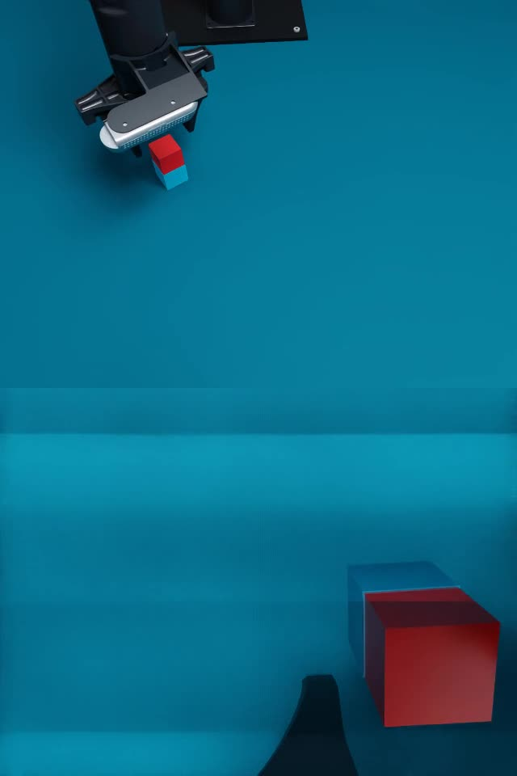
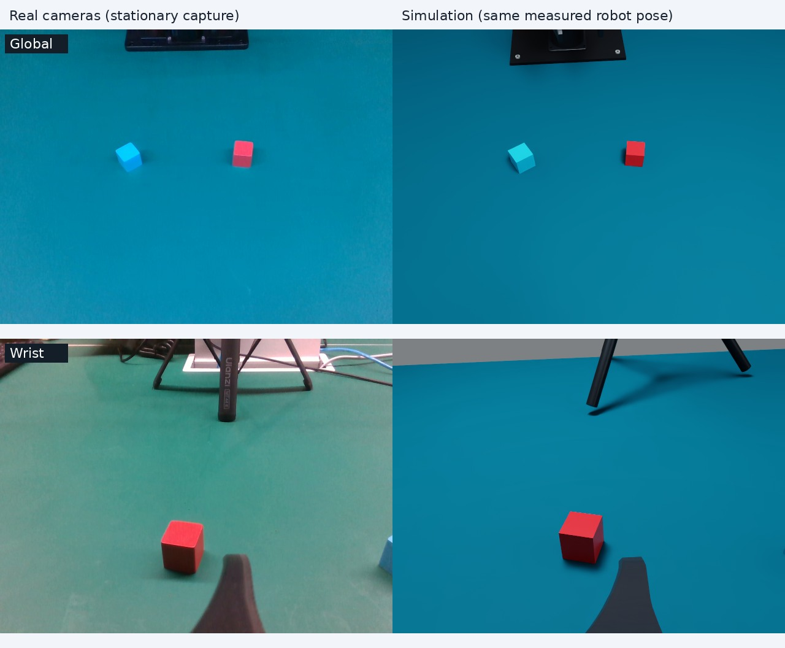
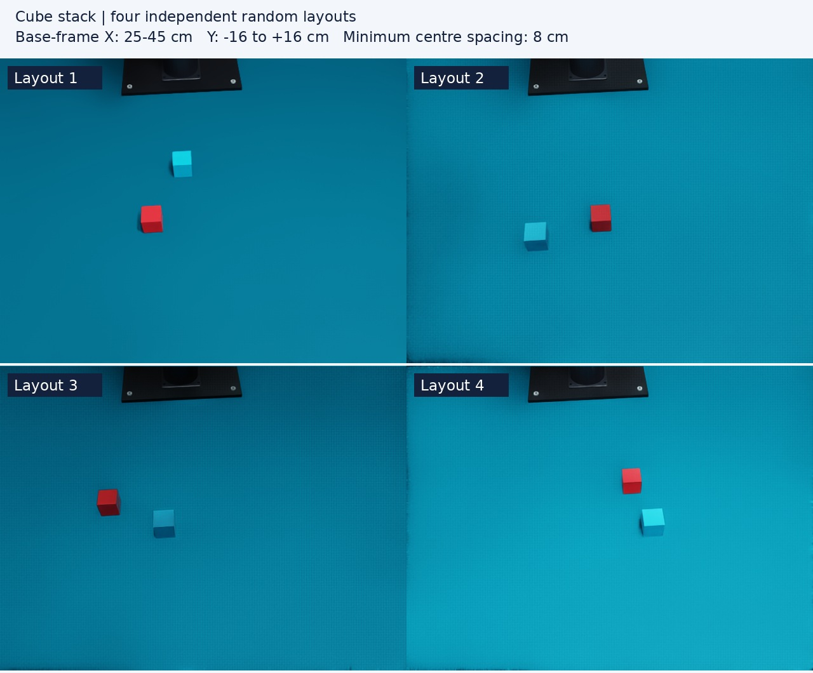

# Cube stacking on the PiPER workbench

`cube_stack` adds a red cube and a blue cube to the pinned
[Playground workspace](../configs/calibration/playground_20261113_appearance.json).
The instruction is **“Pick up the red cube and place it on top of the blue cube.”**
The red cube is the manipulated object; the blue cube is its support.

The task is separate from the empty Playground. It retains the pinned table,
PiPER, base-height convention, materials, lights and camera
calibration. The original Playground configuration is not rewritten. Cube
geometry, initial layout and randomization belong to this task; they are
adjustable task parameters rather than measurements inferred from a successful
simulation.

The current task start is above the centre of its configured X/Y sampling
region, 16 cm above the table, with 15-degree outward tool tilt and full gripper
opening. It is resolved with bounded IK; camera intrinsics and mounting
extrinsics are unchanged. See the [centred-start settings](manipulation_collection.md#centred-start-poses).

[](media/cube-stack-demo.mp4)

Scripted physical execution at 1× simulation time, global view above wrist view.
The fixed-layout simulation completed the entire grasp/stack/release/return
trajectory in two environments. This is a physics validation, not learned-policy
performance. See the [validation record](results/cube_stack_20261109/README.md).
That recording uses the preserved 2026-11-08 camera preset. Current task defaults
use the 2026-11-13 appearance preset with the 2026-11-09 camera registration;
optics and physical parameters remain the same. See the
[recorded-image appearance comparison](playground.md#appearance-calibration-2026-11-13).
The older result is not relabelled as a new-camera
validation.
The [global-camera refinement](results/playground_global_refinement_20261109.json)
records the later camera-specific checks.

## Execution and interfaces

The registry resolves `cube_stack` to
`pressb.tasks.cube_stack.parallel:create_backend`. Its task hooks use the common
`SharedWorldBackend` and PiPER joint driver. They do not introduce a separate
physics loop, renderer or learning implementation. See the
[shared-core contract](project_framework.md#shared-world-simulation-core).

| Interface | Convention |
|---|---|
| Observations | Measured six arm joints plus full gripper opening; RGB `up` and `wrist` |
| Executable actions | Absolute joint positions, shape `[H,7]`; six radians and one full opening in metres |
| Example horizon/rate | Up to 32 actions per chunk, 30 Hz control with 120 Hz physics |
| Parallel scheduling | All active environments receive equal-length action prefixes |
| Reset | Indexed, zero physics ticks; per-environment seeds and explicit object placement |
| Smoothing | Optional joint EMA through the common robot driver; examples use `none` |
| Outcome | Physical stacking success; a time limit yields truncation |

Both cameras retain the pinned template's poses, optical centres and measured
640 × 480 intrinsics. Render size, transmitted image preprocessing and inference
microbatch size are separate settings. Reset-render warmup follows the task's
scene defaults unless explicitly overridden.

## Configuration

The [simulation-node example](../configs/rl_nodes/cube_stack_simulation.json)
configures eight environments without starting a model. The
[experiment example](../configs/experiments/cube_stack_walloss_eval.json) inherits
the existing Wall-OSS service setup and replaces the task, endpoints and output
paths. It reuses the PAP checkpoint only to exercise the joint7 interface; that
checkpoint has not been trained or validated for stacking.

Task settings include:

- `scene_config`: the pinned Playground template path.
- `cubes.red` and `cubes.blue`: `edge_m`, base-frame `center_xy`, `yaw_deg`,
  `mass_kg`, RGB `color` and `roughness`. Omitted fields use the task defaults.
- `randomization.enabled`: sample fresh layouts when true. `x_range_m` and
  `y_range_m` bound the complete cube footprints in the robot-base XY plane;
  `yaw_range_deg` controls their yaw. `min_center_distance_m` and
  `max_attempts` control separation and sampling retries. Invalid or impossible
  layouts are rejected.
- `reward`: sparse `success` and `failure` values. Examples use `1.0` and `0.0`.
- `terminate_on_success`, `max_episode_seconds` and `outcome`: termination and
  physical success settings.
- Shared execution settings: `num_envs`, `horizon`, `gpu`, `spacing_m`, rendering,
  image preprocessing, thread counts and `smoothing`.

The example randomization domain is X `[0.25,0.45]` m and Y `[-0.16,0.16]` m,
with zero yaw and a minimum centre separation of 0.08 m. These are configurable
design bounds, not a claim of complete visual coverage or reachability at every
sample. The examples randomize positions; sampled yaw is zero.

The included fixed-vertical planner does not cover this entire domain. In a
100-layout CPU audit, all 200 red/blue grasp poses passed IK, but placement
passed 99/100, and 90 mm / 80 mm hover poses passed only 66/100 / 70/100.
These are isolated pose checks without collision or full-trajectory validation.
The task's placement sampler does not silently filter out those layouts. See
[planner coverage and retained failures](results/cube_stack_20261109/README.md#planner-coverage).

The [fixed-layout node](../configs/rl_nodes/cube_stack_real_layout.json) disables
randomization and uses one environment for comparison with the captured real
workspace:

| Cube | Edge | Base-frame centre XY | Yaw |
|---|---:|---|---:|
| Red | 29 mm | `[0.331263, 0.102522]` m | −10.51° |
| Blue | 30 mm | `[0.326851, −0.083409]` m | 30.36° |

These are estimates from the captured RGB-D and the existing Playground
calibration, not precise physical measurements. Global RGB corners projected
onto the configured cube-top plane define the placement; wrist depth provides
a cross-check. The red cube's wrist-depth height estimate was 28.72 mm; the blue
cube was approximately 30 mm. The same
geometry is used in the randomized example, while its centres are resampled.
All presets inherit the pinned template's valid initial robot pose; the current
live joint feedback is not substituted as reset home.

The red cube's global/wrist XY estimates differ by approximately **12.1 mm**.
The existing camera calibration and effective base mount are retained; the
two estimates are not silently averaged. Blue is clipped in the wrist view,
so no wrist blue position or size is inferred. This capture does not establish
millimetre-accurate real/simulation registration. See the published
[measurement summary](results/cube_stack_20261109/summary.json); the full local
capture analysis is `outputs/cube_stack_20261109/real_capture/analysis_final/measurements.json`.



The reference comparison is a static render at the measured arm pose, with zero
physics steps. It is separate from the template home used for episode resets.



For deterministic placement, pass task reset options such as:

```json
{
  "objects": {
    "red": {"center_xy": [0.35, -0.07], "yaw_deg": 0},
    "blue": {"center_xy": [0.35, 0.07], "yaw_deg": 0}
  }
}
```

These are `options` within the regular environment reset request; the common
service still requires its run/request/episode protocol. `options.by_env` can
supply different placements for selected environments. Explicit layouts must
meet the same geometry and separation constraints as sampled layouts. The
instruction remains fixed; changing arbitrary language does not change which
cube is manipulated.

## Physical success

The task computes success from measured rigid-body state and contacts. Object
poses are set only during reset; normal action execution uses PhysX contacts.
The default outcome requires all of the following:

| Condition | Default |
|---|---|
| Grasp/lift history | Both fingers simultaneously exert at least 0.02 N on the red cube while its bottom is at least 12 mm above the tabletop |
| Upright cubes | Both local Z axes within 10° of world up |
| Stack height | Red bottom within 3 mm of blue top, with red centre above blue centre |
| Physical support | Red-on-blue and blue-on-table support forces each at least 0.02 N; near-vertical, near-surface contact filtering |
| Blue base | Blue bottom within 3 mm of the tabletop |
| Released gripper | Full opening at least red edge + 8 mm, with both cubes' finger forces below 0.02 N |
| Low motion | Both cubes at most 0.025 m/s linear speed and 0.25 rad/s angular speed |
| Stability | All current conditions remain valid continuously for 0.5 s |

The projected footprint overlap is logged for diagnostics. A stable off-center
placement counts when the blue cube physically supports the released red cube.
Two unrelated historical finger touches cannot satisfy the simultaneous grasp
condition. Support contact filtering uses a maximum normal tilt of 20° and a
3 mm contact-separation tolerance. The default success reward is sparse and
ends the episode; a cube falling below the table terminates as failure, while
reaching the time limit truncates it. These are implementation criteria, not
evidence that the supplied PAP model has learned this task.

## Launch

Validate the experiment without loading Isaac or model weights:

```bash
python scripts/run_experiment.py validate \
  --config configs/experiments/cube_stack_walloss_eval.json
```

Start only the simulation service in the Isaac environment:

```bash
.conda/envs/pressb/bin/python scripts/serve_simulation_node.py \
  --config configs/rl_nodes/cube_stack_simulation.json
```

Use `configs/rl_nodes/cube_stack_real_layout.json` instead for the fixed layout.

For a two-environment reset/step/image smoke check, use a fresh output directory
and an available GPU. This command runs real simulation but no model or training:

```bash
.conda/envs/pressb/bin/python scripts/smoke_parallel_tasks.py \
  --task cube_stack --config configs/rl_nodes/cube_stack_simulation.json \
  --num-envs 2 --gpu 0 --output outputs/cube_stack_smoke
```

Reproduce the complete fixed-layout grasp/stack/release/return trajectory,
including the physical checks and video, with another fresh directory:

```bash
.conda/envs/pressb/bin/python scripts/smoke_cube_stack.py \
  --gpu 1 --num-envs 2 --output outputs/cube_stack_full_smoke_new
```

This uses the task's captured-layout defaults with randomization disabled.
It executes only in simulation. `--plan-only` checks the trajectory on CPU
without launching Isaac; successful planning alone is not a physical success.
For the camera configuration of the recorded demonstration, also pass
`--scene-config configs/calibration/playground_20261108_final.json`.

To connect a model, use the standard three commands in separate terminals and
the appropriate model/Isaac environments:

```bash
python scripts/run_experiment.py inference --config configs/experiments/cube_stack_walloss_eval.json
python scripts/run_experiment.py simulation --config configs/experiments/cube_stack_walloss_eval.json
python scripts/run_experiment.py eval --config configs/experiments/cube_stack_walloss_eval.json
```

The standalone node and experiment simulation use the same port; select one
launch method. For a different number of environments, set both
`task.config.num_envs` and `run.rollout.num_envs` in the experiment. Set model
weights, model-side preprocessing and service devices for the intended policy
before treating an evaluation as evidence of task performance.


## Real-robot replay, 2026-11-09

The 952 simulation-applied joint/gripper targets were replayed on the real PiPER
at 30 Hz and the requested 30% device speed, using the existing reference
execution rules. All targets completed in **32.47 seconds**. Dual-camera footage
shows the red cube lifted, released on the blue cube and remaining stacked after
the arm returned home; a later RGB-D capture confirmed the stack remained in place.
This is one physical transfer demonstration. The source targets, hardware feedback
and video timing are retained in the [execution record](results/cube_stack_real_transfer_20261109.json).
The separate low-speed candidate was not used on hardware.
