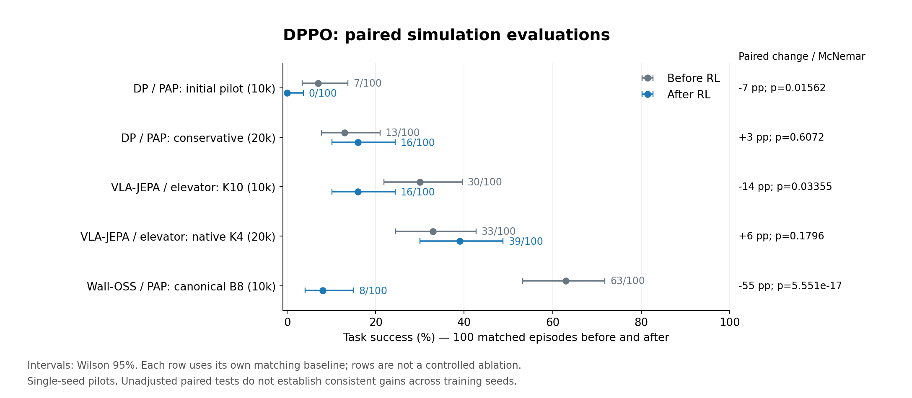

# DPPO integration validation

Evidence snapshot: **2026-11-08**. Diffusion Policy completes supervised training
and achieves nonzero PAP simulation success. Action-expert optimization and
versioned weight transfer work in the completed DPPO runs. **A reliable increase
in task success has not yet been established.**

Implementation details and launch instructions are in [DPPO](dppo.md). The
bundled diffusion components derive from upstream commit
`cc7234ad7ff39a8f32de3af903606723a16f0648`; see the
[source manifest](../src/pressb/model_sources/diffusion_policy/). VLA-JEPA and
Wall-OSS use an explicitly stochastic flow extension, rather than DDPM.
The compact [result data](results/dppo_integration_20261108/summary.json) and
comparison figure are bundled with the source repository. Other artifact links
below refer to the local `outputs` tree; large experiment files are not bundled.

## Completed evaluations

Each completed DPPO comparison has **100 matched episodes before and after**.
Intervals are Wilson 95%; the paired test is exact two-sided McNemar.

| Experiment | Training budget | Before | After | Paired result / status |
|---|---:|---:|---:|---|
| Native Diffusion Policy SFT, PAP | 30,000 SFT steps; evaluated retained step 16,000 | — | 23/100, CI 15.8–32.2% | Completed integration evaluation; [report](../outputs/dppo_integration_20261108/reports/dp_sft16000_100/README.md) |
| DPPO DP, PAP, first FP32 pilot | 10,000 environment transitions | 7/100, CI 3.4–13.7% | 0/100, CI 0–3.7% | 0 improved / 7 worsened; p=0.015625; **negative result**; [report](../outputs/dppo_integration_20261108/dp_pap/dppo_fp32_report/README.md) |
| DPPO DP, PAP, conservative follow-up | 20,000 environment transitions | 13/100, CI 7.8–21.0% | 16/100, CI 10.1–24.4% | 9 improved / 6 worsened; p=0.607239; **no established improvement**; [report](../outputs/dppo_integration_20261108/dp_pap/dppo_conservative_report/README.md) |
| VLA-JEPA, elevator, original K=10 | 10,000 environment transitions | 30/100 | 16/100 | 12 improved / 26 worsened; p=0.0335524; **negative result**; [paired audit](../outputs/dppo_integration_20261108/elevator/paired_result.json) |
| Wall-OSS, PAP, canonical B=8, minibatch 32 | 10,000 environment transitions | 63/100, CI 53.2–71.8% | 8/100, CI 4.1–15.0% | 0 improved / 55 worsened; p=5.55e-17; **negative result**; [report](../outputs/dppo_integration_20261108/walloss_pap/b8_mb32_lr1e6_report/README.md) |
| VLA-JEPA, elevator, native K=4 follow-up | 20,000 environment transitions | 33/100, CI 24.6–42.7% | 39/100, CI 30.0–48.8% | 10 improved / 4 worsened; p=0.179565; **no established improvement**; [report](../outputs/dppo_integration_20261108/elevator/candidate20k/report/README.md) |

The SFT integration result uses a different checkpoint/evaluation protocol and
is not a DPPO comparator. Each DPPO run uses its own matching baseline. In
particular, comparing 7% from the first pilot with 16% from the follow-up would
mix evaluation seeds and protocols.



The [combined source receipt](../outputs/dppo_integration_20261108/final_comparison/summary.json)
records each input report's SHA256. Each row has its own matching baseline;
the rows are not controlled ablations of individual hyperparameters.

## Training and evaluation provenance

SFT uses `/home/pengguanqi/Datasets/piper_pap_20260606_offset`, with **450 training
and 50 validation episodes**, two 128×128 cameras, seven joint/gripper outputs,
and a 16-action horizon. Image augmentation applies only to training;
normalization is fitted on training episodes. The 30,000-step run selected the
EMA checkpoint at step **27,500** by validation denoising loss (**0.00990337**),
not by simulation success. See the [resolved configuration](../outputs/dppo_integration_20261108/diffusion_policy_pap_sft/resolved_config.json),
[episode split](../outputs/dppo_integration_20261108/diffusion_policy_pap_sft/split.json)
and [checkpoint identity receipt](../outputs/dppo_integration_20261108/dp_pap/sft_final_best_receipt.json).

Both DPPO Diffusion Policy pilots start from that SFT model. They use eight parallel
environments, eight executed actions per chunk, and the existing physical
success rule: lift, whole-object containment, release, stable box-floor rest,
and bilateral finger-contact history. One environment transition is an executed
action chunk, not an episode or a denoising step.

The DP expert uses IEEE FP32 scoring, DDIM K=10 and eta=0. Training adds a 0.02
Gaussian transition-noise floor; evaluation uses the corresponding mean-only
transitions with seeded initial noise. PPO uses the upstream mean-log-probability
surrogate with clamp [-5,5]. Earlier eta=1 diagnostics and the TF32 rollout
rejected before any optimizer update are retained separately and excluded from
these comparisons.

The first pilot used rollout length 32, four epochs and actor LR 1e-5. The
conservative run started fresh with rollout length 96, one epoch, actor LR 1e-6,
two critic-only warmup iterations and continued critic fitting after actor KL
stopping. It used the [isolated candidate source](../outputs/dppo_integration_20261108/critic_warmup_patch/README.md)
with trainer SHA256
`8ec319d37303e40fdb9d9bd2bb256b1dd23c87a1a0247091433bac8f3d932fae`.
Its evaluation/training seeds were 20261118/20261119. The final-budget checkpoint
was evaluated; no checkpoint was selected by held-out success. See the
[registered settings](../outputs/dppo_integration_20261108/dp_pap/dppo_conservative_evaluation_plan.json).

Reports audit completion, task/sampler/source settings, stable episode keys,
actual reset data and policy-noise schedules before accepting pairing. Source
log digests are recorded in each `summary.json`. These are single-training-seed
pilots: episode confidence intervals do not measure variability across training
seeds, and training recent SR is not held-out task success.

## What the completed runs establish

The first pilot verified **100,000 denoising pairs**, completed **1,564 optimizer
minibatches** and acknowledged **40 distinct expert versions**. The conservative
run verified **200,000 pairs**, completed **722 actor / 782 critic steps**, and
acknowledged **25 expert versions** after its warmup. See their
[first-pilot audit](../outputs/dppo_integration_20261108/dp_pap/dppo_fp32_train10k/optimization_audit.json)
and [follow-up audit](../outputs/dppo_integration_20261108/dp_pap/dppo_conservative_train20k/optimization_audit.json).
These establish optimization/synchronization, not performance gains.

The real Wall BF16 probe used fixed batch 8 and token length 256. Across all ten
denoising steps, shuffled rows, variable context lengths and incomplete batches,
sampling-versus-gradient scoring had **zero raw log-probability difference**.
The same probe verified backward gradients. See the local
[probe report](../outputs/dppo_integration_20261108/flow_smoke/canonical_batch_report.json).

In the negative pilot, episodes reaching the lift threshold fell **43→13** and
terminal box containment fell **9→0**. Of seven lost successes, four no longer
reached the lift threshold; three lifted but ended outside the box. The
[failure analysis](../outputs/dppo_integration_20261108/dp_pap/dppo_fp32_report/failure_diagnostics.md)
records the matched cases. In the conservative trial, lift counts were **35→30**
and terminal containment **18→20**. Terminal summaries cannot identify the
causal motion error or replace trajectory inspection.

The first VLA K=10 pilot also regressed. Its executed chunks fell **4,597→1,375**,
but **47/100** after-evaluation episodes terminated on recorded tip/frame
collisions (zero before), and wrong-target episodes terminated after 1.42 seconds
on average. Of the 26 lost successes, 15 became collisions, ten wrong presses and
one timeout. The shorter rollouts primarily reflect early failures, not improved
task efficiency. See the [paired termination audit](../outputs/dppo_integration_20261108/elevator/failure_diagnostics.md).

The native K=4 VLA follow-up completed 20,000 transitions in **51.3 minutes**,
with **529 actor / 625 critic steps**, **12 distinct expert publications** and
**80,000 verified denoising pairs**. All 248 action-head parameter tensors
changed; frozen encoding parameters were outside the update scope. The paired
result was **33→39 successes**, with ten gains and four losses (p=0.179565).
Wrong-button terminations fell **58→51**, timeouts changed **9→10**, and neither
side recorded a tip/frame collision. Mean simulated duration was **7.38→7.52 s**.
The result is an observed gain in this seed, not established robust improvement.
It is also not a controlled K=4 versus K=10 ablation: seeds, warmup and optimizer
settings changed. See the [full parameter and pairing audit](../outputs/dppo_integration_20261108/elevator/candidate20k/final_report.json).

Wall completed **10,000 transitions**, **3,125 optimizer minibatches**, **40
distinct expert publications**, and **100,000 denoising pairs with zero raw
likelihood error**. Computation took **87.7 minutes**; streaming the complete
6.53 GB checkpoint from H200 to local storage added **23.6 minutes**. The final
expert hash matched the training acknowledgement, checkpoint and evaluation
publication. The evaluation-only derivative omits optimizer state; the full
resumable checkpoint is retained separately. The
[identity audit](../outputs/dppo_integration_20261108/walloss_pap/b8_mb32_lr1e6_final_identity_audit.json)
includes independent full-file SHA256 rereads and the actual publication chain.

Its success rate regressed **63→8/100**, with **55 lost successes and no gains**.
Episodes reaching 4 cm of bottom clearance fell **91→23**; bilateral contact
history fell **93→35**; terminal whole-object containment fell **63→12**.
Of the 55 lost successes, 45 no longer reached the lift threshold, eight lifted
but ended outside the box, and two ended inside without satisfying all success
conditions. The final evaluation had **92 timeouts**. These describe the loss
of task performance; they do not identify its optimization cause. See the
[physical-stage audit](../outputs/dppo_integration_20261108/walloss_pap/b8_mb32_lr1e6_report/failure_diagnostics.md).

## Differences from the upstream benchmark

These are integration pilots, not a reproduction of the upstream Robomimic
Lift image benchmark at the pinned revision. That reference collects 15,000
chunks per rollout and uses gradient accumulation; the conservative DP and VLA
pilots collect 768 and 1,536 chunks, and Wall collects 256. Their optimizer
frequency, critic targets and update scope differ. PressB freezes observation
encoders and currently trains all executed denoising steps; it does not yet
implement a separately frozen prefix for partial-denoising fine-tuning.

The reference uses running reward scaling and gamma 0.999 per action chunk.
These pilots use no running reward scaling and the task's duration-aware
discount: PAP gamma 0.995 and elevator gamma 0.99 **per 30 Hz action**. For a
reward 15 simulated seconds later, the discount factors are approximately 0.105
and 0.0109, respectively, versus 0.928 for the reference's timebase. They also
use different success, chunk-reward and timeout contracts. These arithmetic
differences are not evidence that discounting caused a particular failure.

Wall's standard deviation 0.03 and log-probability upper bound 2 place about
72.17% of nominal on-policy scalar Gaussian coordinates on the clamp plateau.
This is a mathematical coordinate-level proportion, not a measured fraction
of zero-gradient minibatches. DP and VLA explicitly use higher bounds. Other
differences include critic warmup and advantage normalization. The selected
upstream reference is also sparse-reward, has effectively constant learning
rates, and does not enable the quantile clipping described in a code comment;
those should not be presented as missing active features of these pilots.

The [source/configuration audit](../outputs/dppo_integration_20261108/upstream_comparison.md)
records the exact values and references. None of these factors was isolated in
a controlled ablation, so they identify follow-up work rather than established
causes of regression.

## Reproduce the evidence report

From the repository root, regenerate the conservative report without loading a
model or simulator:

```bash
python scripts/summarize_dppo_experiment.py \
  --baseline outputs/dppo_integration_20261108/dp_pap/dppo_conservative_baseline100 \
  --after outputs/dppo_integration_20261108/dp_pap/dppo_conservative_after100 \
  --training outputs/dppo_integration_20261108/dp_pap/dppo_conservative_train20k \
  --sft outputs/dppo_integration_20261108/diffusion_policy_pap_sft \
  --output outputs/dppo_integration_20261108/dp_pap/dppo_conservative_report
```

Use the corresponding `dppo_fp32_*` paths for the first pilot. The report emits
JSON, Markdown, evaluation intervals, training curves and a separate SFT-loss
plot. `--no-plots` removes the matplotlib requirement. Focused
[protocol tests](../tests/test_expert_sync.py),
[PPO tests](../tests/test_dppo_training.py) and
[reporting tests](../tests/test_dppo_experiment_summary.py) cover implementation
contracts; overlapping test runs are not summed into a unique test total and
are not counted as task-success evidence.

The final CPU regression suite passed **690 tests**, with two environment-based
skips (CUDA batch-parity and native Wall dependencies in the VLA environment).
Those model paths also have separate actual GPU evidence. The suite includes
legacy DSRL/residual contracts, DPPO likelihoods, weight publication, checkpoint
resume, critic warmup, dataset handling, and report pairing. It found a receiver
ordering race on rejected uploads; cleanup and lock release now precede the
error response, with a deterministic regression test. See the local
[test receipt](../outputs/dppo_integration_20261108/final_regression.json).
