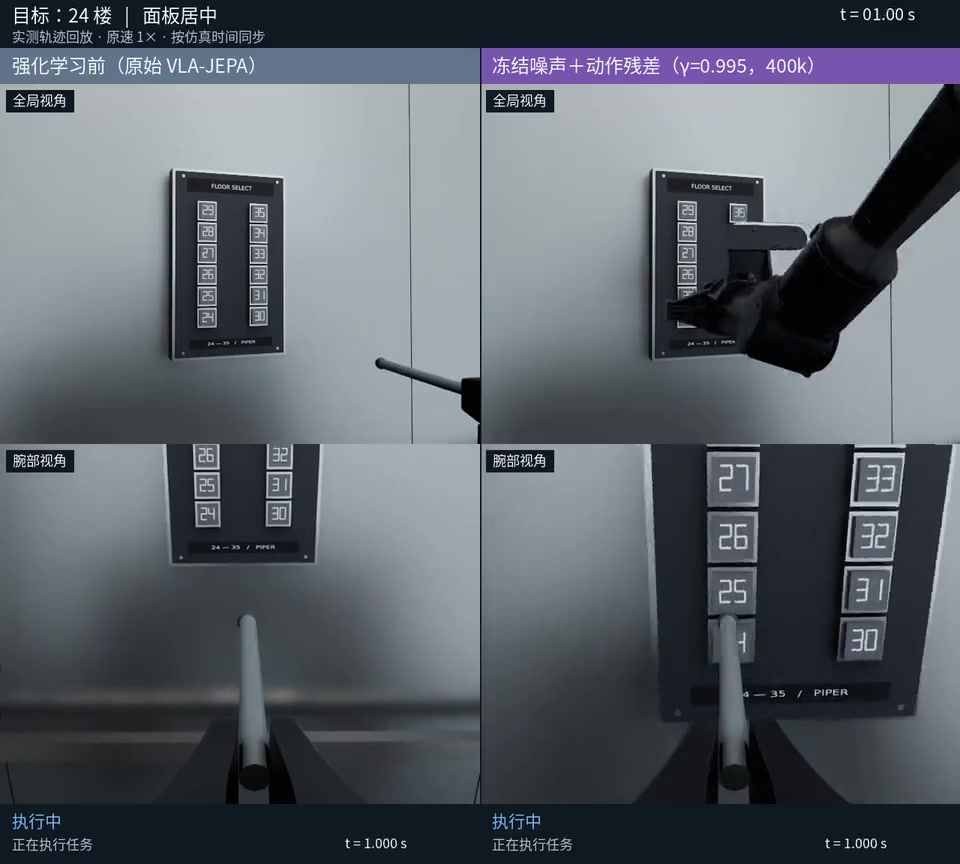
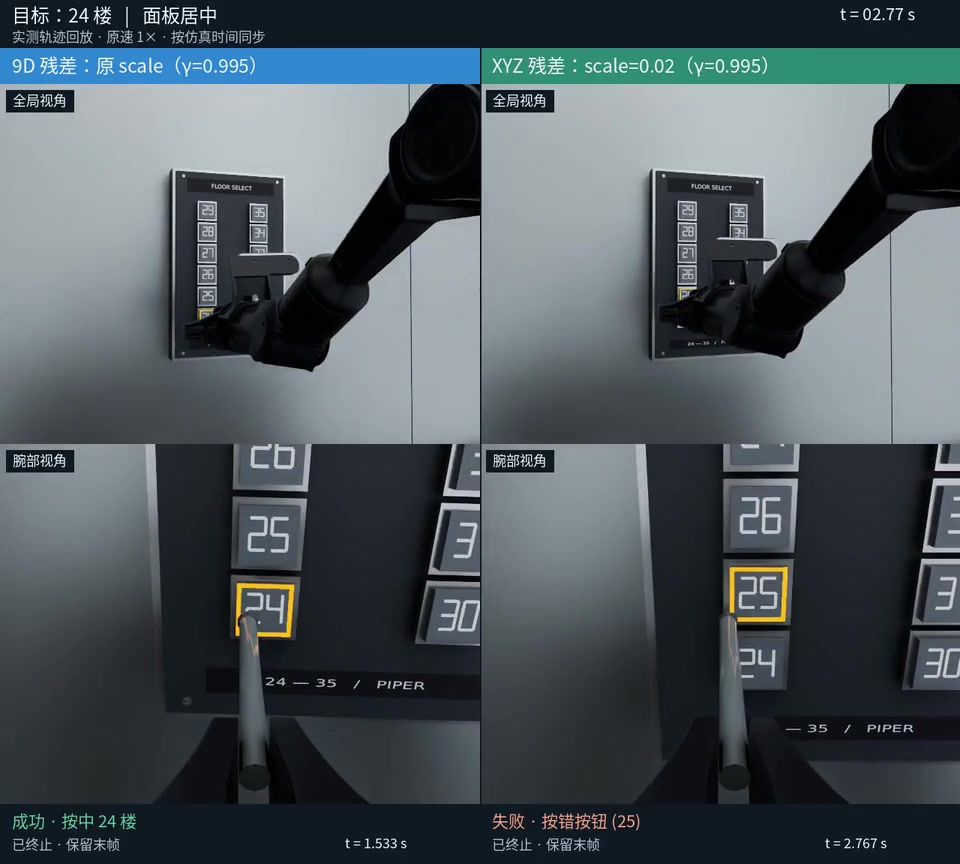
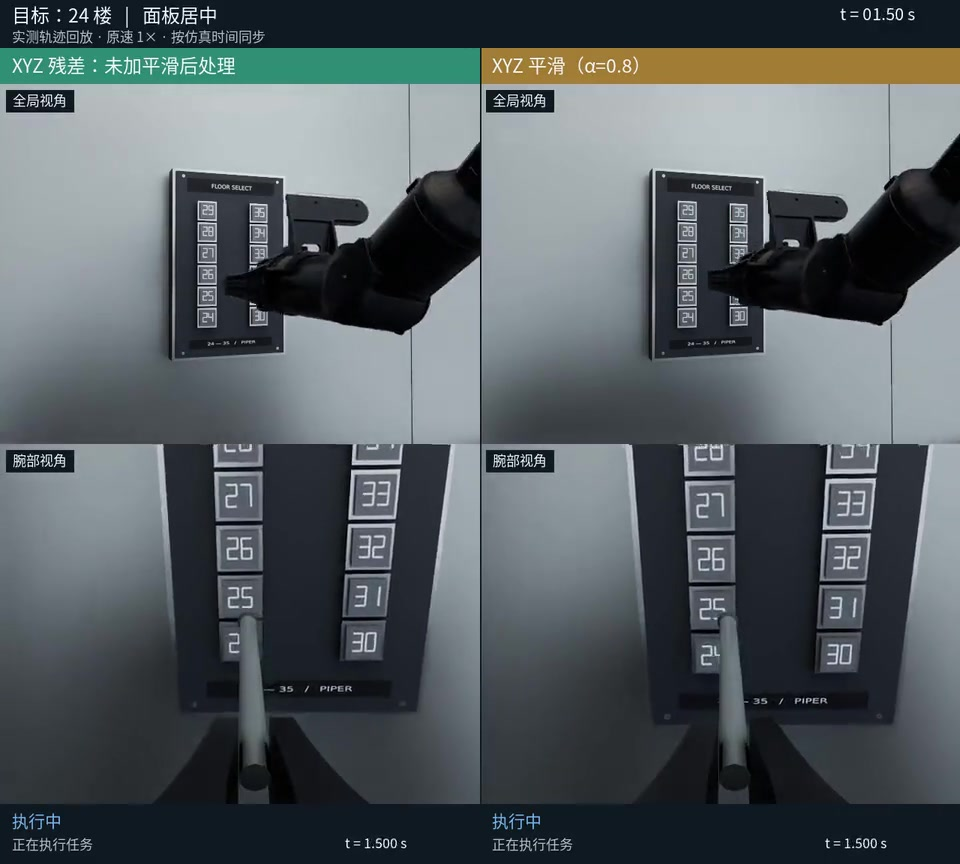
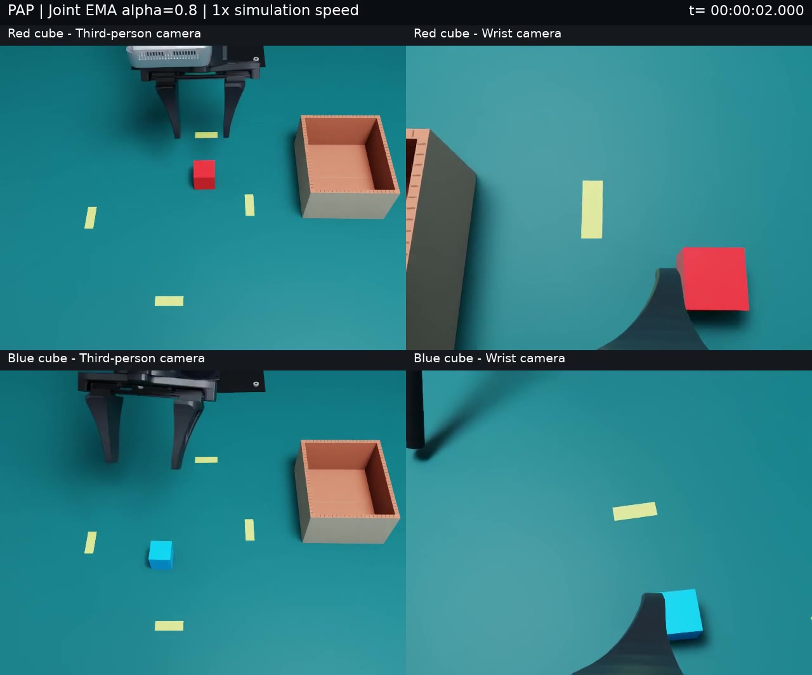
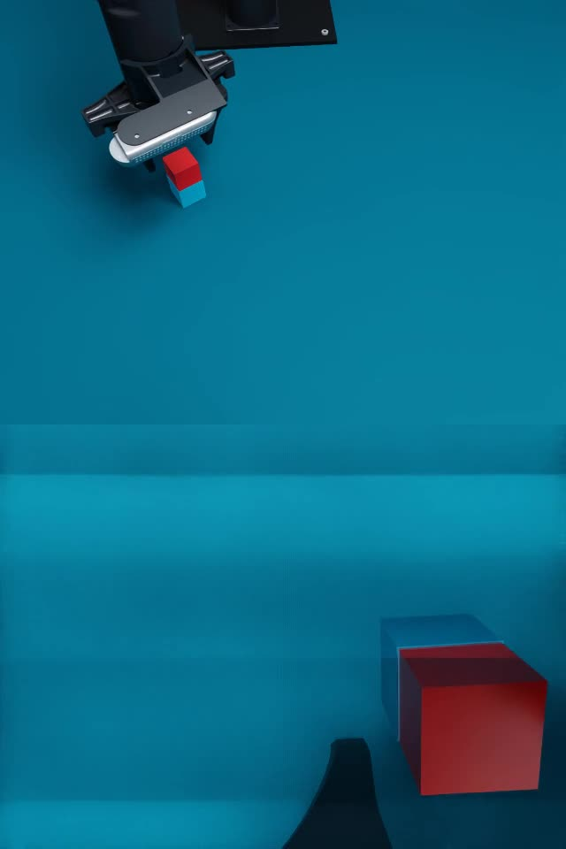
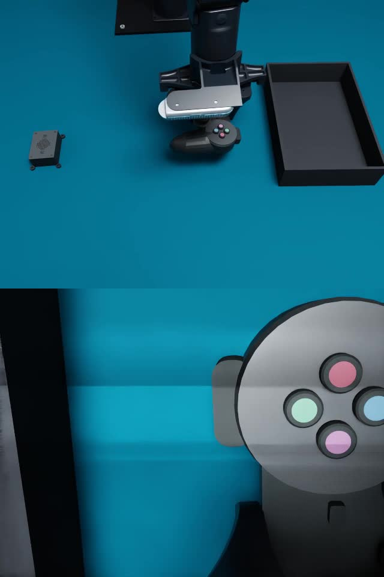

# 仿真演示视频

本目录包含三段完整的 12 按键演示、一段 PAP 模型执行演示，以及方块堆叠、桌面收纳的物理仿真演示，供 README 在干净克隆中直接播放或下载。
电梯视频为 H.264 MP4，960×864、30 fps，保留全局和腕部视角以及原始方法、按键和结果标签。
全部按 **1× 仿真时间**同步播放；先结束的一侧停留在终止画面，未把较慢的动作加速。
电梯视频保留原录像中的全部按键和失败结果，仅缩小分辨率并重新压缩。

## 强化学习前后

[播放 / 下载 MP4](before-vs-residual.mp4) · 107.67 秒

- 左：原始 VLA-JEPA；右：冻结已训练的初始噪声策略，再从零训练 9D 动作残差 400k，γ=0.995，位置 scale=0.03、旋转 6D scale=0.1。
- 每侧另录 12 个中心布局任务，24–35 按键各一次：左 **4/12**，右 **12/12**。全部保留，没有按结果筛选。
- 这批演示不属于原先 120 次评估；右侧策略原评估为 **118/120**。视频内 12/12 不代表所有面板偏移均成功。

## 9D 与 XYZ 动作残差

[播放 / 下载 MP4](pose9-vs-xyz.mp4) · 42 秒

- 左：上述 9D 动作残差；右：只输出 XYZ 残差，scale=[0.02,0.02,0.02]，旋转沿用冻结策略。两侧固定同一初始噪声策略，均从零训练动作残差 400k，γ=0.995。
- 每侧另录 12 个中心任务：左 **12/12**，右 **11/12**；右侧 24→25 误按保留在片头。
- 原先各自的 120 次固定条件评估分别为 **118/120** 和 **119/120**，与这批录像属于不同运行。

## XYZ 平滑后处理实验

[播放 / 下载 MP4](xyz-smoothing-experimental.mp4) · 42.57 秒

- 左：XYZ 残差，无新增后处理；右：对最终 XYZ 目标应用因果 EMA，α=0.8。模型权重、残差 scale 和旋转均不变。
- 来自 seed=20261010 的完整评估，每个按键取第一次中心布局，共每侧 12 条，**两侧均 12/12**；按布局和序号选取，没有按成功结果筛选。
- 同次完整评估包含偏移布局，为左 **116/120**、右 **117/120**。平滑未达到预定的至少 119/120 确认门槛，**仍为实验选项，没有默认启用**。完整结果见[平滑评估说明](../residual_on_frozen_noise.md#2026-10-09-实测结果保留默认无新增滤波)。

## PAP：Wall-X 与可选关节平滑

[播放 / 下载 MP4](pap-wallx-smoothed.mp4) · 12.03 秒 · 1280×1064、30 fps

- 上排红色方块、下排蓝色方块；左侧固定第三视角，右侧腕部视角。
- 使用给定 Wall-X 权重，关节 EMA α=0.8；两个固定布局均完成物理抓取放盒。
- 361 帧对应 0–12 秒仿真采样，原速播放，发布文件与已验证源视频一致，无额外剪辑或转码。
- 这是两个独立演示，不属于随机 200 次评估，也不是平滑前后的受控比较。见[演示记录](../results/pap_smoothing_demos_20261023.json)和[随机评估](../results/pap_rectangle_20261023/README.md)。

## 方块堆叠：Playground 派生任务

[播放 / 下载 MP4](cube-stack-demo.mp4) · 31.77 秒 · 640×960、30 fps、953 帧

上方全局视角、下方腕部视角，按 1× 仿真时间展示完整规划轨迹。
这是共用并行核心中的物理接触执行，未使用学习策略，也未控制真机。
固定布局的两个环境均完成抓取、堆叠、释放和回位；此视频展示环境 0。
本片来源、哈希与验证范围见[方块堆叠结果清单](../results/cube_stack_20261109/summary.json)，独立于下面的历史视频 manifest。

## 桌面收纳：两物体场景与资产预览

[播放 / 下载 MP4](tabletop-cleanup-demo.mp4) · 69.97 秒 · 640×960、30 fps、2099 帧

上方全局视角、下方腕部视角，按 1× 仿真时间展示手柄和扬声器的完整抓取、放盒、释放与回位。文件与该物理执行的源视频一致，包含初始帧及 2098 个动作帧；使用规划轨迹，未使用学习策略或控制真机。来源、SHA 与验证范围见[桌面收纳结果清单](../results/tabletop_cleanup_20261109/summary.json)。

这些收纳视频和预览保留原 2026-11-08 相机标定与修正前物体形状，早于后续全局相机更新、手柄尺寸修正和最终盒位固定；不能当作当前配置的重新验证。

- [随机布局](tabletop-cleanup-random-layouts.jpg)：1984×1218，来自八环境 Isaac 检查的环境 1、5、3，分别展示手柄＋扬声器、手柄＋雷达、扬声器＋雷达；上方全局视角，下方腕部视角。
- [资产细节](tabletop-cleanup-assets.jpg)：1984×1260，根据程序化网格直接生成的 CPU 预览，不是 Isaac 渲染，也不是三物体任务。任务始终只激活两个不同物体。

说明见[桌面收纳任务](../tabletop_cleanup.md)及[发布结果清单](../results/tabletop_cleanup_20261109/summary.json)；完整图片来源清单仅在本地 `outputs/tabletop_cleanup_20261109/reference/docs_figure_sources.json`。这些演示不表示模型成功率，也不加入历史电梯/PAP 视频 manifest。

## 来源与验证

[manifest.json](manifest.json) 记录上述电梯与 PAP 视频的来源路径、源文件和发布文件 SHA-256、原始审计文件哈希、逐段范围、成功次数、转码参数、帧数与完整解码验证结果。源录像和详细轨迹保留在本地 `outputs/`，不随代码发布；清单中的路径均以仓库根目录为基准。

三段电梯源录像都通过实测轨迹、零物理推进的渲染回放和最终合成审计。PAP 记录核对了模型目标、EMA 和执行时序。发布视频均检查完整解码、30 fps、时长及帧数；海报直接截取对应发布视频的一帧，没有重新绘制。

这些是 PressB 仿真运行的渲染录像。本目录不打包场景模型，不对第三方资产授予新许可；既有来源和许可声明见 [THIRD_PARTY.md](../../THIRD_PARTY.md)。
