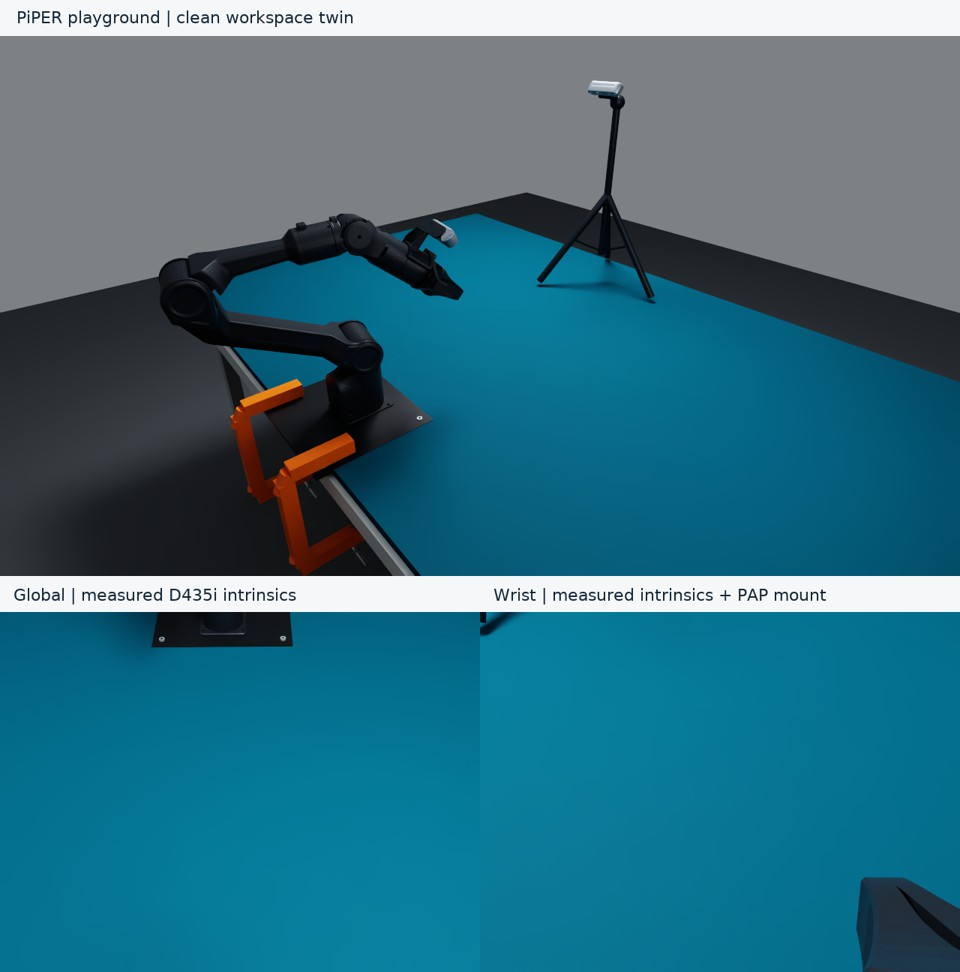
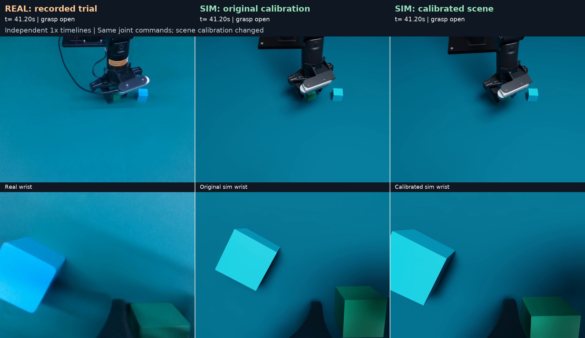

# PiPER playground workspace twin

The independent `playground` plugin reconstructs the current PiPER workbench on
`ssh piper`, using the 2026-11-07 reference video, stationary dual-D435i RGB-D
captures and measured CAN joint feedback. The default workspace contains the
table, PiPER, mounting hardware and camera tripod. **There are no task objects,
box, tape markers or buttons.** The green and blue cubes in the capture are
registration references only. Elevator, PAP and table-button presets remain
separate.

Playground is also the **base scene template for future tasks** on this workbench.
Derived tasks reuse its calibrated table, robot, cameras, lights and dynamics,
then add their own objects, reset distribution, instructions and outcome logic.
The empty reference and its versioned calibration remain available independently.



## Derive another task from this workspace

Use three layers:

1. **Pinned scene template:**
   [`playground_20261108_final.json`](../configs/calibration/playground_20261108_final.json)
   defines the calibrated workbench. Pin this file for reproducible tasks;
   `piper_playground.json` is the working default and can evolve in future revisions.
2. **Scene additions:** the node's `scene_overrides` specifies new objects and
   local changes. The existing loader combines them with `scene_config` in memory;
   neither the reference file nor another task's configuration is modified.
3. **Task plugin and experiment:** the new plugin owns sampling/randomization,
   observation/task features, rewards, success/failure and termination. The
   experiment selects that plugin and the existing model/training components.

Future recalibration should publish a new template version and update derived
tasks explicitly. Object/layout changes belong in each task's overrides rather
than in the frozen empty-workspace reference.

The runnable [object-addition example](../configs/rl_nodes/playground_objects_example.json)
adds one 29 mm red dynamic cube while inheriting the final camera transforms,
intrinsics, initial robot pose, effective base height, table, lights and physics.
Start it with the normal simulation endpoint:

```bash
.conda/envs/pressb/bin/python scripts/serve_simulation_node.py \
  --config configs/rl_nodes/playground_objects_example.json
```

This example intentionally uses the workspace backend: it exposes the normal
environment API, **one environment, zero reward and no automatic task success**.
It demonstrates scene composition, not a completed grasp task. Its reset rebuilds
the stage and restores the configured object positions; the seed does not yet
randomize those positions. Through the service API, reset an environment after
its episode ends, or retire an active episode using `/end_episode` first.

Configuration rules:

- Dictionaries merge recursively; lists such as `objects` and `static_props`
  are replaced in full. To add static props, include the inherited floor in the
  resulting list as well. Setting `objects: []` restores an empty tabletop.
- Dynamic `objects` currently represent boxes/cubes. `center_xy` is in the
  robot-base XY frame, `size` is in metres, and the object's centre Z is derived
  from the table surface plus half its height and `clearance`.
- `static_props` uses `center_base_m` for XYZ and requires `collision: true`
  when contact should be simulated. Mesh objects, articulated buttons and other
  geometry can be authored by the derived task's scene builder.
- `run_playground.py --config` expects a resolved **scene JSON**, whereas the
  example above is a **node JSON** containing `backend.config`. Use the simulation
  server command above for that file.

For an actual new task, keep its implementation under `src/pressb/tasks/<task>/`.
Its scene builder can compose
[`playground.scene.build_scene`](../src/pressb/tasks/playground/scene.py), which
returns the table/base coordinates, named object prim paths and collision paths,
then add task-specific geometry. It should set its own scene/task identity and
outcome semantics. Reuse the shared PiPER runtime and environment wire contract;
the existing `PlaygroundBackend` still has the fixed workspace-only outcome.
An explicit `backend.factory: package.module:create_backend` supports new plugins
without a registry edit. See [task plugin contracts](project_framework.md).

The example passed 40 existing CPU/USD checks and an actual Isaac check using
the node configuration. The cube remained displaced after a 72 mm XY move and
physics stepping, then returned to its original pose after episode retirement
and reset. Both cameras retained the template calibration, the reference files
were unchanged, and the simulator shut down cleanly. Evidence:
[`playground_template_20261108`](../outputs/playground_template_20261108/isaac/report.json).

## Configuration and camera registration

[`configs/piper_playground.json`](../configs/piper_playground.json) owns the
workspace geometry, appearance, robot initial pose, cameras and optional props.
The robot starts at the pose actually observed during the capture, rather than
at a newly invented home pose. State/action units are six joint angles in radians
and full gripper opening in metres; the configured opening limit is 70 mm.

Both RGB cameras use their **live device intrinsics** at 640×480:

| Camera | Serial | fx | fy | cx | cy |
|---|---|---:|---:|---:|---:|
| Global (`up`) | 261622078356 | 606.1517 | 605.0548 | 327.2539 | 249.8617 |
| Wrist | 243322073170 | 605.6945 | 605.6385 | 320.6308 | 250.7730 |

The original wrist `link6_from_camera_usd` transform came from PAP. After the
2026-11-07 real grasp attempt, the Playground transform was refined using
pre-contact images and measured joint feedback. **Live focal lengths and
principal points remain unchanged.** PAP's own configuration is unchanged.
The latest refinement uses measured-opening finger contours to adjust only the
Playground wrist optical pose by approximately 0.707 degrees and 1.63 mm; see below.
The current global optical centre is approximately
`[0.71167, 0.01042, 0.48880]` metres in the robot-base frame. The fit04 revision
jointly registered the two cameras and static reference cubes using the retry-08
video, measured joint feedback and the global bare-table depth plane. The
current simulation uses an **effective 6 mm mounting height**, reduced from the
user-estimated 14 mm to improve grip depth under the same recorded commands.
The fixed camera's world pose is unchanged; its base coordinates were re-expressed.
This is an empirical correction, not a measurement of the physical mounting plate.
These are approximate calibrated poses, not independent
absolute world or tool metrology. Stationary global and wrist RGB-D captures
were sequential.

This is an approximate workspace reconstruction. Table dimensions and mounting
visuals remain adjustable priors. The latest refinement improves image
registration, while near-field projection and closed-gripper width differences
remain. The historical trials below retain their original measurements and
failure diagnoses; they are not descriptions of the current configuration.
Surface materials and lights are image-guided approximations. The scene does
not use a photograph as the camera background.

## Final balanced reference, 2026-11-08

The selected configuration is frozen in
[`playground_20261108_final.json`](../configs/calibration/playground_20261108_final.json)
and is also the active [`piper_playground.json`](../configs/piper_playground.json).
The review retained the existing runtime parameters: further joint calibration
did not establish a sufficiently better combination. Only the final-selection
provenance was added. This is the chosen reference for the available recording,
not a claim that every physical parameter has been uniquely measured.

| Component | Final setting |
|---|---|
| Effective base mounting height | **6 mm** above the table; empirical contact-depth correction |
| Table | 1.60 × 1.05 m, top at world Z = 0.76 m |
| Global camera | Retained registered pose; optical centre in base coordinates `[0.711675, 0.010421, 0.488800]` m |
| Wrist camera | Retained measured-opening refinement; full `link6_from_camera_usd` matrix in the preset |
| Both cameras | Live D435i `fx/fy/cx/cy`, 640×480, unchanged |
| Reference cubes | Green 29 mm, blue 30 mm; optional calibration fixtures, default `objects=[]` |
| Surface and lights | Retained materials, roughness and light rig; approximate appearance |
| Dynamics | Retained robot meshes, joint kinematics, drives and friction |

Four new candidates jointly refitted global/wrist extrinsics and static-cube
XY/yaw at fixed 6/8/10/14 mm mount heights. Every candidate executed the exact
original 2,146 joint/gripper commands, with natural PhysX contacts. The current
reference reuses its already completed, hash-verified full replay. All five
passed the physical checks, including bilateral hold, approximately 50 mm lift,
return, no unintended external contact and no attachment or teleportation.

| Configuration | Balanced image/depth score ↓ | Finger 7 / 8 overlap at closure | Minimum held lift |
|---|---:|---:|---:|
| **Retained reference, 6 mm** | **0.644** | **17.89 / 18.49 mm** | **49.97 mm** |
| New joint fit, 6 mm | 0.683 | 17.89 / 18.49 mm | 49.97 mm |
| New joint fit, 8 mm | 0.668 | 15.89 / 16.49 mm | 49.74 mm |
| New joint fit, 10 mm | 0.659 | 13.90 / 14.50 mm | 49.72 mm |
| New joint fit, 14 mm | 0.662 | 9.89 / 10.49 mm | 50.01 mm |

The score gives equal weight to five normalized groups: global cube landmarks,
global fingers, excluded wrist cube landmarks, excluded-opening wrist contours
and table depth. It is a declared engineering comparison, not a probability or
an accuracy estimate. Differences within 10% were treated as insufficient to
justify extra adjustment. A mount-only 8 mm sensitivity scored 0.641, just 0.37%
better, while worsening wrist cube alignment; it also did not justify a change.
Vertical overlap is a mesh/cube envelope measure, not a measured contact patch.

Depth is evaluated at the working cube position, consistent with earlier
calibration reports. Evaluating the extrapolated wrist plane at the base origin
changes the ranking and rejects the reference under the coarse 15 mm criterion;
both interpretations are retained in the audit. Thus the effective 6 mm setting
does **not** supersede the user's approximate 14 mm physical-riser estimate.

A single brighter-table material candidate reduced mean colour error in both
views, but two wrist regions exceeded the frozen local-degradation limit
(+2.27/+2.02 versus +2.0 DeltaE76). It was retained as an alternative artifact,
not adopted. No geometry, roughness or lighting was altered to hide image errors.
The remaining natural grasp opening is about **35.6 mm real versus 30.0 mm sim**;
contact offset, cube reflections and surface texture remain approximate.

Final validation: **102 CPU/USD tests passed**, a fresh empty-scene render
retained the calibrated intrinsics and FK, and the actual Isaac backend passed
reset/step, measured motion, timeout, request retry and clean shutdown checks.
No robot hardware was accessed. Validation images were inspected during
development and come from the same recording, not an independent real trial.

See the [portable result](results/playground_final_20261108.json),
[complete selection audit](../outputs/playground_final_20261108/review/integrated_selection.md),
[clean workspace preview](../outputs/playground_final_20261108/media/final_empty_preview.png)
and [real / final simulation at original speed](../outputs/playground_final_20261108/media/real_final_1x.mp4).
The comparison uses the existing real recording and verified simulated replay;
temporary reference cubes appear only in that grasp comparison.

```bash
.conda/envs/pressb/bin/python scripts/run_playground.py \
  --config configs/calibration/playground_20261108_final.json \
  --headless --output outputs/playground_final_preview
```

## Wrist-camera refinement at matched gripper openings, 2026-11-07

The default wrist `link6_from_camera_usd` now includes a small optical-pose
correction. The real D435i focal lengths, principal point and 640×480 resolution
are unchanged. This refinement leaves the effective 6 mm base mount, global
camera, table/objects, robot assets and all physical commands unchanged.

Two effects were separated before fitting. The natural real grasp reports about
35.6 mm opening while PhysX settles near 30 mm: that difference alone moves the
visible fingertip about 15 pixels horizontally. After rendering the same measured
opening, the remaining discrepancy is chiefly the finger-body right edge, reaching
19 pixels near the image bottom. An audit found no duplicated RGB optical offset,
wrong joint-opening sign or mismatch between the fitted STL and authored USD mesh.

The fit uses native-image contours at 35.0 and 59.4 mm measured openings and static
pre-contact cube landmarks; 40.1/50.0 mm openings are excluded from optimization.
It projects original STL triangles rather than a convex hull that would fill the
finger's concave silhouette. The chosen strong-regularization candidate changes
the optical centre by `[-0.336, -1.580, -0.242]` mm in link6 coordinates and applies
a rotation-vector correction `[-0.661, -0.235, -0.085]` degrees (norm 0.707 degrees).

Independent actual-render contour checks, using fixed real-image row annotations:

| Pixel-coordinate error | Before | After |
|---|---:|---:|
| All four measured openings, RMSE | 7.44 px | 4.64 px |
| Optimizer-excluded 40.1/50.0 mm openings, RMSE | 6.06 px | 4.91 px |
| Maximum contour error | 19 px | 12 px |

[Matched-opening real / before / after detail](../outputs/playground_wrist_refine_20261107/evidence/renderer_comparison_selected.png)
shows the corrected finger silhouette. These frames are pose-only render checks,
not new grasp executions; post-contact objects in those renders are not a valid
dynamic-object comparison. The [original-speed execution video](../outputs/playground_wrist_refine_20261107/video/real_wrist_before_after_1x.mp4)
uses real recording / previous simulation / corrected simulation, global above
wrist. It retains the natural 35.6/30 mm grasp-opening difference.

The complete 2,146-frame before/after physics logs are **byte-identical**: this
change improves imaging without changing the grasp. The cube still lifts 49.974 mm
and returns naturally with no unintended external contact. **102 CPU/USD tests
passed**, including known synthetic camera recovery, unchanged non-camera config,
concave-contour projection and validation of input/output handling.

There is a tradeoff: a static-cube validation image at 20 seconds changes from
5.70 to 7.62 px coordinate RMSE. Real finger geometry, material and contact opening
remain imperfectly matched. Candidate selection inspected the excluded-width
metrics, so these are development checks within one recording, not blind metrology.

Reproduce the selected offline fit without hardware or simulation:

```bash
PYTHONPATH=src python scripts/refine_playground_wrist.py \
  --config configs/calibration/playground_20261107_before_wrist_refine.json \
  --annotations configs/calibration/playground_20261107_retry08_video_annotations_v04.json \
  --edges configs/calibration/playground_20261107_wrist_contours.json \
  --output outputs/playground_wrist_reproduced
```

Defaults use cube sigma 5 px, rotation prior 0.3 degrees and translation prior
0.5 mm. Outputs cannot overwrite an existing directory. The previous configuration,
source annotations, candidate-selection history and [portable result](results/playground_wrist_refinement_20261107.json)
are retained. No robot hardware was accessed.

## Mount-height correction from the recorded grasp, 2026-11-07

The default now uses `robot_base_height_above_table_m=0.006`. A controlled
14/10/6 mm comparison preserved all 2,146 original joint/gripper commands,
initial state, timing, table/object world positions, camera intrinsics,
wrist hand-eye, meshes, drives and friction. Fixed cameras, lights and static
props retain their world poses through base-coordinate re-expression. Only
the robot and its attached wrist camera move down; the visual mounting plate
also reflects the new height. No new robot movement was executed.

| Effective mount | Finger 7 / 8 vertical cube overlap at closure | Lowest finger above table |
|---|---:|---:|
| Previous 14 mm | 9.90 / 10.51 mm | 18.50 mm |
| Alternative 10 mm | 13.89 / 14.49 mm | 14.51 mm |
| Adopted 6 mm | 17.89 / 18.49 mm | 10.51 mm |

These are actual-state mesh/cube envelope overlaps, not measured contact areas.
All three natural PhysX replays lift approximately 50 mm, maintain bilateral
contact and return the cube with no unintended external contacts. At 6 mm the
return displacement is 7.24 mm. The default remains empty and keeps its original
initial joint pose. Other task presets are unchanged.

The 6 mm setting prioritizes the observed shallow grip: near-contact wrist green
face coordinate RMSE improves from 20.42 to 12.72 px. It is not uniformly better:
pooled wrist static-cube error changes from 5.51 to 6.44 px, and a roughly 13.46 mm
tool-X object offset and the real/sim gripper-width discrepancy remain. The 10 mm
candidate has the best pooled multi-stage image errors. The original 14 mm
measurement estimate is retained; the true mount thickness and finger/kinematic
errors are not identified independently.

[Original-speed comparison: real / 14 mm / 10 mm / 6 mm](../outputs/playground_mount_height_20261107/video/real_mount_14_10_6mm_1x.mp4)
shows global views above wrist views. The 25-second clip uses native elapsed
34–59 seconds for each source without phase stretching.

The [previous 14 mm preset](../configs/calibration/playground_20261107_before_mount_depth.json)
and [10 mm alternative](../configs/calibration/playground_20261107_mount10mm_candidate.json)
are preserved. Generate another candidate without moving room fixtures:

```bash
python scripts/adjust_playground_mount.py \
  --config configs/calibration/playground_20261107_before_mount_depth.json \
  --height-m 0.010 --output outputs/playground_mount10_candidate.json
```

For a controlled replay, use the original plan with `--plan-input`. Do not
combine this adjustment with the earlier deeper-arm diagnostic. Newly generated
tabletop-relative IK plans compensate for the mount height, so their requested
tabletop TCP height remains unchanged. Archived plan metadata refers to the old
scene; use each replay's actual config to compute effective table-relative height.

Validation: **92 CPU/USD tests passed**, both new full physical replays passed,
and the adopted empty default passed the Isaac backend reset/step/camera/shutdown
smoke test. See the [portable results](results/playground_mount_depth_20261107.json).

## Earlier retry-08 video calibration, 2026-11-07

Before the mount-depth correction above, the preset adopted `fit04` from the complete real grasp recording.
The two camera extrinsics and the pre-contact reference-cube XY/yaw were jointly
adjusted. Live camera intrinsics, measured joint states, URDF, 29 mm green cube,
retained 30 mm blue cube, drive gains, friction and all 2,146 trajectory commands
were fixed. The user-estimated 14 mm base mounting height is now included in
that revision's preset. Its earlier default pose was preserved and `objects=[]`.

| Validation within this recording | Before | Current |
|---|---:|---:|
| Wrist cube corners at 20 s, coordinate RMSE | 30.96 px | 8.71 px |
| Global fingertips at 20/36 s, coordinate RMSE | 13.38 px | 4.10 px |
| Selected green-edge / fingertip vertical relation at 41 s | about 63 px | about 21 px |
| Global static cube coordinates, repeated consistency check | 0.98 px | 1.15 px |

Validation frames were excluded from the optimizer but viewed during candidate
development; these are **within-recording checks, not a blind independent test**.
The 34 s blue-cube points were added to training to constrain the near-field
view. The global home depth plane is a fitting constraint (1.17 mm residual at
the reference XY), not independent validation. Unfitted wrist depth checks
improve from +16.56/+23.99 mm table-height offsets at home/retreat to
−4.17/+3.87 mm. These residuals do not bound absolute calibration accuracy.

The same complete command plan was then executed in natural PhysX contact:
the free green cube lifted 50.019 mm, held bilateral contact for 1.5 seconds,
and returned to the table, 7.20 mm from its initial centre. No attachment,
teleportation or unintended external robot contact was recorded. The new
gripper opening during lift hold is 30.018 mm versus 29.049 mm previously and
35.6 mm on the real robot. **Near-field registration and contact geometry
remain imperfect.** The simulation outcome alone does not establish a correct
digital twin or a new real-world success. No hardware commands were sent during
this calibration work.

Reproduce the fit offline, using the versioned inputs and existing robot assets:

```bash
PYTHONPATH=src python scripts/calibrate_playground_video.py \
  --config configs/calibration/playground_20261107_retry08_video_baseline.json \
  --annotations configs/calibration/playground_20261107_retry08_video_annotations_v04.json \
  --depth-plane-report configs/calibration/playground_20261107_retry08_video_depth.json \
  --output outputs/playground_video_calibration_reproduced
```

The tool refuses an existing output directory and records its input hashes.
It uses only local NumPy/SciPy, measured-pose annotations and the bundled STL/URDF
assets; it never opens a robot connection or launches a simulator. The previous
default is archived in
[`playground_20261107_before_retry08_video.json`](../configs/calibration/playground_20261107_before_retry08_video.json).
See the [portable result](results/playground_video_calibration_20261107.json)
and [reproduction manifest](../configs/calibration/playground_20261107_retry08_video_manifest_v04.json).
Original real footage, candidate comparisons and contact logs remain under
`outputs/playground_grasp_transfer_20261107/retry_08/calibration_optimization/`.



Local videos: [25-second descent/closure/lift comparison](../outputs/playground_grasp_transfer_20261107/retry_08/calibration_optimization/video/descent_close_lift_detail_1x.mp4)
and [79.4-second complete comparison](../outputs/playground_grasp_transfer_20261107/retry_08/calibration_optimization/video/real_original_calibrated_1x.mp4).
Each column retains its own 1× timing; finished simulation views are explicitly
frozen. There is no phase-dependent stretching. All 2,146 joint commands are
identical across simulation revisions. The default-scene Isaac interface smoke
test and 63 related CPU/USD tests passed with no skipped tests.

## Contact-depth diagnosis and explicit tabletop heights

The video registration above did not change the original trajectory's grasp
depth. At closure, the fit04 simulated fingers have minimum heights of
19.11/18.50 mm above the table; their vertical envelopes overlap the 29 mm cube
by only 9.90/10.51 mm. This is a geometry calculation, not a measured contact
area. The corrected cube is also about 14.16 mm away from the frozen path's
TCP along tool-local X, so lateral alignment remains relevant.

A separate **simulation-only motion experiment** lowers the TCP by 8 mm:
20 mm becomes 12 mm above the table. It preserves the scene, gripper commands,
phase timing and 2,146 frames, but changes 999 arm-command rows. At closure the
minimum finger/table gap becomes 10.51 mm and cube overlap becomes
17.89/18.49 mm (about 62–64% of cube height). Natural PhysX contact lifts the
cube 49.978 mm and returns it, with no unintended external robot contacts.
This is not a new calibration, an identical-command replay or a real-robot
execution. At that diagnostic stage the default geometry remained fit04.
The subsequent mount-height comparison and adopted effective height are documented above.

[Watch the 25-second real / current / deeper-motion comparison](../outputs/playground_grasp_transfer_20261107/retry_08/calibration_optimization/contact_depth_review/video/depth_20_vs_12mm_diagnostic_1x.mp4).
The [diagnostic record](results/playground_contact_depth_20261107.json) includes
geometry assumptions, command changes and provenance. The archived diagnostic
plan inherited two old metadata fields; `metadata_erratum.json` identifies
them, and a corrected metadata copy has exactly the same actions. Original
execution evidence is preserved.

New plans now explicitly distinguish tabletop height from robot-base Z:

```bash
# A NEW simulation plan, not the exact diagnostic trajectory or a hardware command.
env -u PYTHONPATH .conda/envs/pressb/bin/python scripts/run_playground_grasp.py \
  --grasp-height-above-table 0.012 --plan-only --output outputs/playground_deeper_plan
```

The default is 20 mm **above the tabletop**. With a 14 mm mount, a 12 mm
tabletop target converts to base Z = −2 mm, which is valid. Explicit
`--grasp-height` / `--grasp-height-base` retains the old base-frame convention.
`--plan-input` preserves archived actions and rejects simultaneous height
overrides. This fixes a new-plan frame-conversion bug; retry08's supplied plan
already used base Z = 6 mm for 20 mm above the table, so the bug does not
explain the earlier real/simulation discrepancy. The updated suite passed
83 CPU/USD tests without skips.

Contact-image annotations were also corrected: image upper/lower edges of the
visible green quadrilateral belong to the cube's near-side vertical face,
not necessarily its top face. Projecting all eight known simulated vertices
establishes that correspondence. Previous pixel residuals still apply, but
those earlier face labels cannot establish physical grasp depth.

## Inspect and render

From the repository root, with the existing Isaac environment and robot assets:

```bash
# Clean scene, three PNG views and a USD snapshot. Output must be new.
env -u PYTHONPATH .conda/envs/pressb/bin/python scripts/run_playground.py \
  --headless --gpu 0 --output outputs/playground_preview

# Interactive viewport; close the window when finished.
env -u PYTHONPATH .conda/envs/pressb/bin/python scripts/run_playground.py \
  --gpu 0 --output outputs/playground_gui

# Explicit diagnostic only: temporarily include the two registration cubes.
env -u PYTHONPATH .conda/envs/pressb/bin/python scripts/run_playground.py \
  --headless --gpu 0 --reference-objects --output outputs/playground_registration
```

`up.png`, `wrist.png`, `overview.png`, `scene.usda` and `summary.json` record the
scene and effective camera transforms. The visualizer holds configured poses
without advancing physics. With `--replay-jsonl` and `--video`, it visualizes
measured PressB replay feedback at the recorded elapsed times; this is not a
new policy rollout. The action-taking backend below advances actual physics.

## Shared environment interface

```bash
env -u PYTHONPATH .conda/envs/pressb/bin/python scripts/serve_simulation_node.py \
  --config configs/rl_nodes/playground_simulation.json
```

The node uses the existing HTTP environment service on loopback port 8101:
`/health`, `/reset`, `/step`, `/end_episode` and `/close_run`. It exposes measured
seven-dimensional state, `up`/`wrist` RGB, bounded joint-position action chunks,
optional `none`/`joint_ema` execution smoothing and a configurable time limit.
Request retry handling and episode ownership remain in the common runtime.
The initial implementation supports **one environment per node**.

The real Isaac backend passed both unsmoothed and joint-EMA action tests,
including measured arm/gripper motion, both camera streams, retry idempotency,
timed truncation and a second reset. The final regression run passed 130 tests
with no skips. Reproduce the physical simulation check with:

```bash
env -u PYTHONPATH .conda/envs/pressb/bin/python scripts/smoke_playground.py \
  --gpu 0 --output outputs/playground_smoke
```

Isaac's standard fast shutdown exits its owning process. The smoke supervisor
checks native exit code and component cleanup; it does not claim that
`SimulationApp.close()` returns to Python. The diagnostic slow-shutdown crash
is retained in the evidence and excluded from passing verification.

There is no task-specific success detector yet: rewards are zero, automatic
success is false, and reaching the time limit produces `truncated=true`.
Choose a task/outcome plugin or a human-label workflow before using this empty
workspace for meaningful RL. Moving an arm alone does not imply task success.

## Reproduce the registration

`scripts/capture_real_workspace.py` is a standalone capture utility for the
camera host with `numpy`, `Pillow`, `python-can` and `pyrealsense2` installed. It
opens CAN for receiving feedback only; it never sends movement, enable or reset
commands. It saves RGB, aligned depth, device intrinsics and frame timestamps.

```bash
python scripts/capture_real_workspace.py --output /path/to/new_capture
python scripts/fit_playground_camera.py \
  --capture /path/to/new_capture --correspondences /path/to/annotations.json \
  --output /path/to/registration.json
```

The fitting script's default manual annotations and depth masks refer only to
the original `playground_capture_01`. Moving a camera or the reference cubes
requires new annotations; a new output does not automatically update the scene
config. `--wrist-intrinsics pap` reproduces the superseded focal-length comparison.

Original evidence and previews are stored locally under
`outputs/playground_twin_20261107/`; large captures and USD snapshots are not
bundled in Git. See the portable [verification record](results/playground_20261107.json)
for the initial configuration and tested scope. The subsequent calibration
revision is recorded separately below.

## Historical multi-pose revision from the first real grasp attempt

The original preset is archived at
[`configs/calibration/playground_20261107_before_multiview.json`](../configs/calibration/playground_20261107_before_multiview.json).
That revision adopted a **partial visual-registration improvement**:
the wrist optical centre changes by 6.82 mm in total and its rotation by about
0.69°. The historical green reference cube shifts by +10.37 mm in base X and
−6.91 mm in base Y, with fitted edge 30.16 mm. The default scene remains empty;
the real cube has since moved, so these coordinates refer only to the original
pre-contact recording.

`scripts/calibrate_playground_multiview.py` estimates constant wrist extrinsics
and a stationary cube from recorded encoder feedback, fixed live RGB
intrinsics, initial RGB-D and a finger silhouette constraint. Camera exposure
timestamps determine interpolated measured poses. Object motion after contact
is excluded. Camera intrinsics, URDF, joint zeros, table/base height convention,
TCP, drive settings and friction are not fitted.

| Image validation | Original point RMSE | Revised point RMSE |
|---|---:|---:|
| Reserved contiguous pregrasp block, 5 poses | 21.47 px | 5.72 px |
| Independent annotations, 6 poses | 29.07 px | 6.82 px |
| Newly annotated descent after freezing the candidate, 3 poses / 11 visible corners | 51.35 px | 19.07 px |

Errors are two-dimensional Euclidean corner errors, not per-coordinate errors.
The first two checks informed candidate review; only the last set was produced
after freezing the selected parameters. Improvement is not uniform: one early
pose worsens, and finger-tip vertical error grows from about 1 px to 8 px. The
new descent errors grow toward the object (12.54, 19.56, 24.77 px).

The same actual `applied` command timeline was also replayed in PhysX with both
configurations, without setting the object pose or forcing measured arm states.
Both have **zero cube contacts during descent**. Real first visible object
motion occurs at 6.867 s; simulation first contacts at 11.057 s originally and
9.724 s after revision, both during closing. Thus the contact mismatch remains.
Actual finger geometry/opening, absolute joint zeros and base-to-table geometry
need independent measurements before claiming accurate grasp transfer.

Reproduce the session-specific fit in a new output directory:

```bash
python scripts/calibrate_playground_multiview.py \
  --config configs/calibration/playground_20261107_before_multiview.json \
  --transfer outputs/playground_grasp_transfer_20261107 \
  --output outputs/playground_multiview_review
```

This tool uses the locally saved annotations and RGB-D from this session;
other captures require new annotations. It writes a candidate for review and
does not alter the scene preset or access hardware. Use
`scripts/render_playground_alignment.py` for equal-measured-pose static
comparisons, and `scripts/run_playground_grasp.py --plan-input ... --retime-log ...`
for actual-applied-command physics replay. Static comparison is not a contact
test. See the [revision and validation record](results/playground_calibration_20261107.json).
The revision passed 47 relevant CPU/USD tests; both original and revised actual
Isaac replays completed, with the unresolved physical mismatch reported above.

## Green-cube grasp transfer check, 2026-11-07

`scripts/run_playground_grasp.py` temporarily adds the registration cubes and
executes an explicit joint-space grasp plan in PhysX. The default clean scene
is unchanged. The original-preset simulation lifted the free green rigid body 49.965 mm,
maintained bilateral finger contact throughout a 1.5-second stability window,
and returned it within 0.035 mm of its starting centre. No attachment or object
teleportation was used. This script does not access real hardware.

The authorized slow real-robot test reached the pregrasp pose, descended and
contacted the cube, but **stopped during closing before any lift**. At original
plan frame 940, the requested opening was 26.990 mm and feedback remained
32.1–32.2 mm. This exceeded the 5 mm arrival tolerance for five seconds, triggering
the replay stop. The arm's maximum tracking error during that wait was 0.091°.
This is an incomplete transfer test, not evidence of a successful real grasp
or a dropped object. Opening feedback alone does not establish the cube size.

The onsite operator subsequently clarified that a finger hit the cube edge
**during descent**, before the later closing timeout. The timeout is therefore
the controller's stop condition, not a sufficient explanation of the physical
failure. The earlier description of the cube as already grasped was incorrect.
The camera registration at the time inherited PAP wrist extrinsics and did not
independently validate cube coordinates relative to the actual finger geometry.
Descent alignment and tool calibration must be checked before another contact
attempt; changing the closure arrival tolerance cannot fix a descent collision.

The real stop remains latched; no reset or retry was sent. Subsequent recovery
requires onsite preparation and fresh observations. A future grasp executor
needs explicit bounded contact handling rather than treating blocked closure
as ordinary position tracking or globally ignoring gripper error.

Simulation evidence is in `outputs/playground_grasp_20261107/sim_trial_03/`.
Real joint logs and the dual-D435i capture are in
`outputs/playground_grasp_transfer_20261107/`. The comparison videos under its
`video_comparison/` directory preserve each run's original speed and explicitly
label completed/frozen views and the real stop; they do not claim hardware
synchronization between separate simulation and real runs. See the
[transfer audit](results/playground_grasp_20261107.json).

## Authorized grasp retry, 2026-11-07

The later `retry_03` experiment completed all four authorized physical execution
phases without an executor error or emergency stop. These results supersede the
latched-stop state described in the historical attempt above.

| Physical phase | Completed action rows | Actual duration |
|---|---:|---:|
| Return home | 1 / 1 | 16.694 s |
| Open-jaw pregrasp approach | 615 / 615 | 52.039 s |
| Stage at planned TCP height 52.5 mm | 99 / 99 | 5.511 s |
| Descend, close, lift, lower, release and retreat | 710 / 710 | 40.631 s |

**Execution succeeded; the physical grasp failed.** The green cube remained on
the table and did not rise with the fingers in the recorded lift views
(`grasp_live_03.jpg` and `grasp_live_04.jpg`). The replay summary's `success=true`
means that the requested action rows completed under the configured arrival
rules; it is not a detected object-grasp outcome. The portable
[retry result](results/playground_grasp_retry_20261107.json) records
`execution_success` and `task_success` separately.

The corresponding PhysX `sim_trial_02` lifted the free cube about 49.975 mm and
held bilateral contact for a 1.5-second stability window. Both plans used a
25 mm grasp TCP height and 28 mm closing target. The real grasp executor kept
the same clamp goal through closing, lifting and lowering, with the existing
5 mm gripper arrival tolerance. The real controller retimes actions according
to feedback, so this comparison does not establish identical applied-command
timelines. The cause of the remaining real/simulation discrepancy is not yet
established.

An [offline geometry audit](/home/pengguanqi/Workspace/Research/PressB/outputs/playground_grasp_transfer_20261107/retry_03/geometric_failure_audit/report.json)
compares measured real and simulated joints at matching action indices using
the same URDF. The resulting TCP difference is approximately 1.10 mm at the end
of closure and 0.30 mm during lift hold. Meanwhile, manually inspected wrist
images show a roughly 30–40 px difference in cube position relative to the
fingers. These pixels are not calibrated 3D measurements, and the common-URDF
calculation does not validate physical joint zeros or tool geometry. This
narrows the investigation away from gross reported joint-tracking error but
does not isolate object position/height, finger geometry, joint zeros or camera
registration. The prior 2D clearance check was insufficient to validate 3D
grasp contact; the evidence does not establish friction as the cause.

A [separate localization review](/home/pengguanqi/Workspace/Research/PressB/outputs/playground_grasp_transfer_20261107/retry_03/localization_01/failure_review/report.json)
also finds no visible lasting cube displacement between pregrasp and final
images. Its subpixel image-shift estimate is not independent physical metrology
and cannot prove zero contact. At closure, the largest reported joint tracking
error is 0.073°; the physical finger-pad gap and contact forces remain unmeasured.

The home phase physically exercised the explicit
`native_startup_recovery.check_inward_progress=false` option and completed its
native recovery. Other configured native limits remained active; the ordinary
motion checks resumed afterward. This validates the option on this approach,
not general recovery from every out-of-range starting pose.

After the grasp sequence, a 100-sample read-only probe transmitted zero frames
and reported joints `[-1.666, 101.206, -71.174, 0.000, 65.043, -1.777]` degrees,
59.4 mm gripper opening, `arm_status=0`, `error_code=0`, all six motors enabled
and no motor faults. The arm holds the retreat pose with planned TCP height
80 mm; that height is a kinematic plan value, not a measured table clearance.
No later reset or motion was sent. The clean Playground default and live wrist
intrinsics remain unchanged. Raw evidence is under
`outputs/playground_grasp_transfer_20261107/retry_03/`.

The [full real retry video](/home/pengguanqi/Workspace/Research/PressB/outputs/playground_grasp_transfer_20261107/retry_03/video/real_full_retry_1x.mp4)
is 131.933 seconds: motion within each phase plays at actual 1× speed, while
long waits between phases are omitted with transitions. The
[real/simulation grasp comparison](/home/pengguanqi/Workspace/Research/PressB/outputs/playground_grasp_transfer_20261107/retry_03/video/real_vs_sim_grasp_1x.mp4)
is 43.633 seconds. Real motion takes 40.631 seconds and the corresponding
simulation segment 23.667 seconds; each retains its own 1× timing, and the
shorter side explicitly freezes on completion. Neither the two cameras nor
the separate runs are hardware synchronized. The
[lift-hold comparison still](/home/pengguanqi/Workspace/Research/PressB/outputs/playground_grasp_transfer_20261107/retry_03/video/lift_hold_real_vs_sim.jpg)
compares the same phase at different elapsed times, not simultaneous frames.
The encoded-video previews and timing manifests were checked. Replay, camera
and passive CAN capture processes have exited.

The operator subsequently measured the cube edge as **29.0 mm**. The actual
retry configuration used **29.0734578 mm**, a difference of 0.07346 mm
(approximately 0.253% of the measured edge). The earlier 30.16 mm estimate
belongs to the original capture and was not the cube size used in this retry.
Completed-run configurations remain unchanged. A separate
[29.0 mm controlled repeat](/home/pengguanqi/Workspace/Research/PressB/outputs/playground_grasp_transfer_20261107/retry_03/sim_trial_measured_29mm/comparison.json)
changed only the green cube's three size components, preserving all 809 action
targets, initial state, phase timing and physical parameters. It still lifted
the cube 49.9755 mm with stable bilateral contact throughout the hold, returned
within 0.0072 mm of the initial centre, and reported no unintended external
contacts. Continuous video recording was omitted for this repeat; physics
steps and initial/lift/final screenshots were retained. The 0.07346 mm size
correction alone does not change the outcome in the current simulator and is
therefore not a sufficient explanation of the observed miss. This check does
not validate real contact geometry or isolate the remaining calibration error.

## Deeper grasp attempt: stopped during closing, 2026-11-07

Following the request to grasp lower, `retry_04` reduced the planned TCP grasp
height from 25 to 20 mm, retaining XY and the 28 mm final closure target, with
the measured 29 mm cube. Its 833-frame PhysX plan completed a stable 49.9768 mm
lift. The real arm completed staged open-jaw descents to planned heights of
25 mm, 22.85 mm and 20 mm. Fresh joint feedback at the last stage gives a
20.059 mm TCP height under the URDF; this is not measured finger/table clearance.

**The physical execution then stopped during closure, before any lift.**
`playground_retry_06_grasp` completed 90 of 656 actions in 9.46865 seconds.
At local action index 90 (full-plan frame 267), target opening was 29.6667 mm
while reported opening remained 34.8 mm. The 5.1333 mm tracking error exceeded
the existing 5 mm arrival tolerance; a roughly five-second tracking wait
timed out and the software sent an emergency stop. The reported obstruction
does not establish a correct bilateral grasp, and the planned lift, release
and retreat did not execute. See the separate
[deeper-grasp record](results/playground_deeper_grasp_20261107.json).

**After stopping, the arm changed pose; it did not hold or retract.** The
subsequent 100-sample read-only probe sent zero frames and reported joints
`[-1.666, 125.664, -84.364, -0.342, 76.284, -1.528]` degrees, 34.8 mm opening,
`ctrl_mode=0`, `arm_status=1`, `error_code=0`, six enable bits still true and no
reported motor fault flags. J5 is beyond its 70° upper limit. The enable bits
do not demonstrate a maintained holding torque. The stop remains latched;
no reset or further motion was sent. Onsite handling, reset readiness and fresh
pose feedback are required before any subsequent physical motion. The earlier
retry's enabled retreat pose is historical, not the current state.

The complete evidence is under
`outputs/playground_grasp_transfer_20261107/retry_04/`. This attempt leaves the
clean Playground default and live wrist intrinsics unchanged. Neither closure
tracking nor simulator success establishes successful physical object lifting.

The [closure audit](/home/pengguanqi/Workspace/Research/PressB/outputs/playground_grasp_transfer_20261107/retry_04/retry_06_gripper_contact_audit.json)
records 600 fresh CAN samples over seconds 5–8 with opening fixed at 34.8 mm
and signed effort median −1043 raw units. This supports substantial closing
resistance, not stale feedback. The effort is not calibrated physical force,
and neither object identity nor a correct bilateral grasp follows from it.
Opening alone also cannot identify a gripper-zero error or measure cube size.

The [real attempt with post-stop footage](/home/pengguanqi/Workspace/Research/PressB/outputs/playground_grasp_transfer_20261107/retry_04/video/real_deeper20_with_poststop_1x.mp4)
is 51.433 seconds, preserves actual 1× speed within each phase and includes
15 seconds of live footage after the stop. Long waits between stages are
omitted; the dual cameras are not hardware synchronized. The before/after
images show the post-stop pose change. The video digest matches its timing
manifest; it must not be presented as a completed grasp or a successful fix.


### Full contact-aware grasp attempt (2026-11-07, after 21:25)

The operator confirmed that the prior 20 mm attempt had engaged the cube but had not lifted it. After one explicitly authorized reset and a separate hands-clear confirmation, the arm completed a 646-action return to PAP home in 61.268 seconds. Post-home RGB-D located the measured 29 mm green cube at base XY `[0.419486, 0.091522]` m. The preserved wrist calibration still disagrees with the global estimate by 21–28 mm; absolute alignment remains unresolved.

At this farther target, a vertical tool cannot complete the trajectory within the existing wrist limit. A fixed 5° radial tilt and 60 mm pregrasp were therefore planned, with 20 mm grasp TCP and a 50 mm lift. The whole 1177-frame PhysX trajectory succeeded: stable lift 49.964 mm, bilateral finger contact throughout the hold, return offset 0.115 mm, no unintended table/blue-cube contacts. Maximum observed J5 was 66.337°; the URDF limit was not expanded. Nominal mesh clearance is not measured real clearance.

The full plan was then submitted as one physical replay session at 2% device speed (previously 1%), unchanged gripper effort 1000, pregrasp targets capped at 8°/s and contact phases at 5°/s. Contact was acquired at about 39.66 seconds with opening 34.4 mm and raw effort around −1040. At the beginning of lift, opening fell toward the empty 28 mm target and effort dropped sharply. The explicit `grasp_lost` task check aborted at 41.964 seconds after 726/1177 completed actions. The remaining lift, lower, release and retreat were not executed. The user confirmed the cube was on the table; this was not a successful full grasp.

The measured-arm URDF TCP rose approximately 5.63 mm before holding; this is not a measured cube lift. The driver preserved the 28 mm clamp command and held without emergency stop. Subsequent 100-sample read-only feedback showed unchanged joints, all six motors enabled, status/error 0. The arm currently remains in that held pose, not at home. No automatic reset or retry followed. Raw evidence, the full simulation and original-speed videos are under `outputs/playground_grasp_transfer_20261107/retry_05/`; [portable summary](results/playground_complete_grasp_20261107.json). Default empty Playground and the live camera intrinsics remain unchanged.

## Tabletop and robot mounting height (2026-11-07)

The operator estimates approximately **14 mm** between the tabletop and the
robot mounting underside, excluding the robot's own base housing. Previously,
the workbench placed `base_link` at tabletop height; neither the robot USD nor
URDF supplied an implicit mounting offset. The visible installation plate in
saved global RGB-D is roughly 11–13 mm above its fitted table plane. This
corroborates a raised mount but does not identify an exact base-frame origin.

`robot_base_height_above_table_m` now separates these frames. It defaults to
zero, retaining the existing task presets. The table remains at `table_height`,
the robot origin is at `table_height + robot_base_height_above_table_m`, and
dynamic Playground objects still rest on the tabletop. Static properties
named `*_base_m` retain their robot-base-relative meaning. To keep fixed
cameras, lights and props at their previous world poses, their base-relative
Z coordinates must decrease by the added mounting height. The wrist's local
transform and measured intrinsics are unchanged.

The [empty 14 mm candidate](../configs/calibration/playground_20261107_mount14mm_candidate.json)
includes these coordinate conversions and can be loaded explicitly:

```bash
env -u PYTHONPATH .conda/envs/pressb/bin/python scripts/run_playground.py \
  --config configs/calibration/playground_20261107_mount14mm_candidate.json \
  --headless --gpu 0 --output outputs/playground_mount14_preview
```

The default `configs/piper_playground.json` remains available for reproducing
the earlier trials. The candidate contains no task objects; its optional
`calibration_objects` are historical references, not current cube locations.
Mount plate and clamp geometry remain visual-only, so contact with these
parts is not modeled.

Two full PhysX runs used the same measured 29 mm cube, position, 5° tool tilt,
camera parameters, friction and dynamics:

| 14 mm mounting scenario | Stable cube lift | Bilateral contact during hold | Result |
|---|---:|---:|---|
| Original joint trajectory, 1,177 frames | 0 mm | 0% | Missed the cube |
| Replanned against the tabletop, 1,180 frames | 49.961 mm | 100% | Lifted and returned |

The original target was base Z=20 mm, which becomes 34 mm above the table with
this mount. The revised target is **20 mm above the table = base Z=6 mm**.
These heights refer to the planned TCP, not the lowest finger surface. The
revised run returned within 0.117 mm of the initial cube position, reported no
unintended external robot contacts, and kept maximum J5 at 63.572° within its
69.901° URDF limit. It used physical contact without object attachments or
teleportation. The first failure report required reconstruction from its
complete physics log after a NumPy-boolean serialization bug; this provenance
is recorded and the bug is fixed. The successful run wrote its report normally.

This supports a mechanism for shallow grasping, **not successful physical
transfer or precise 14 mm calibration**. On the saved post-home wrist image,
the added height reduces the vertical centroid discrepancy from 20.55 to
6.44 pixels, while a horizontal discrepancy of about 25.23 pixels remains.
The earlier 21–28 mm figure was cross-view XY disagreement, not a directly
measured hand-eye translation. Existing fits fixed the tabletop at base Z=0,
so mounting height, hand-eye parameters and forward-kinematic errors remain
coupled. No new physical motion or camera-parameter fit was performed here.

See the [mount-height evidence](results/playground_base_height_20261107.json)
and `outputs/playground_grasp_transfer_20261107/retry_05/base_height_14mm/`.
Independent USD checks preserve 37 fixed scene transforms and the wrist
configuration; focused Playground, camera, scene, object and replay regression
tests passed. This does not certify real finger/table clearance.

## Physical retry with the 14 mm candidate

After a successful return home, new RGB-D localized the 29 mm green cube at
base XY `[0.421168, 0.093492]` m. A fresh 1,188-frame PhysX plan lifted it
49.965 mm and returned it with physical contact. The physical trial nevertheless
**failed: the operator observed gripping without lifting the cube**. The
49.217 mm displacement computed from real joint feedback is a modeled TCP
movement, not a measured cube lift. The remaining wrist/global localization
disagreement is about 18–28 mm; the mounting correction alone has not resolved
the transfer error.

The real executor completed 939/1188 actions in 55.828 seconds before a separate
release-control deadlock triggered its five-second tracking timeout and software
emergency stop. The first gradual opening target, 28.167 mm, remained below the
loaded 35.1 mm opening, preventing advancement to the actual opening targets.
The fix is local only and passed 401 tests plus a dynamic fake-MCU comparison;
it has not been deployed or physically validated. No additional motion or reset
followed the failed attempt. The latest read-only feedback reports a latched
stop and J5 at 76.258°, above its 70° limit; motor enable bits do not establish
holding torque.

The [portable retry record](results/playground_mount14_grasp_retry_20261107.json)
links the unchanged execution sources, localization, simulation, CAN and camera
evidence. Videos under `outputs/playground_grasp_transfer_20261107/retry_06/video/`
are labeled with the failed physical outcome and retain 15 seconds of actual
post-stop footage. Real and simulated footage run at their independent original
speeds, with the shorter simulation explicitly frozen at its end.
