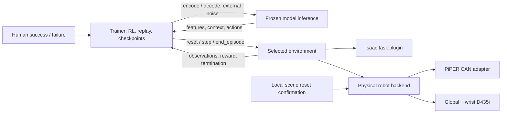

# Physical robot environment and human feedback

PressB can run four node roles: inference, training, simulation, and a physical robot. A rollout selects **one environment endpoint**, either simulation or real hardware. The trainer still owns model calls, DSRL/action residuals, replay, asynchronous learner updates and checkpoints. The physical endpoint owns one robot, fresh camera/state observations, paced action execution and task reset/outcome hooks.



## Boundaries and compatibility

- `runtime/real_robot.py`: one-environment execution, wall-clock pacing, watchdog, observations and task hooks. No model or simulator dependency.
- `robots/base.py`, `robots/piper/real.py`: replaceable hardware adapter; PiPER V2 is implemented first.
- `sensors/realsense.py`: explicit logical-name-to-serial RGB camera mapping. Devices are independently sampled, not hardware synchronized.
- `runtime/real_robot_operator.py`: optional local operator reset/outcome hook. Custom `module:factory` task hooks can implement sensor/vision-based outcomes and task-specific resetting.
- `runtime/human_feedback.py`: optional labels on the **trainer host**, independently usable with simulation or real hardware.

Both environments use schema version 2 and the same `/health`, `/status`, `/reset`, `/step`, `/close_run` operations. The physical backend advertises `environment_type: real_robot`, `num_envs: 1`; the historical wire value `node_type: simulation`, experiment key `nodes.simulation` and runner address `endpoints.simulation` remain compatible. `pressb real_robot` selects the physical service; `--environment` is an alias for the existing `--simulation` endpoint argument.

Backends with an `end_episode(env_ids)` hook advertise `external_episode_end` and accept `/end_episode`. This operation validates run, episode and returned step IDs, calls the backend stop/retire hook, then marks the episode done without another action or physics step. Duplicate request IDs return the cached acknowledgement. The original `/step` response stays unchanged. It supports the native PAP, table-button and elevator backends and PiPER hardware; legacy remote bridges without this capability cannot use early human termination.

The current PiPER action/state ABI is six absolute joint angles in **radians**, plus **full gripper width in metres**. The hardware adapter converts to SDK millidegrees and micrometres. Wall-OSS's model-specific degree/centimetre conversion stays in the model adapter. Pose9 models need an explicit pose-to-joint hardware adapter; they are not silently interpreted as joint commands.

## Install and configure

The robot machine needs Python 3.10 or 3.11, PressB and the hardware extras; no `lerobot-piper`, Wall-X or VLA-JEPA checkout is needed:

```bash
python -m pip install -e '.[real-robot]'
python scripts/real_robot_probe.py --discover --probe-can
```

The reference PiPER SDK conventions are adapted from the user's Apache-2.0 `lerobot-piper` fork. The implementation and attribution live in `robots/piper/real.py`; upstream LeRobot is not imported. The SDK itself (`piper_sdk`) and RealSense library (`pyrealsense2`) remain dependencies.

Start from [`pap_real_walloss_dsrl.json`](../configs/experiments/pap_real_walloss_dsrl.json) or [`pap_real_walloss_eval.json`](../configs/experiments/pap_real_walloss_eval.json). These are commissioning templates, not evidence of a real robot training run. Set:

1. Camera serials for `up` and `wrist`, after checking actual images. Template placeholders intentionally do not guess their mounts.
2. Model/normalization paths on the inference host and local operator directory on the robot host.
3. Reachable endpoints (or SSH tunnels) between the machines. All template servers bind loopback; bind explicitly and configure `token_env` for remote hosting as needed.
4. Hardware CAN name, limits, rate, speed and gripper settings. `actuation_enabled` defaults to `false`; only enable after the arm and its workspace are commissioned. The code does not configure CAN, select master/slave mode, home the arm or reset firmware emergency stop.

Use a dedicated follower CAN connection without a competing controller. Missing/down CAN, absent/stale feedback, driver faults or failed transmissions are errors. The adapter checks SDK timestamps and arrival of each required joint-pair, gripper and driver-status CAN frame. Software limits constrain commanded setpoints, not collision geometry or measured physical speed. A physical emergency stop remains necessary; the SDK emergency stop may allow damped descent and is not a holding brake.

The templates use joint EMA (`alpha=0.8`), six joint command velocity limits and a gripper width-rate limit. EMA history follows the actual hardware-projected command. Set `smoothing.mode: none` to disable EMA. Each action is paced at 30 Hz; overruns do not trigger catch-up bursts. The full executed setpoints are recorded in `info.applied_actions`.

```bash
pressb validate --config configs/experiments/pap_real_walloss_eval.json
# Inference host:
pressb inference --config configs/experiments/pap_real_walloss_eval.json
# Robot host:
pressb real_robot --config configs/experiments/pap_real_walloss_eval.json
# Trainer host, with endpoint overrides when hosts differ:
pressb eval --config configs/experiments/pap_real_walloss_eval.json \
  --inference ws://INFERENCE_HOST:18231 --environment http://ROBOT_HOST:18201
```

Use `pressb train` with the DSRL template for training, or configure `run.method: action_residual` and its residual scales/frozen DSRL settings as in simulation. The template executes 8 actions from each 32-action model chunk; this limits the normal delay before a trainer-side human label is handled. Model/inference time adds to that delay.

## Physical reset and task hooks

A reset reads the actual robot state; it never invents initial joint values or teleports the robot. The default task waits for a person to restore the physical scene. On the robot host:

```bash
python -m pressb.runtime.real_robot_operator --directory outputs/pap_real_operator status
python -m pressb.runtime.real_robot_operator --directory outputs/pap_real_operator \
  ready --episode RESET_TOKEN_FROM_STATUS
```

The reset token is local to the operator hook. It differs from the environment `episode_id`, which is created after reset succeeds. Ready signals are single-use and phase/token checked. Normal boundaries hold the measured pose without disabling motors. Reposition the arm through an appropriate external control/teach procedure; `ready` itself does not move it.

A task factory accepts a config and exposes `reset(seed, options)`, `poll()`, `describe()`, `end(reason)`, `status()` and `close()`. `poll()` returns reward/terminated/truncated/success/reason. An optional `evaluate(observation, context)` can evaluate the measured RGB/state once per chunk. Replace this factory to add a task-specific detector or automated reset. The reset seed is logged; it does not randomize physical objects by itself.

The backend's manual task can also supply `success`/`failure` locally when `labels_enabled: true`. The shipped templates set it to `false` because they use trainer-side feedback instead. Its `abort` command requests a backend fault/stop; it is not a task-failure label.

## Optional trainer-side success/failure

Without a reliable real-world detector, task success requires a human label. This is configurable rather than mandatory for every task:

```json
"human_feedback": {
  "mode": "human",
  "directory": "/absolute/path/on/trainer/human_feedback",
  "timeout_s": 300,
  "success_reward": 1.0,
  "failure_reward": 0.0
}
```

`mode: environment` is the default and preserves the environment's rewards and success flags. In human mode:

- Unlabelled nonterminal transitions receive zero reward and `success: false`.
- Human `success` or `failure` supplies the configured reward and ends the episode. Rewards are assigned at the returned chunk boundary; no precise within-chunk event time is inferred from a delayed human label.
- For an early label, the trainer obtains `/end_episode` acknowledgement before storing the transition/resetting. For an already terminal environment, it waits for a label instead of accepting the environment's task result.
- Environment rewards/flags are retained in transition info for auditing. Hardware errors, timeout of the feedback channel and operator aborts remain errors; they are not converted into successful episodes.
- Full terminal observations and nonfused reset are required. Stopping the trainer during a human-label wait cancels it promptly, saves the completed replay/checkpoint, and does not invent a label. The feedback mode and reward values are checkpoint semantics; resuming a checkpoint under a different reward scheme is rejected.

On the trainer host, use the current **environment episode ID** shown by the feedback channel:

```bash
python -m pressb.runtime.human_feedback --directory outputs/pap_real_feedback status
python -m pressb.runtime.human_feedback --directory outputs/pap_real_feedback \
  success --episode EPISODE_ID_FROM_STATUS
# Or:
python -m pressb.runtime.human_feedback --directory outputs/pap_real_feedback \
  failure --episode EPISODE_ID_FROM_STATUS
```

Labels are accepted only for a current episode; stale IDs, duplicate labels and another owner's channel are rejected. For parallel simulation, select the intended episode ID. This is episode outcome feedback, not action teleoperation. A label is applied at a chunk boundary, not an instantaneous emergency stop.

## Bounded dataset replay

[`scripts/replay_real_robot.py`](../scripts/replay_real_robot.py) validates or executes a finite absolute-joint replay plan. Validation is the default and does not connect to hardware:

```bash
python scripts/replay_real_robot.py --plan /path/to/reviewed_plan.json
```

Physical execution additionally requires `--execute --output /path/to/fresh_output_directory`; `--stop-file /path/to/stop_request` provides file-based cancellation. The plan contains explicit SI-unit actions, an expected measured starting pose and tolerance, hardware settings and replay settings. The runner checks the actual pose immediately before enabling and records requested/applied/observed states in `replay.jsonl`. The selected scheduler and adapter policy determine timing and command projection. Normal completion leaves motors enabled; reference mode retains the device's last target, while tracked mode explicitly holds. Neither validation nor execution clears firmware emergency stop.

The finite replay scheduler now supports a `reference` policy based on the
queue-dispatch section of `lerobot-piper/piper_scripts/piper_inference/piper_client.py`:
consume the next action at the configured control frequency, clip the target,
apply the reference per-update delta limits against fresh measured state, and
repeat the final target during a fixed 0.5-second settling interval. It does
not add per-target arrival waits, contact-phase barriers or a five-second
soft-arrival timeout. Existing generated trajectories are not automatically
smoothed again; model action smoothing remains a separate preprocessing step.
Set `replay.reference_chunk_size` to an explicit positive integer to reproduce
chunk boundaries (the original online client defaults to 32 actions). Omit it
or use `null` to dispatch a finite generated trajectory as one queue, with one
settling interval at the end. `replay.control_hz` controls the send frequency.

The reference policy reports command dispatch completion, not measured target
arrival or physical task success. The old `tracked` scheduler remains available
for reproducing earlier runs. Library plans without a policy retain `tracked`;
the CLI selects `reference` when neither the plan nor the command line specifies
one. An explicit plan policy is preserved, and `--execution-mode` overrides it.
Inspection prints the effective policy without importing the hardware driver:

```bash
python scripts/replay_real_robot.py --plan /path/to/reviewed_plan.json \
  --execution-mode reference
```

Reference replay selects `robot.command_policy: reference`. This policy bounds
sent targets by the intersection of the original client's range and the
configured device range, but does not reject a finite measured joint angle
solely for falling outside that target range. It sends valid targets directly
for device interpolation at the configured `speed_percent`; the extra software
slew projection is not applied. `joint_speed_rad_s` and `gripper_speed_m_s` are
therefore not guarantees of physical speed in reference mode. Trajectory
sampling, original per-update delta limits and device speed remain distinct.
The default adapter policy `projected` preserves historical behavior, including
measured-angle startup checks and software slew; tracked replay uses it.

Reference `hold`/`close` do not publish a new joint target or disable motors,
following the original bus's disconnect behavior. The last device target can
continue executing after dispatch ends; command completion is not an arrival
test. Faults and cancellation still request stop. Fresh-feedback/fault checks,
initial-pose matching, manual stop and the control watchdog remain. This neither
changes firmware limits nor clears a latched emergency stop. Reference mode
does not use tracked grasp-monitor
fields to gate actions and records that distinction; it rejects a native
startup-recovery block instead of silently executing a different startup
procedure. Source-level comparison applies to the queue-dispatch rules, not
the original client's entire inference, UI, idle-return or error lifecycle.

On 2026-11-07 this policy passed 429 related tests, including four comparisons
against the original client's unchanged control loop with smoothing disabled.
Targets and send timing matched, including the terminal settling tick. The
actual PressB adapter with a dynamic fake MCU dispatched all 1,188 actions of
the archived grasp plan; this verifies dispatch, not physical grasp success.
The update was deployed to `ssh piper`, with previous source files backed up;
remote inspection selected `reference` and reported `executed: false`. CAN TX
remained unchanged. No reset, enable or physical motion was performed for this
update. See [the verification record](results/piper_reference_execution_20261107.json).

The subsequent adapter alignment passed **475 related tests**, including 27
actual-adapter/fake-SDK integration checks, and was deployed before an
operator-authorized physical test. A fresh 900-action home plan completed in
30.812 seconds at 1% device speed, with 0.070° final joint error. The subsequent
2,146-action grasp completed in 72.378 seconds at 2% device speed, including
opening and retreat, without a stop or execution error. Continuous global and
wrist footage independently shows the green cube lifted and returned to the
table. This is one physical trial, not a success-rate evaluation or a complete
camera calibration. The executor keeps `task_success: null`; visual assessment
is separate. See [the physical verification record](results/piper_reference_grasp_retry_20261107.json).

The PiPER adapter rejects out-of-range startup feedback by default. A reviewed plan can explicitly allow at most 3° per joint through `joint_startup_recovery_tolerance_rad`, with a finite `startup_recovery_timeout_s`. This only permits a bounded, inward approach from the measured starting excursion; action targets still have to be within nominal limits. `startup_recovery_feedback_slack_rad` allows at most 0.25° of measured settling per joint (default 0.002°), bounded by both the original excursion and the best excursion reached, plus the configured slack, and by the total startup tolerance. It cannot accumulate outward drift. Ordinary recovery allowance clears once the joint enters its normal range; explicit native recovery retains only its original J2/J3 allowance until stable interior arrival. This software mechanism does not calibrate joint zeros, change firmware limits or prove collision clearance.

An optional `native_startup_recovery` plan block now invokes `recover_startup_native` before ordinary replay commands. It is **off by default**. From fresh measured feedback, it sends a complete nominally valid MOVE J target at 1% device speed, moving only initially out-of-range J2/J3 to at most 1° inside their limits while holding other joints and the gripper. This explicitly uses the device's motion planning instead of the ordinary reference-slew rule for that startup phase. The caller must first verify the six firmware speed limits and their units; the method does not query/change firmware settings, enable motors or clear an emergency stop.

Native recovery is bounded to 4° total joint travel and 20 seconds. It checks measured speed against 5°/s using advancing CAN timestamps over at least 0.2 seconds, nonrecovering-joint drift against 1°, and gripper drift against 1 mm. Arrival requires fresh feedback within 0.25° of the target for at least 0.5 seconds, with all joints nominally in range. Existing feedback, fault, cancellation and watchdog checks remain active. On completion, ordinary replay starts from the measured recovered pose; a recovery fault latches stop. These are software guards and do not constitute a physical speed or collision guarantee.

Set `"check_inward_progress": false` inside the `native_startup_recovery` block to disable the extra monotonic-feedback check during native recovery. The default is `true`. With `false`, the originally recovering J2/J3 use their fixed `joint_startup_recovery_tolerance_rad` boundary (still capped at 3°); feedback no longer has to remain within 0.25° of its best inward progress. Only these two native-phase checks change: the shrinking feedback boundary and observed-progress reversal check. Targets must still point inward and lie within nominal limits. Initial-pose matching and connect/enable checks, all travel/speed/drift/deadline/fault/stop checks, and stable arrival remain active. The selected policy is recorded in dry-run summaries, native samples and status. Scope exit restores ordinary checks, including on failure, and retired joint exceptions cannot reopen.

This option does not establish that a startup position jump is harmless: a discontinuity may still trigger the independent measured-speed or travel guard. It does not automatically enable, reset, home or grasp. The 2026-11-07 change was validated offline; no physical motion was performed to validate the disabled monotonic policy.

The first physical native-recovery test exposed a boundary-handling bug: the shared feedback check cleared a joint's recovery allowance immediately on touching the nominal boundary, before native recovery reached its stable interior target. A subsequent small outward reading then triggered strict-limit rejection. The native-only deferred-retirement fix subsequently passed offline validation and one physical approach to PAP episode 144's initial pose. A later run completed that episode's full trajectory on an empty table, as recorded below.

## Timing and current verification scope

Discounts use executed control ticks, excluding inference and manual reset waits, matching the existing chunk-level RL contract. `info.physics_steps` is retained for protocol compatibility and explicitly means **hardware control ticks** for a real backend. `info.hardware_control_steps` and wall-clock timing distinguish it from simulated physics.

The control watchdog runs independently of HTTP/model waits and latches a timeout even if a driver call is blocked. Stop transmission still waits for an in-flight SDK/kernel call to return; this is not a hard real-time emergency-stop guarantee. If an active episode receives no successful control/observation progress within its configured interval, it requests stop and latches a fault. Missing CAN cannot produce an RL observation or a fake successful transition. SIGTERM/Ctrl-C closes the node and camera pipelines; failed infrastructure execution is never retried automatically.

In the first probe on 2026-11-07, `ssh piper` exposed two D435i devices, serials `243322073170` and `261622078356`, and no CAN interface. Both 640×480 RGB streams were captured at a configured 30 FPS; 30 paired probe batches had advancing frame IDs/timestamps. Close, reopen/read and final close passed, with no remaining video-device holder. Probe throughput includes image saving and is not a robot rollout benchmark. These first captures were dark, so the physical mapping was not established at that stage. Later images confirmed `up/global = 261622078356` and `wrist = 243322073170`.

Local artifacts: `outputs/real_robot_20261107/camera_verification.json`, `cameras/probe.json`, and `node_probe/verification.json`. CPU tests use explicit fake hardware to verify wire negotiation, pacing, fault handling, DSRL/residual replay/updates, and human-label overrides. Existing formal PAP residual training remains paused.

Later on 2026-11-07, the USB-CAN adapter was attached and the operator activated `can0` using `sudo ip link set can0 up type can bitrate 1000000`, as documented in the reference PiPER setup guide. A 10-second receive-only probe verified six-joint and gripper feedback at approximately 200 Hz, with zero CAN RX/TX errors and zero transmitted frames. The isolated probe environment uses `piper_sdk==0.6.2` and `python-can==4.6.1`; 100 SDK samples had advancing joint/gripper timestamps, normal arm status and no reported motor faults. All SDK sends were blocked by the probe, and the motors remained disabled.

The PressB adapter did **not** complete that read-only connection with its default limits: measured J2 was −1.507° (configured lower bound 0°) and J3 was +2.381° (configured upper bound 0°). This was a feedback-range rejection, not missing CAN traffic. That test did not change limits or issue calibration commands. See `docs/results/piper_can_connection_20261107.json` and the raw evidence in `outputs/piper_connection_20261107/`.

### 2026-11-07 startup attempt: stopped before dataset replay

PAP episode 144 from `/home/pengguanqi/Datasets/piper_pap_20260606_offset` was selected after checking its action ranges. The reviewed conversion is arm degrees to radians and full gripper opening centimetres to metres, following the reference robot driver; no additional offset was inferred from the dataset name. The first target is `[-1.687, 25.062, -25.171, -4.869, 40.370, 5.102]` degrees with the gripper closed.

The first physical attempt enabled control and logged **2 control ticks, 0 completed action rows**, all in the approach-to-first-pose phase. It stopped after approximately 0.297 seconds with `PiPER startup recovery feedback moved outward`. The 0.002° startup feedback slack was too strict for the observed settling: before/after reads showed J2 changing from −1.507° to −1.546° and J3 from +2.381° to +2.513°. The exact first faulting feedback frame was not retained, so these differences do not identify which joint triggered first. The program sent the emergency stop; the recorded motor status reported no collision or driver fault. **The initial pose was not reached and dataset trajectory replay did not start.**

A subsequent query received all six firmware limits: J1 ±150°, J2 [0°, 180°], J3 [−170°, 0°], J4 ±100°, J5 ±70°, J6 ±180°. The speed field was originally decoded incorrectly as 0.3 rad/s. The later firmware query confirmed S-V1.8-7, for which raw 300 means **3.0 rad/s**; `firmware_limits_corrected.json` preserves the corrected interpretation, and the original query bytes/artifact remain unchanged. These were query-only commands; no firmware limits were changed. Before the operator-authorized reset described below, read-only feedback had `arm_status = 1` (emergency stop), `error_code = 0`, all six motor enable flags true and all reported motor fault flags false.

The follow-up plan only approaches episode 144's first pose, using the queried limits, 30 Hz control, a 5°/s joint command cap, 10 mm/s gripper command cap, and 5% SDK speed setting. J2/J3 explicitly permit up to 3° startup excursion for 10 seconds and 0.25° feedback slack; other joints retain zero startup excursion allowance. It first passed local and remote dry-run validation (`executed: false` in those validation reports); deployment for validation sent no robot commands. The corresponding PiPER, replay, physical backend and wiring test suites passed **208 tests**. Its subsequent physical attempt is recorded below; those software tests did not establish successful physical motion.

In the installed `piper_sdk==0.6.2`, `ResetPiper()` and `EmergencyStop(0x02)` both send `MotionCtrl_1(0x02, 0x00, 0x00)` on CAN ID `0x150`. The SDK explicitly states that this reset removes motor power and can let the arm fall. It was therefore not treated as a harmless status-clear operation, and no automatic reset/retry was performed.

The two-camera recording contains 427 independently sampled pairs, and both pipelines closed. `outputs/piper_replay_20261107/startup_attempt_d435i.mp4` is the short recording around this stopped startup attempt, **not a successful dataset replay video**. The machine-readable snapshot is [`results/piper_replay_20261107.json`](results/piper_replay_20261107.json); raw summaries, joint feedback, firmware responses, tested plans and executed source copies are in `outputs/piper_replay_20261107/`. Complete dataset replay, grasping, physical task success and physical online RL remain unverified.

### Operator-authorized reset before the second attempt

After the operator explicitly confirmed that the arm was supported and authorized one reset, a single CAN `0x150` frame with payload `0200000000000000` was sent. This operation sent no enable or motion commands. `reset_run_01/report.json` records that one send attempt and the received status frames; reset was not repeated automatically.

The subsequent 100-sample read-only probe (`after_reset_feedback.json`) reported `arm_status = 0`, `error_code = 0`, all six motors disabled and all reported motor fault flags false; it transmitted zero CAN frames. The measured joints at that stage were `[2.863, -1.596, 2.429, -1.687, 21.390, -2.373]` degrees, with zero gripper opening. Comparison of `before_reset.jpg` and `after_reset.jpg` showed no obvious large displacement. That visual check does not establish that the arm is mechanically supported or safe to enable.

`home_plan_after_reset.json` refreshed the expected starting pose from this feedback and passed dry-run validation. Execution waited for the operator's explicit hands-clear confirmation.

### Second approach attempt: stopped by the startup command envelope

After the operator confirmed hands clear and authorized the approach, `home_run_01` attempted the first-pose motion. It logged **7 control ticks, 0 completed action rows** over approximately 0.505 seconds and stopped with `PiPER projected setpoint exceeds the active startup recovery envelope`. The software command-envelope check triggered the stop; the recorded motor status reported no collision or driver fault. The initial pose was not reached and dataset trajectory replay did not start.

The read-only probe after this second attempt (`after_home_attempt_feedback.json`, 100 samples, zero transmitted frames) reported `arm_status = 1`, `error_code = 0`, all six motor enable flags true and all reported motor fault flags false. Its last joint feedback was `[2.863, -1.493, 1.891, 0.000, 23.089, -2.267]` degrees, with zero gripper opening. Software emergency stop was latched again; no automatic retry followed. `after_home_attempt.jpg`, `home_run_01/summary.json` and `home_run_01/replay.jsonl` preserve that attempt's evidence. A separately authorized second reset and third approach attempt are recorded below.

The subsequent [reference control-path audit](results/piper_control_reference_audit_20261107.md) confirms equivalent position units and MOVE J mode, but different startup targets and constraints. The reference directly sends a valid fixed idle pose; PressB's small recovery references conflicted with its shrinking feedback envelope. The audit includes source hashes, three hardware-free SDK encoding comparisons and the firmware speed-unit correction. Additional diagnostic coverage passed 213 tests after the failed attempt.

The explicit native recovery implementation described above subsequently passed **332 related software tests** and an independent integration run using a **fake MCU only**. Local and remote dry-run outputs for `home_plan_native_prepared.json` were identical and both said `executed: false` at that preparation stage. The deployed code uses verified firmware maxima of 3 rad/s, 1% SDK speed for both recovery and the following ordinary approach, and a 0.5° ordinary arrival tolerance. The integration's assumed target clipping and simplified dynamics do not establish actual firmware behavior.

### Third approach attempt: enabled, then stopped at the nominal boundary

The operator explicitly authorized a second reset while supporting the arm. `reset_run_02/report.json` records one reset frame, and `after_reset_02_feedback.json` confirms the cleared stop, zero error code and six disabled motors. After a separate hands-clear confirmation, `home_plan_native_after_reset_02.json` was executed as `home_native_run_01`. It failed after **1.234 seconds**, with **43 native-feedback records, 0 ordinary control ticks and 0 completed action rows**. Neither native recovery nor approach to the PAP initial pose completed; dataset replay did not start.

The motors were enabled before the recovery phase. `native_enable_feedback_transitions.json` shows all six driver enable bits changing from false to true between **16:59:21.937 and 16:59:22.017 CST**; the first native-feedback record follows at 16:59:22.044. `native_enable_audit.json` records the decoding and enable-sequence comparison. As in the reference, connection sends `EnableArm(7)` and gripper enable; PressB additionally waits for driver feedback. The receive-only CAN recorder cannot establish absence of SDK commands from missing transmit frames: the SDK disables local loopback, so those transmitted frames are not visible to that separate passive socket.

Raw feedback in `home_can_03/frames.jsonl` identifies the stopping sequence: J2 reached exactly 0° at Unix time `1794041962.9158902`, then read −0.052° at `1794041962.9413748`. The code retired J2's startup allowance on the zero reading; the next small negative value therefore raised `PiPER feedback is outside configured joint/gripper limits`. The first emergency-stop status follows at `1794041962.965425`. This is a software boundary-retirement bug, rather than evidence that the motors were never enabled.

The fix retains only the original J2/J3 recovery allowance throughout native recovery, releasing it after stable interior arrival or phase exit, and rejects reversed recovery targets before sending. The 0.25° feedback cap and ordinary strict limits remain unchanged. **339 related software tests passed** (`native_boundary_regression_tests_final.log`). An independent fake-MCU replay uses the 43 recorded feedback samples plus the observed −0.052° return: the old code reproduces the failure, while the final corrected code completes the simulated home sequence with zero illegal targets, 108 native samples, 416 ordinary ticks and maximum final joint error 0.451°. Its 16.003 seconds are virtual time. A −0.251° return still triggers rejection. The correction is deployed with matching local/remote source hashes and a remote dry run reporting `executed: false`, recorded in `native_boundary_deployment.json`. Deployment itself sent no reset or motion; the separately authorized third reset is recorded below.

The read-only feedback after this native attempt (`after_native_home_feedback.json`, 100 samples, zero transmitted frames) had joints `[2.861, -1.411, 1.696, 0.000, 23.740, -2.346]` degrees, zero gripper opening, `arm_status = 1`, `error_code = 0`, six enable flags true and no reported motor faults. The arm was left in software emergency stop pending a separately authorized reset. `home_native_attempt_d435i.mp4` is a 7.305-second actual-time recording labelled as a stopped attempt.

### Third authorized reset before the successful approach

`reset_run_03/report.json` records one operator-authorized CAN `0x150` reset frame (`0200000000000000`) at Unix time `1794042535.913374`. No enable or motion command accompanied it. The subsequent 100-sample read-only check (`after_reset_03_feedback.json`) transmitted zero frames and confirmed `arm_status = 0`, `error_code = 0`, all six motors disabled and no reported motor faults. The latest joints are `[2.862, -1.511, 0.743, 4.392, 30.117, -2.335]` degrees with the gripper closed; `after_reset_03.jpg` records the camera view.

`home_plan_native_after_reset_03.json` refreshed the expected pose from this feedback. Its local and remote dry-run reports matched and both said `executed: false` before the subsequent execution. The deployment artifact's earlier latched-stop note is historical and has not been overwritten.

### Successful physical approach: PAP episode 144 initial pose only

After the operator confirmed hands clear, `home_native_run_02` successfully executed the one-target plan in **16.237 seconds** at 1% device speed. Native recovery completed in **1.951 seconds**, with 93 feedback records; ordinary approach then completed 408 control ticks and **one action row**. Maximum joint arrival error was **0.454°**, within the 0.5° criterion. `home_native_success_audit.json` and the passive CAN feedback confirm that all six motors were enabled before native recovery began.

The subsequent 100-sample read-only check (`after_native_home_02_feedback.json`, zero transmitted frames) reported joints `[-1.691, 24.917, -24.717, -4.792, 40.323, 5.047]` degrees, zero gripper opening, `arm_status = 0`, `error_code = 0`, all six motors enabled and no reported motor faults. That run held the initial pose without an emergency stop, and its camera/passive CAN recordings were closed before the later full-episode run.

This home run validated initial positioning only: its plan contained episode 144's action 0. `pap_home_success_d435i.mp4` is an approximately 20.3-second actual-time recording with before/after footage, played at 1×; the robot itself used 1% device speed. Executed adapter/runner source copies are preserved as `executed_native_home_02_piper_real.py` and `executed_native_home_02_real_replay.py`.

### Successful complete episode: empty-table physical replay

The user then requested the complete **episode 144, 342 frames**, not the dataset's entire 500 episodes. `full_episode144_run_01` completed **342/342 actions and 3,944 control ticks in 135.524 seconds** using `episode144_full_plan_01.json`. The run started from nominal joint positions, required no reset or native recovery, and set all startup-recovery allowances to zero. Device speed remained 1%, with joint-reference slew capped at 5°/s and gripper-reference slew at 10 mm/s. Across all action arrivals, the largest joint error was **0.499°** and gripper error **1 mm**.

The original episode's timestamps span **11.367 seconds**. Execution was retimed to the configured limits and tracking feedback; the 135.524-second run does not preserve the original 30 Hz action timing. This verifies complete trajectory execution on an **empty table**, not object grasp/place success, a success-rate evaluation, model inference or physical online RL. The source adapter and runner are archived as `executed_full_episode144_piper_real.py` and `executed_full_episode144_real_replay.py`; `full_episode144_audit.json` records the action coverage and arrival checks.

The [dual-camera recording](/home/pengguanqi/Workspace/Research/PressB/outputs/piper_replay_20261107/full_episode144_d435i.mp4) is 139.52 seconds at actual execution speed (1×), including approximately two seconds before and after: global view on the left and wrist view on the right. These cameras are not hardware synchronized. Replay, camera capture, passive CAN capture and read-only probe processes have all exited.

The latest read-only probe (`after_full_episode144_feedback.json`, 100 samples, zero transmitted frames) reports final joints `[-10.621, 27.116, -26.308, -6.519, 42.856, 4.695]` degrees, closed gripper, `arm_status = 0`, `error_code = 0`, all six motors enabled and no reported faults. **The arm now holds the dataset's final pose, which differs from its initial pose, and remains enabled with no emergency stop.** The complete physical record includes three prior failed approaches, three authorized resets, one successful home approach and one successful full-episode replay. Object-transfer outcomes and physical online RL remain unverified.


### Optional contact-aware tracked replay (2026-11-07)

This historical policy applies only to `execution_mode: tracked`. The CLI's
default `reference` policy does not apply these contact or arrival gates.

`ReplayPlan` accepts `grasp_policy` together with one `action_modes` entry per action (`position`, `close`, `carry`, `release`). Omitting both retains the existing position-only behavior. The arm must remain stationary during close and release; a finite program must release before finishing. Close requires fresh, distinct CAN samples with an explicit opening interval, effort interval, low opening velocity and contact dwell. These signals establish a loaded contact hypothesis, not object identity or visual grasp success.

An acquired close/carry exempts the soft gripper arrival check. A bounded initial release transition also permits gradual opening targets to advance past the last trusted contact opening: the target must remain below that opening and the measured width, with both feedback samples inside the configured opening window. This exception retires permanently when the target reaches the remembered or measured opening; its original tracking deadline accumulates across action rows. Opening beyond this transition must satisfy ordinary position tracking and the final release criterion. Arm tracking, hard tracking bounds, feedback age, hardware fault, cancellation and watchdog checks remain active. A failed acquisition prevents lifting; a lost contact stops subsequent trajectory commands and holds the arm. For an acquired grasp, `PiperHardware.hold_grasp(gripper_target_m=...)` and subsequent `close()` preserve the exact previously applied clamp target without increasing effort. Hardware/control faults still request the latched stop. Ordinary `hold()` and `close()` retain their previous behavior when grasp hold is not selected. No path automatically resets a stopped robot.

`read_gripper_feedback()` returns a coherent raw CAN 0x2A8 snapshot: full width, signed `effort_raw`, status bits, enabled/fault and source timestamp. Its read paths send no commands. Raw effort is not calibrated gripping force. Tests include the real adapter and runner with a dynamic fake MCU, covering contact/release, empty close, carry loss with clamp-preserving cleanup, effort fault and persistent arm tracking error.

The first physical use of this mode acquired contact but lost it during the first few millimetres of TCP lift. It held without requesting an emergency stop; the operator confirmed the cube was on the table. See [the full attempt record](results/playground_complete_grasp_20261107.json). Software validation is not evidence that physical grasping is solved.

The subsequent 14 mm mounting-height retry also failed physically: the operator
reported gripping without lifting. Its original release implementation stalled
at action 939 because a 28.167 mm target was still below the loaded 35.1 mm
opening, then requested an emergency stop after five seconds. The bounded
release transition above fixes that software deadlock in `tracked` mode. It
was subsequently deployed with the reference-dispatch update, but has **not
been tested on hardware**. Reference mode does not use these arrival/contact
gates. The same dynamic fake MCU and actual
driver reproduce 939/1188 actions with archived original code and complete
1188/1188 with the fix. See [the retry record](results/playground_mount14_grasp_retry_20261107.json).
