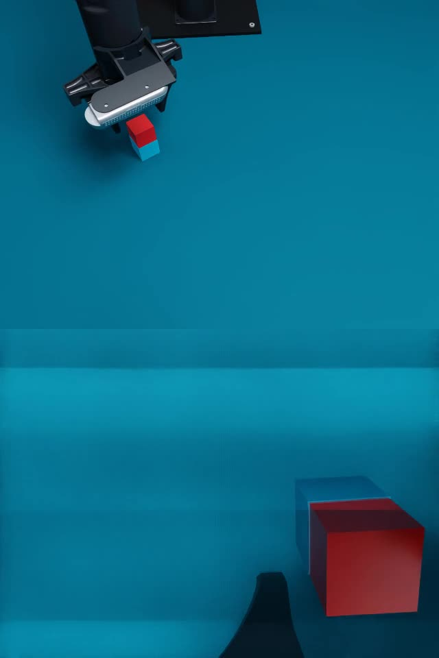

# Cube-stack task validation — 2026-11-09

The `cube_stack` task adds red-on-blue stacking to the pinned Playground workspace
and runs on the common `SharedWorldBackend`. Its template, interfaces and strict
physical outcome are described in the [task guide](../../cube_stack.md).

## Completed evidence

| Check | Result | Scope |
|---|---|---|
| Real workspace capture | Dual RGB-D capture and stationary CAN feedback | Sequential cameras; no motion commands; CAN TX increment zero |
| CPU regression | 3,785 unique tests passed | 3,716 main + 69 additional USD tests; 27 main-suite skips |
| Parallel smoke | Eight environments passed | Seeded layouts, zero-tick indexed reset, unchanged peers, images and executable joint actions |
| Complete physical stacking | Four of four environment demonstrations passed | Two fixed layouts × two environments; full planned grasp/stack/release/return trajectories |

The CPU supplement passed 156 tests, of which 69 were additional to the main
suite. The 101 cube-stack unit/integration cases are included in the total.
The source manifests for 762 Python files were unchanged during that regression.
CUDA parity, a `torchdiffeq` native-expert check and the official LeRobot
writer/reader integration were outside this CPU environment's coverage.

The two environments using the captured layout executed completely using physical contacts,
without object attachment or teleportation during execution. Each lifted the
red cube approximately 78 mm, released it on the blue cube and returned the arm
home. The final red/blue XY errors were 0.119 and 0.130 mm **within simulation**;
these values do not measure real/simulation registration accuracy. The physical
test report says `status=passed`; Kit fast shutdown leaves `closed=false`, while
the operator confirmed exit code 0.

The eight-environment check validates random sampling and execution plumbing.
It does not establish stacking success over the entire random domain. The
fixed-layout demonstration uses a scripted planner, not Wall-OSS or another
learned policy. No real robot grasp was executed in this validation.

An additional sampled XY layout with the fixed real-layout yaw was initially rejected
by the CPU planner at a 90 mm hover height: best position/orientation residuals
were 0.837 mm and 0.013238 rad. It never entered Isaac. A 75 mm alternative
failed the object-clearance validation; 80 mm passed complete CPU planning.
The same XY layout with the 80 mm plan then completed physically in both
environments, including stable stacking and return home. Its plan duration was
29.4 seconds. All attempts remain in the portable summary; changing the hover
height is recorded rather than hiding the initial failure.

## Planner coverage

The default randomization rectangle is a valid placement domain, not a guarantee
that this fixed-vertical scripted planner can complete every layout. A CPU audit
sampled 100 layouts (seeds 2026110900–2026110999, yaw zero) and checked individual
poses with the original bounded IK solver. Acceptance thresholds remained
0.5 mm position error and 0.01 rad orientation error.

| Pose check | IK accepted / 100 |
|---|---:|
| Red grasp at 12 mm | 100 |
| Blue grasp at 12 mm | 100 |
| Placement above blue at 43 mm | 99 |
| Red hover at 90 mm | 66 |
| Red hover at 80 mm | 70 |

These are single-pose solver results, without collision-clearance, complete-path
or physical-contact validation. They show that the current planner does not
cover the full default domain. Four successful demonstrations and eight seeded
reset environments do not establish random-layout or learned-policy success
rates. The [IK summary](ik_summary.json) and [all 100 samples](ik_samples.json)
retain failures and solver residuals.

## Capture and registration limits

The fixed initial layout uses global RGB corners projected through the existing
camera calibration onto the configured cube-top plane: red edge 29 mm at
`[0.331263, 0.102522]` m/yaw −10.51°, blue edge 30 mm at
`[0.326851, −0.083409]` m/yaw 30.36°. Sizes remain estimates. Wrist depth gives a
red-height estimate of 28.72 mm; the blue cube is clipped in the wrist view.
The red global/wrist XY discrepancy is 12.1 mm. Cameras, effective mounting
height and Playground lighting were retained, not refitted to hide that error.

The real capture had zero joint-angle range over the sampled interval and zero
CAN TX increment. Its cameras were sampled sequentially rather than hardware
synchronized. The real/simulation preview uses the measured pose only for
static optical comparison; task reset home remains the pinned template pose.

## Demo and provenance

The published video copies environment 0's physical-run recording: H.264,
640 × 960, 30 fps, 953 frames, 31.766667 seconds, original simulation speed.
Global view is above wrist view. Complete decoding was checked on publication.

- [Portable values, source fingerprints and media identities](summary.json).
- [IK coverage](ik_summary.json) and [sampled IK cases](ik_samples.json).

Full evidence remains local under `outputs/cube_stack_20261109/`; those files
are not distributed in a Git clone. Paths relative to that directory:

- Capture access audit: `real_capture/access_audit.json`; geometry analysis: `real_capture/analysis_final/measurements.json`.
- Eight-environment smoke: `parallel_8env/result.json`.
- Physical stacking report: `stack_fixed_2env/report.json`.
- Second layout: `stack_alternate_2env_080/report.json`; initial rejected plan: `stack_alternate_2env/report.json`.
- CPU regression receipt: `cpu_regression/summary.json`.
