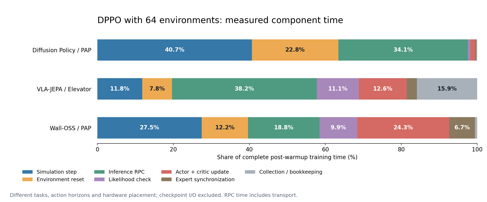

# DPPO: 64-environment throughput and resource measurements

All three workloads completed real optimization and versioned expert publication. These are short throughput experiments, not new success-rate evaluations.

| Model / task | Transitions | Training loop (min) | Post-warmup transitions/s | Minutes per 10k at this rate |
|---|---:|---:|---:|---:|
| Diffusion Policy / PAP | 10,752 | 9.91 | 17.554 | 9.49 |
| VLA-JEPA / Elevator | 12,288 | 33.81 | 5.897 | 28.26 |
| Wall-OSS / PAP | 4,096 | 41.25 | 1.740 | 95.77 |

A transition is one environment action-chunk interaction, not an episode. The training-loop column includes learner initialization and warmup; inference and simulation services were already ready. The normalized 10k column is a conversion, not another experiment. All checkpoint writes were explicitly skipped, including the final save.

## Configuration

| Model | Per-environment rollout | Global PPO batch | Executed action prefix | Denoising steps | Inference microbatch | Rendered image | Hardware |
|---|---:|---:|---:|---:|---:|---|---|
| Diffusion Policy | 12 | 768 | 8 | 10 | 8 | 640×480 | 2 local RTX 5090 |
| VLA-JEPA | 24 | 1536 | 7 | 4 | 4 | 224×224 | 2 local RTX 5090 |
| Wall-OSS | 4 | 256 | 32 | 10 | 8 | 640×480 | 1 local RTX 5090 + 2 H200 |

DP and VLA-JEPA used local GPU0 for simulation and GPU1 for inference plus the learner. Wall-OSS used local GPU0 for simulation, H200 GPU1 for inference and H200 GPU2 for the learner. Experiments ran sequentially on their selected GPUs. Unrelated H200 GPU0 work is excluded from task/GPU summaries; whole-host counters still include background work.

DP and VLA-JEPA exclude two critic-only warmup rounds from steady throughput. Wall-OSS retains its historical zero-warmup algorithm, but discards the first two complete actor rounds from the timing window. DP/VLA steady timing begins at collect round3; Wall begins at round_end2. Resource windows start at round_end2; sub-millisecond/millisecond alignment details and cross-host clock offsets are retained in summary.json.

## Component time

| Component | Diffusion Policy | VLA-JEPA | Wall-OSS |
|---|---:|---:|---:|
| Simulation step | 213.52 s (40.7%) | 184.11 s (11.8%) | 565.58 s (27.5%) |
| Environment reset | 119.57 s (22.8%) | 122.27 s (7.8%) | 251.36 s (12.2%) |
| Inference RPC | 178.90 s (34.1%) | 596.48 s (38.2%) | 387.71 s (18.8%) |
| Likelihood check | 3.56 s (0.7%) | 172.92 s (11.1%) | 203.93 s (9.9%) |
| Actor + critic update | 6.80 s (1.3%) | 196.34 s (12.6%) | 499.53 s (24.3%) |
| Expert synchronization | 1.30 s (0.2%) | 41.98 s (2.7%) | 138.93 s (6.7%) |
| Collection / bookkeeping | 1.36 s (0.3%) | 248.73 s (15.9%) | 12.33 s (0.6%) |

Each column covers its own full post-warmup window. Nested timing is exclusive: verification and publication are removed from optimization, and simulation/inference RPCs are removed from collection overhead. Actor and critic updates were timed together. RPC time includes transport, serialization and server work; encoder and denoising GPU costs were not independently measured. [Detailed call counts and mean latency](component_timing.csv).

## Hardware in the same post-warmup windows

| Model | Host / GPU | Mean GPU utilization | Peak used VRAM (GiB) | Peak capacity occupancy | Mean / peak power (W) |
|---|---|---:|---:|---:|---:|
| Diffusion Policy | local / 0 | 50.9% | 15.19 | 47.7% | 281.4 / 466.9 |
| Diffusion Policy | local / 1 | 3.9% | 1.84 | 5.8% | 76.7 / 137.0 |
| VLA-JEPA | local / 0 | 11.9% | 7.79 | 24.5% | 108.1 / 371.4 |
| VLA-JEPA | local / 1 | 11.5% | 27.32 | 85.8% | 129.1 / 294.4 |
| Wall-OSS | local / 0 | 22.6% | 15.25 | 47.9% | 144.6 / 459.1 |
| Wall-OSS | h200 / 1 | 10.2% | 9.78 | 7.0% | 129.5 / 393.4 |
| Wall-OSS | h200 / 2 | 30.1% | 52.45 | 37.4% | 197.4 / 422.7 |

Resources were sampled every two seconds, so brief peaks can be missed. Device totals include display/runtime contexts, including any secondary Isaac context. Capacity occupancy means used VRAM / total VRAM and is distinct from memory-controller activity.

| Model | Host | Mean host CPU | Min available host RAM (GiB) | Peak task RSS (GiB) | Host swap in / out (MiB) |
|---|---|---:|---:|---:|---:|
| Diffusion Policy | local | 9.9% | 40.74 | 16.30 | 0.59 / 0.00 |
| VLA-JEPA | local | 65.5% | 37.37 | 19.90 | 4.47 / 0.00 |
| Wall-OSS | local | 5.4% | 43.90 | 12.32 | 2.14 / 0.00 |
| Wall-OSS | h200 | 4.0% | 481.05 | 11.69 | 0.00 / 0.00 |

Task RSS sums may double-count shared pages. Host CPU, RAM, swap, disk and network totals are background measurements, not exclusive job attribution. Existing swap occupancy is not counted as newly swapped data. Sampled startup and monitor-lifetime resource windows, per-role CPU/RSS, identities, query errors and sampling gaps are retained in [summary.json](summary.json). The H200 monitor started immediately after the learner launch, after Wall inference was ready: inference-loading resource peaks were not captured. Subsequent complete steady training windows are covered.

## Historical references and interpretation

| Model | Prior smaller-environment steady transitions/s | Current 64-environment steady transitions/s | Observed ratio |
|---|---:|---:|---:|
| Diffusion Policy | 18.131 | 17.554 | 0.968× |
| VLA-JEPA | 6.389 | 5.897 | 0.923× |
| Wall-OSS | 1.899 | 1.740 | 0.916× |

These ratios are historical references, not an isolated environment-count ablation: old runs shared hardware, DP/VLA old windows included checkpoint overhead, and per-environment rollout/GAE truncation changed while each model's global PPO batch was kept fixed. Actual minibatch counts, KL stops and publication hashes are in each report. Different tasks, action horizons, camera resolution and hardware prevent a controlled cross-model ranking. No new DSRL run was performed; these measurements alone do not establish a matched DPPO/DSRL speed comparison.

Raw configs, status, metrics, RPC logs, phase events, hardware samples, source hashes and cleanup receipts are under `outputs/dppo_64env_benchmark_20261108/<model>/`. Portable source hashes are in summary.json. The DP monitor began before an exact launch-source archive was made; its later a6 snapshot is not claimed as the exact running source. Normal recorded samples and the independent raw-data audit remain available. Per-run collector paths, hashes and provenance limitations are retained in summary.json; an AST-equivalent collector is not presented as an identical full source file.

See [DPPO documentation](../../dppo.md#measuring-throughput-and-component-time) and [resource monitoring](../../runtime_resource_monitor.md) for reusable tools.
