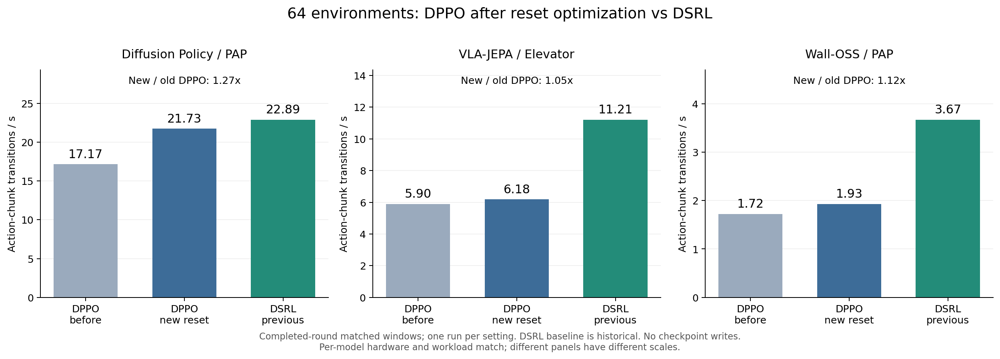
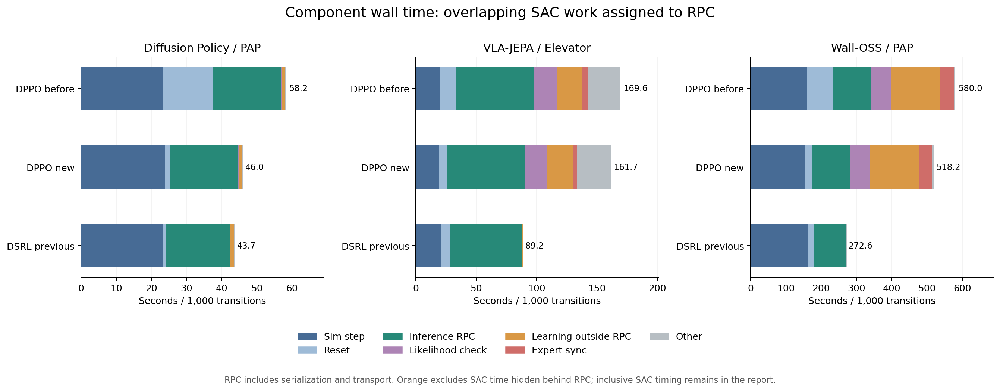

# DPPO after batched reset: 64-environment comparison

Fresh DPPO runs with batched per-environment reset seeds are compared with the sealed previous DPPO and DSRL runs. All runs perform real optimization. DSRL was not rerun for this report. These short runs measure execution speed, not convergence or success-rate improvement.

| Model / task | Transitions | DPPO before | DPPO now | DSRL previous |
|---|---:|---:|---:|---:|
| Diffusion Policy / PAP | 10,752 | 9.91 min | 8.16 min | 7.77 min |
| VLA-JEPA / Elevator | 12,288 | 33.81 min | 32.50 min | 17.85 min |
| Wall-OSS / PAP | 4,096 | 41.25 min | 37.43 min | 18.36 min |

A transition means one environment executing one action chunk. Full-loop time includes learner initialization and native warmup with simulation/inference services already ready; shutdown is excluded. All periodic and final checkpoint writes are skipped as in the previous benchmark. The stopped 200k run remains stopped.

## Matched throughput

| Model | Range | Before t/s | New t/s | DSRL t/s | New / before | DSRL / new |
|---|---:|---:|---:|---:|---:|---:|
| Diffusion Policy / PAP | 2,304–10,752 | 17.173 | 21.733 | 22.889 | 1.266× | 1.053× |
| VLA-JEPA / Elevator | 3,072–12,288 | 5.897 | 6.184 | 11.209 | 1.049× | 1.813× |
| Wall-OSS / PAP | 2,048–4,096 | 1.724 | 1.930 | 3.668 | 1.119× | 1.901× |

Boundaries are completed round/batch events. DP/VLA/Wall retain inference microbatch B8/B4/B8, execution horizon H8/H7/H32, denoising steps K10/K4/K10, and critic warmup 2/2/0. DP and VLA use local RTX 5090 GPU0 for simulation and GPU1 for inference+learning. Wall uses local GPU0 for simulation, H200 GPU1 for inference and GPU2 for learning. PAP renders 640×480; Elevator renders 224×224.

| Model | New DPPO matched critic / actor minibatches | Published versions | Verified denoising pairs |
|---|---:|---:|---:|
| Diffusion Policy / PAP | 330 / 330 | 11 | 84,480 |
| VLA-JEPA / Elevator | 288 / 288 | 6 | 36,864 |
| Wall-OSS / PAP | 640 / 640 | 8 | 20,480 |

## Reset and component times

| Model | DPPO old reset s / calls / envs | DPPO new reset s / calls / envs | DSRL reset s / calls / envs |
|---|---:|---:|---:|
| Diffusion Policy / PAP | 119.57 / 129 / 129 | 12.48 / 14 / 128 | 6.73 / 7 / 128 |
| VLA-JEPA / Elevator | 122.27 / 320 / 320 | 61.62 / 120 / 303 | 68.31 / 129 / 319 |
| Wall-OSS / PAP | 151.10 / 155 / 155 | 38.17 / 29 / 145 | 39.35 / 29 / 156 |

Old DPPO issued one reset RPC per ended environment; new DPPO issues one RPC for the done set with individual seeds. Actual reset environment counts are joined from reset and episode logs. Final-budget terminal slots are not reset. Batching changes render history, so matched seeds do not imply identical images, trajectories, episode outcomes or optimization work. This is a current-implementation end-to-end rerun, not a reset-only causal experiment.

Component bars are an exclusive wall-time partition. For DSRL, SAC updates overlapping RPC are assigned to RPC; learning shows only unhidden time. RPC includes encoding, serialization, transport and server work; these are not CUDA-only kernel timings. Full inclusive SAC intervals and actual optimizer counts are retained in summary.json.

## Resources in matched windows

| Model | Method | Host / GPU | Mean GPU utilization | Peak used VRAM | Mean power |
|---|---|---|---:|---:|---:|
| diffusion_policy | new_dppo | local / 0 | 39.9% | 15.25 GiB | 240.0 W |
| diffusion_policy | new_dppo | local / 1 | 4.8% | 1.84 GiB | 87.1 W |
| diffusion_policy | dsrl | local / 0 | 36.7% | 15.25 GiB | 234.5 W |
| diffusion_policy | dsrl | local / 1 | 6.9% | 1.64 GiB | 98.4 W |
| vlajepa | new_dppo | local / 0 | 7.2% | 7.79 GiB | 95.9 W |
| vlajepa | new_dppo | local / 1 | 13.5% | 27.32 GiB | 131.6 W |
| vlajepa | dsrl | local / 0 | 17.5% | 7.79 GiB | 146.5 W |
| vlajepa | dsrl | local / 1 | 20.3% | 11.50 GiB | 157.0 W |
| walloss | new_dppo | local / 0 | 14.7% | 15.25 GiB | 110.2 W |
| walloss | new_dppo | h200 / 1 | 11.3% | 9.78 GiB | 134.6 W |
| walloss | new_dppo | h200 / 2 | 33.0% | 52.45 GiB | 209.4 W |
| walloss | dsrl | local / 0 | 31.4% | 15.25 GiB | 194.2 W |
| walloss | dsrl | h200 / 1 | 20.0% | 9.86 GiB | 160.3 W |
| walloss | dsrl | h200 / 2 | 1.1% | 0.95 GiB | 91.7 W |

New resource monitors start before services and sample every two seconds; short peaks may be missed. VRAM is whole-device usage including runtime/display contexts. Only selected GPUs and owned PID identities enter task metrics; host CPU/RAM/swap still include background activity. CPU process percentages can exceed 100%, and summed RSS can count shared pages more than once. Startup, full-loop, matched windows, role breakdowns and clock receipts are preserved in the machine-readable report.

Native algorithm differences remain: DSRL trains a small asynchronous SAC adapter; DPPO verifies denoising likelihoods, updates the action expert and publishes weights. DPPO stochastic transitions and Wall canonical batching/token shapes differ from native DSRL decoding. Equal interaction budgets do not imply equal learning work or quality. Single short runs do not establish time to reach a target success rate.

[Summary](summary.json) · [Throughput CSV](throughput.csv) · [Component CSV](component_timing.csv) · [GPU and power](gpu_resources.csv) · [CPU/RAM/swap](host_resources.csv)

All owned benchmark services were stopped after collection; source, seed, timing and resource checks passed. DP uses run02: its first driver attempt failed a health-response type check before learner startup, and is excluded from measurements. The independent resource checker was corrected to exclude missing process observations from startup RSS means, matching the frozen collector; training-window results were unaffected and all three audits were rerun. Original receipts are retained.

Raw launch receipts, frozen source/configuration differences, training phases, reset/episode logs and resource evidence: `outputs/dppo_batched_reset_vs_dsrl_20261109/`. Historical baseline: [previous comparison](../dsrl_vs_dppo_64env_20261108/README.md).
