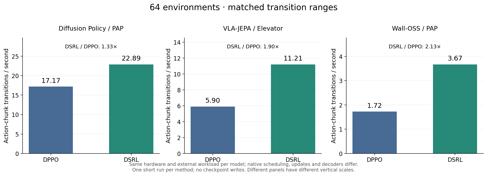
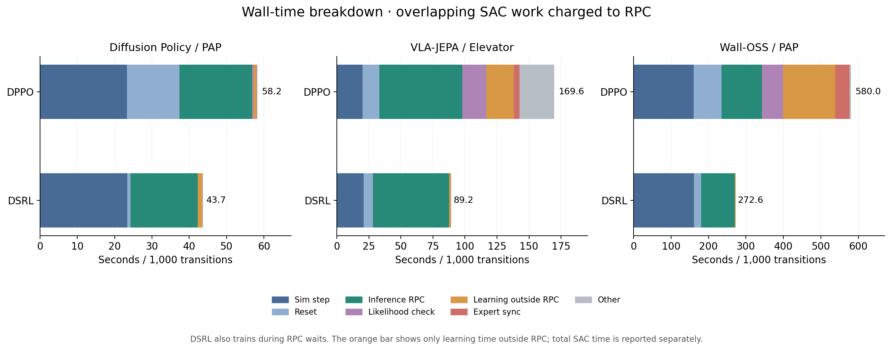

# DSRL vs DPPO: 64-environment training throughput

Three fresh DSRL runs are compared with the completed DPPO64 runs using the same per-model interaction budgets, tasks, pretrained models, rendering, action prefixes, inference microbatches, and GPU placement. Each run performed real optimization. These are short speed measurements, not convergence or success-rate evaluations.

| Model / task | Transitions | DSRL loop | DPPO loop | DSRL / DPPO full-loop speed |
|---|---:|---:|---:|---:|
| Diffusion Policy / PAP | 10,752 | 7.77 min | 9.91 min | 1.27× |
| VLA-JEPA / Elevator | 12,288 | 17.85 min | 33.81 min | 1.89× |
| Wall-OSS / PAP | 4,096 | 18.36 min | 41.25 min | 2.25× |

A transition is one environment executing one action chunk, not one episode. Full-loop time includes learner initialization and the native warmup; the simulation/inference services were already ready. All interval and final checkpoint writes were explicitly skipped. The DSRL benchmark did not save a reusable policy.

## Matched comparison windows

| Model | Transition range | DSRL transitions/s | DPPO transitions/s | DSRL / DPPO |
|---|---:|---:|---:|---:|
| Diffusion Policy / PAP | 2,304 → 10,752 | 22.889 | 17.173 | 1.333× |
| VLA-JEPA / Elevator | 3,072 → 12,288 | 11.209 | 5.897 | 1.901× |
| Wall-OSS / PAP | 2,048 → 4,096 | 3.668 | 1.724 | 2.127× |

Windows run from a completed batch/round boundary to another completed boundary. DPPO was re-summarized from its sealed raw logs; its earlier report used different windows for DP and Wall. DSRL retains its 2,000-transition learning threshold (2,048 random-action transitions at batch64). Neither method was resumed or forced to drain extra updates after its budget.

## Configuration and scope

| Model | Task | Executed prefix | Denoising steps | Microbatch | Camera render | GPU placement |
|---|---|---:|---:|---:|---|---|
| Diffusion Policy | PAP | 8 | 10 | 8 | 640×480 | local 5090 GPU0 sim; GPU1 inference + learner |
| VLA-JEPA | Elevator | 7 | 4 | 4 | 224×224 | local 5090 GPU0 sim; GPU1 inference + learner |
| Wall-OSS | PAP | 32 | 10 | 8 | 640×480 | local 5090 GPU0 sim; H200 GPU1 inference, GPU2 learner |

DSRL uses its native small SAC actor, five-Q ensemble, batch256, hidden256, actor/temperature update every two Q steps, configured UTD1, backlog limit1000 and at most16 updates per RPC wait or loop tail. Its temporal initial-noise controls are DP16, VLA1, Wall32, each with scale1.5. These counts are separate from denoising iteration counts.

Both methods use WebSocket inference and HTTP simulation, full terminal observations and no fused step/reset. DSRL keeps native asynchronous SAC updates and batched resets; DPPO collects synchronously, checks denoising likelihoods, updates the action expert and publishes weights, and its measured implementation resets environments individually. Same seeds do not imply paired layouts or trajectories.

Native decoder differences also remain: DP DSRL uses deterministic DDIM transitions conditioned on initial noise, whereas DPPO adds transition noise; VLA retains native K4 flow decoding while DPPO adds transition std0.002; Wall DSRL uses native BF16 decoding with actual token lengths/cache behavior, while DPPO uses its canonical batch8/token256 scoring path and FP32 latent-chain accumulation with transition std0.03. Thus this is an actual framework-workflow comparison at matched external settings, not an isolated RL-loss ablation or the fastest possible DSRL configuration.

## Component time and asynchronous work

The stacked bars assign overlapping SAC time to the active RPC. The learning segment shows only time outside RPC; total SAC time is larger. RPC includes serialization, transport and server work, not a separate CUDA-kernel profile. Other covers DPPO collection/bookkeeping outside RPC, or DSRL time outside both RPC and SAC intervals.

| DSRL model | Total SAC interval time | Overlaps RPC | SAC outside RPC | Other local time |
|---|---:|---:|---:|---:|
| Diffusion Policy / PAP | 63.36 s | 52.55 s | 10.81 s | 1.27 s |
| VLA-JEPA / Elevator | 93.74 s | 79.87 s | 13.87 s | 1.70 s |
| Wall-OSS / PAP | 15.06 s | 10.82 s | 4.23 s | 1.58 s |

For Diffusion Policy, reset RPC time falls from 119.57 s over 129 calls in DPPO to 6.73 s over 7 calls in DSRL. Simulation step time is similar. Reset RPC is the largest measured reduction. Different trajectories and reset batching both affect this observation; it does not isolate the effect of the RL update rule.

[Per-component exclusive time](component_timing.csv), inclusive per-route timings, exact overlap partitions and logging-cost receipts are retained in [summary.json](summary.json). Cumulative logging costs are reported, not subtracted: some recording can overlap RPC, and the counter does not include every instrumentation operation.

## Actual optimization work

| Model | DSRL Q / actor steps in matched window | DPPO critic / actor minibatches in matched window | DSRL final backlog / dropped credits |
|---|---:|---:|---:|---:|
| Diffusion Policy / PAP | 7,759 / 3,880 | 330 / 330 | 764 / 0 |
| VLA-JEPA / Elevator | 9,184 / 4,592 | 288 / 288 | 46 / 0 |
| Wall-OSS / PAP | 2,016 / 1,008 | 640 / 640 | 46 / 0 |

Equal interaction counts do not imply equal optimization work or learning quality. The SAC Q count is one optimizer step for the whole five-Q ensemble. Actor/alpha/Q optimizer receipts and changed actor hashes were verified; Q parameter hashes were not recorded. Generated update credit equals actual Q updates plus backlog plus dropped credit for every completed batch. No base-model weight publication occurred in DSRL.

## Hardware in the matched windows

| Model | Method | Host / GPU | Mean GPU utilization | Peak used VRAM | Peak capacity occupancy |
|---|---|---|---:|---:|---:|
| diffusion_policy | DPPO | local / 0 | 51.8% | 15.19 GiB | 47.7% |
| diffusion_policy | DPPO | local / 1 | 3.7% | 1.84 GiB | 5.8% |
| diffusion_policy | DSRL | local / 0 | 36.7% | 15.25 GiB | 47.9% |
| diffusion_policy | DSRL | local / 1 | 6.9% | 1.64 GiB | 5.2% |
| vlajepa | DPPO | local / 0 | 11.9% | 7.79 GiB | 24.5% |
| vlajepa | DPPO | local / 1 | 11.5% | 27.32 GiB | 85.8% |
| vlajepa | DSRL | local / 0 | 17.5% | 7.79 GiB | 24.5% |
| vlajepa | DSRL | local / 1 | 20.3% | 11.50 GiB | 36.1% |
| walloss | DPPO | local / 0 | 23.5% | 15.25 GiB | 47.9% |
| walloss | DPPO | h200 / 1 | 10.4% | 9.78 GiB | 7.0% |
| walloss | DPPO | h200 / 2 | 29.9% | 52.45 GiB | 37.4% |
| walloss | DSRL | local / 0 | 31.4% | 15.25 GiB | 47.9% |
| walloss | DSRL | h200 / 1 | 20.0% | 9.86 GiB | 7.0% |
| walloss | DSRL | h200 / 2 | 1.1% | 0.95 GiB | 0.7% |

Two-second sampling can miss short peaks. Device totals include display/runtime contexts. Used-memory capacity occupancy differs from memory-controller activity. Unrelated H200 GPU0 and its processes are excluded; whole-host CPU, RAM, swap and IO counters still include background work. Task RSS sums may double-count shared pages.

[GPU / power CSV](gpu_resources.csv) · [CPU / RAM / swap CSV](host_resources.csv). All monitor-lifetime, startup, full-loop and matched windows, PID identities, clock alignment, query errors and sampling gaps are in summary.json. New DSRL collectors were archived and SHA-verified before launch and started before services. Original DPPO startup/provenance limitations remain documented in the embedded resource receipts; no complete DPPO Wall inference-loading comparison is claimed.

Each method/model has one short run. Episode outcomes affect early termination and resets, and there are no repeated-seed confidence intervals. Cross-model tasks, horizons, image sizes and hardware differ. Throughput cannot establish which method reaches a target success rate faster.

Raw configs, phases, metrics, source hashes, GPU samples and process-cleanup receipts: `outputs/dsrl_vs_dppo_64env_20261108/`. Offline analyzer: [`scripts/summarize_dsrl_benchmark.py`](../../../scripts/summarize_dsrl_benchmark.py). Reusable instrumentation: [resource-monitoring guide](../../runtime_resource_monitor.md).
