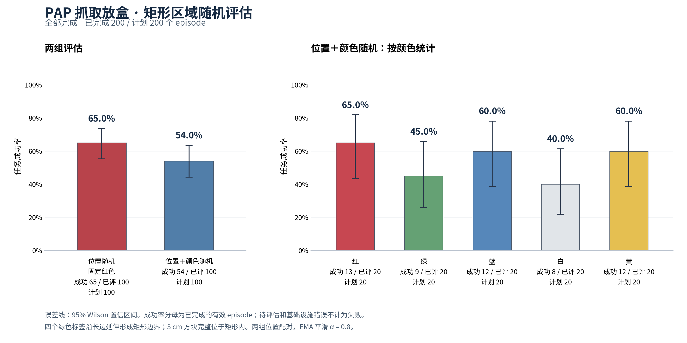
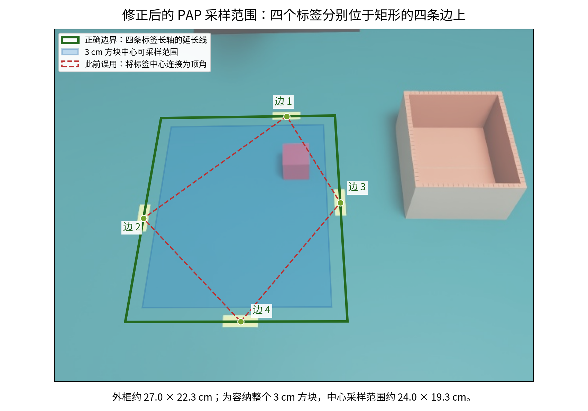
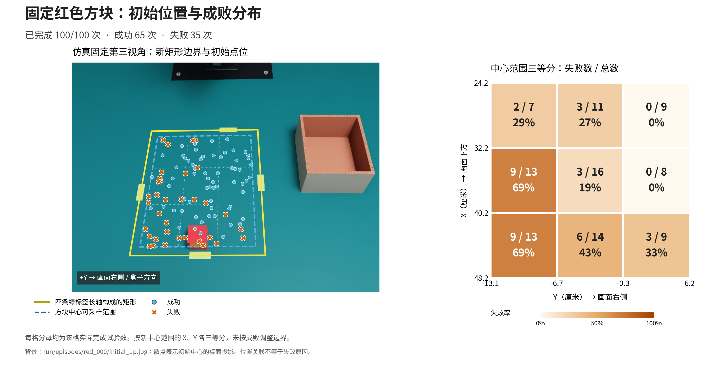

# PAP evaluation over the corrected rectangle — 2026-10-23

This package contains the completed **200-episode simulation evaluation** of
the supplied Wall-X PiPER checkpoint. It is an inference evaluation, with no RL
training or real-robot validation. Full RGB recordings, physics trajectories,
model weights and datasets remain outside Git.

| Condition | Success | Rate | Wilson 95% interval |
|---|---:|---:|---:|
| Random position, fixed red | 65/100 | 65% | 55.3–73.6% |
| Random position and five colors | 54/100 | 54% | 44.3–63.4% |

Second-group successes, with 20 trials per color: red **13**, green **9**,
blue **12**, white **8**, yellow **12**. The groups share 100 positions,
with a balanced random color permutation. Native diffusion draws are not
paired. [Paired comparisons](paired_color_breakdown.json) use each color's
exact position subset from the red baseline.



## Placement and execution

The four green tape markers identify **four rectangle edges**, along their
long axes, rather than four corner vertices. The boundary measures about
27.02 × 22.31 cm. The valid centre domain for a 3 cm cube is about
24.02 × 19.31 cm, so its entire footprint stays inside. Positions are uniform
by area, without a reachability filter; the seed is 20261023.

The checkpoint is `piper_pap_20260606`, with its associated normalization
statistics. The robot starts from dataset episode 0. Six arm targets use joint
EMA with alpha 0.8; gripper commands are unchanged. Each inference chunk has
32 actions, applied at 30 Hz over 120 Hz physics. The time limit is 20 simulated
seconds. Physical success requires a lift, full containment, release, floor
rest and 0.5 s stability, with bilateral finger-contact history.

All 200 planned episodes completed in 40.34 minutes. All 81 failures were
timeouts; there were no infrastructure errors or invalid model actions.
Recomputed physical outcomes and recorded-action checks passed for all 200.

**The earlier 88/100 and 85/100 results used an incorrect, smaller quadrilateral
joining the tape centres. They do not describe this rectangle and are excluded
from the results above.**



## Failure positions

In the fixed-red group, the middle-left and lower-left cells have the highest
observed failure rates, each 9/13 (69.2%). Cells divide each axis of the valid
centre rectangle into equal thirds; they were not optimized to the outcomes.
The background is a simulation frame, and points show initial tabletop
positions. Position association alone does not identify a failure mechanism.



## Files and reproduction

- [summary.json](summary.json), [episodes.csv](episodes.csv): all 200 outcomes
  and initial positions, including every failure.
- [plan.json](plan.json), [effective_config.json](effective_config.json): the
  evaluated protocol and scene settings, retaining local source-path references.
- [placement_audit.json](placement_audit.json),
  [rollout_audit.json](rollout_audit.json): placement/configuration checks and
  recorded-action, state, timing and physical-outcome checks.
- [location_summary.json](location_summary.json),
  [failed_initial_positions.csv](failed_initial_positions.csv),
  [grid_failure_rates.csv](grid_failure_rates.csv): fixed-red spatial statistics.
- [failure_review.json](failure_review.json): reviewed failure stages and the
  one ambiguous end-state classification. Its referenced raw evidence is local.

From the repository root, regenerate the success-rate figure using this package:

```bash
.conda/envs/pressb/bin/python scripts/plot_pap_eval.py \
  --summary docs/results/pap_rectangle_20261023/summary.json \
  --output-prefix outputs/pap_published_rates
```

Chinese figures use Noto CJK fonts (`fonts-noto-cjk` on Ubuntu). The rollout and
failure-location tools additionally require local `run/` reports, initial images,
trajectories and contacts, which are not included here. See the
[PAP guide](../../piper_pick_place.md#randomized-policy-evaluation) for preparing
a fresh evaluation and running these tools. Re-running the model may produce
different outcomes because inference is stochastic.
