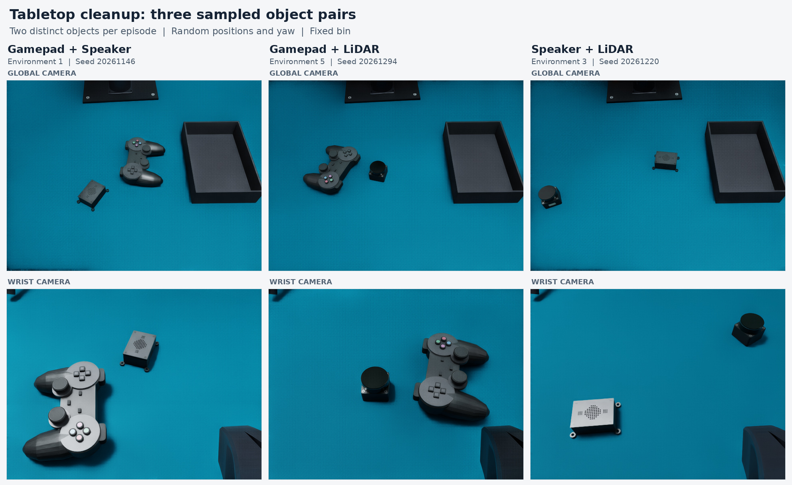
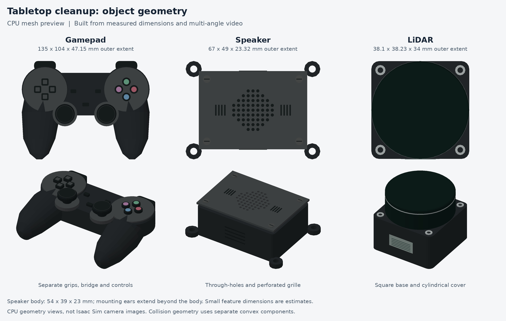
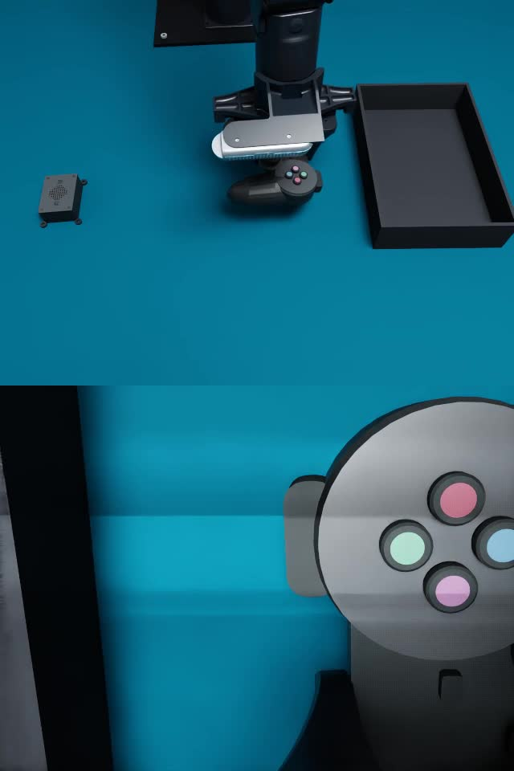

# Tabletop cleanup on the PiPER workbench

`tabletop_cleanup` adds a fixed open black box and two movable objects to the pinned
[Playground template](playground.md). Each episode contains **exactly two different
objects**, selected without replacement from a gamepad, a speaker and a lidar.
The task is to pick up both objects and place them inside the box.
Every episode uses the instruction `Put all objects on the table into the black box.`

The task preserves the template's table, PiPER, home pose, lighting and both
camera calibrations. It is a separate plugin; the empty Playground, cube-stacking
task and PAP environment retain their existing configurations.
Current defaults pin
[`playground_20261109_global_refined.json`](../configs/calibration/playground_20261109_global_refined.json).
This upgrades only the global camera pose; wrist, intrinsics and physical task
parameters are unchanged.
See the [global-camera refinement](results/playground_global_refinement_20261109.json)
for the later camera-specific evidence.



These are three initial layouts from the eight-environment simulation smoke
check, showing all three possible pairs. They demonstrate scene composition,
not complete cleanup execution or policy success.

## Shared execution

The lazy registry entry resolves to
`pressb.tasks.tabletop_cleanup.parallel:create_backend`. Task hooks build the
scene, sample layouts and interpret physical outcomes; the common
[`SharedWorldBackend`](../src/pressb/runtime/parallel.py) owns stepping, rendering,
episode clocks and indexed resets. PiPER's shared robot driver executes the
commands. There is no separate task-specific simulation loop.

The action/state contract is `joint7`: six joint positions in radians followed
by the full gripper opening in metres. Observations contain `up` and `wrist` RGB
views, measured state and the task instruction. The example action horizon is 32
at 30 Hz control, with 120 Hz physics. Object positions and sizes use metres;
configuration fields named `yaw_deg` use degrees.

Each step covers all active environments with equal-length action prefixes.
Selected episodes can reset independently with `env_seeds`; indexed reset
advances zero physics ticks and leaves other environments unchanged. Reset
rendering inherits the pinned scene's warmup setting. Camera calibration is
independent of output resizing and inference batching.

## Layouts and examples

The [simulation-node configuration](../configs/rl_nodes/tabletop_cleanup_simulation.json)
uses eight environments. Each reset selects two different object identities and
randomizes their tabletop positions and yaw. The box remains fixed. The
[fixed-layout configuration](../configs/rl_nodes/tabletop_cleanup_real_layout.json)
also contains exactly two objects; it disables reset randomization for comparison
with the captured arrangement. A three-object asset preview is not a task episode.
The example time limit is 120 seconds to allow sequential pickup and placement
of both objects, including release and final settling.

Object selection and spatial sampling are separate configuration fields:

```json
{
  "randomization": {
    "enabled": true,
    "pool": ["gamepad", "speaker", "lidar"],
    "fixed_subset": null,
    "x_range_m": [0.24, 0.48],
    "y_range_m": [-0.25, 0.19],
    "yaw_range_deg": [-180, 180],
    "clearance_m": 0.01,
    "max_attempts": 2048
  }
}
```

`fixed_subset` may select a pair such as `["gamepad", "speaker"]`; it does not
change the required count. Disabling randomization uses the configured object
poses. The box is configured separately under `bin`, with `center_xy`, `yaw_deg`,
`size_xyz_m` and `wall_thickness_m`; it is not part of the random object pool.
These box dimensions are configurable; the defaults reproduce the supplied box.
After the real transfer, the box was remeasured on 2026-11-09 with the refined
global camera and pinned across the plugin default and all three example
configurations. Its centre in the PiPER base frame is approximately
`[0.3396856, 0.21861745]` m, with yaw `2.070158°`. Its nominal outer dimensions
remain 222 × 148 × 49 mm; the 4 mm wall thickness is an estimate. The bin is a
static collision body and does not move or randomize on reset; only the selected
objects do. The fixed example's demonstration object poses are retained, rather
than tracking subsequent real prop rearrangements.

The [final box registration](results/tabletop_cleanup_bin_fixed_20261109.json)
records the new capture and corner fit. These remain image-based estimates,
not millimetre-accurate metrology or evidence that a grasp planner can reach
every sampled pose. Historical transfer artifacts retain their original poses.
The props are procedural assets assembled from measured/reference shapes, with
separate convex collision pieces rather than a single bounding box. Their local
origin is the centre of the full visual bounding box. Small speaker grille holes
have a continuous collision cover; the visible grille and larger mounting holes
retain their shape. These approximations matter when selecting a grasp or
comparing contact depth with the real objects.

| Asset | Approximate visual extent | Basis |
|---|---|---|
| Gamepad | 135 × 104 × 59.65 mm | Measured width; height refined with RGB-D; other shape details approximated |
| Speaker | 67 × 49 × 23.32 mm including mounting ears | Measured main housing: 54 × 39 × 23 mm; ears estimated |
| Lidar | 38.1 × 38.23 × 34 mm | Base and cylindrical housing reconstruction, including exterior details |



This historical asset-detail figure is a CPU mesh preview predating the gamepad
height refinement, not an Isaac camera image or a three-object task episode.

The assets are reconstructed meshes, not 3D scans. Default masses are also
estimates and can be overridden with each object's `mass_kg`; `scale` uniformly
scales the geometry.

For an explicit reset, the two keys in `options.objects` select the active pair:

```json
{
  "objects": {
    "gamepad": {"center_xy": [0.350157, 0.038151], "yaw_deg": 1.32646},
    "speaker": {"center_xy": [0.360005, -0.212919], "yaw_deg": 1.45995}
  }
}
```

These are task options within the regular reset request, which still requires
the shared service's run/request/episode protocol. A single object, three objects
or repeated identities do not form a valid episode.

The sampler checks the full rotated object footprints against the configured
rectangle, table, other selected object and fixed box, including clearance.
The nominal rectangle therefore includes positions that are rejected near the
box. It is not a claim of grasp-planner reachability.

The [Wall-OSS experiment](../configs/experiments/tabletop_cleanup_walloss_eval.json)
connects the same eight environments to the existing PAP `joint7` model as an
**interface example**. The PAP checkpoint has not been trained or evaluated for
this cleanup task. Use weights and normalization appropriate to the intended
policy before reporting learned-policy performance.

## Physical success

Success uses measured rigid-body geometry and contacts for both selected objects.
Each object must have been lifted at least 12 mm above the tabletop while both
fingers exerted at least 0.02 N and no table, box or other object supported it.
Placing an untouched object in the box at reset cannot satisfy this history.

Both objects must then satisfy these conditions continuously for 0.5 seconds:

| Condition | Default |
|---|---|
| Containment | Full transformed geometry fits the box's interior XY bounds, with 1 mm tolerance, and does not penetrate its floor |
| Support | At least 0.02 N of support from the box floor, or a supported selected object underneath; geometric support gap at most 4 mm |
| Release | Full gripper opening at least 50 mm, finger forces below 0.02 N and no table support |
| Low motion | Linear speed at most 0.025 m/s and angular speed at most 0.25 rad/s |

Stacking the two objects inside the box is allowed. The permitted top height is
bounded by the higher of the rim or the floor plus their combined current
vertical extents, with the containment tolerance. A support chain must reach the
box floor; contact between two unsupported objects is insufficient. Inactive
object slots cannot supply support or count toward success.

The default reward is sparse: 1 for completing both objects and 0 for failure;
success ends the episode. A dropped object ends it as a failure, while the time
limit truncates it. Normal execution relies on rigid-body contact physics;
placement changes at reset are not a grasp or cleanup demonstration.

## Validation and demonstration

The [pre-refinement task validation](results/tabletop_cleanup_20261109/summary.json) records
**3,917 unique CPU tests passing**, including 132 cleanup tests and a separate
OpenUSD supplement. Eight Isaac environments passed shared stepping, repeatable
per-environment seeds and zero-tick reset isolation, with all three object pairs
present.

Two fixed-layout scripted simulations completed both pickups, supported
placement, release and return home: speaker + lidar in 71.63 seconds, and
gamepad + speaker in 69.93 seconds. These are physical contact demonstrations, not a
learned-policy or randomized success-rate evaluation. Complete cleanup for the
gamepad + lidar pair has not been tested. A subsequent real-robot transfer is
recorded below.
These tests and recordings retain their original 2026-11-08 camera-preset
provenance. The later camera-only migration has its own validation and does not
replace these historical result files.

[](media/tabletop-cleanup-demo.mp4)

The video shows the gamepad + speaker run at **1× simulation time**, global view
above and wrist view below. It contains the initial frame and 2,098 action
frames: 2,099 frames at 30 fps, or 69.97 seconds. No learned model or real robot
is used in this demonstration.

## Real-robot trajectory transfer, 2026-11-09

With the refined global camera, fresh RGB-D observations located the gamepad,
speaker and box. They also corrected the gamepad's estimated face height to
48 mm, total height to 59.65 mm and central bridge width to 55 mm. The latter
is a visual estimate within roughly 50–60 mm; hidden contact surfaces, mass
and friction remain approximations. The speaker approached with a 70 mm
opening, retaining its 36 mm closing target.

Both the narrow-bridge comparison and the corrected-width simulation completed
pickup, placement and release with the same 1,935 joint/gripper targets. Those
recorded targets were replayed on PiPER at 30 Hz and 30% device speed using the
existing reference execution mode. Real dispatch took 65.33 seconds, without
arrival waits, contact gating, automatic smoothing, protection stops or reported
device faults. The arm returned to its initial pose.

Global and wrist video before human contact show both objects transferred into
the box. The gamepad lies approximately flat; the speaker rests tilted against
the inner wall. The real box moved during gamepad placement, whereas the
simulation uses a static bin. This is one scripted transfer, not a learned-policy
or randomized success-rate evaluation. Exact real containment forces/volumes
were not measured. A person subsequently moved the box to inspect it during the
terminal settling period; those later frames are excluded from the visual result.

The [transfer report](results/tabletop_cleanup_real_transfer_20261109.json)
records source paths, timing and evidence. Local trajectory, video and audits
are under `outputs/tabletop_cleanup_transfer_20261109/`. This transfer's pre-test
configuration is preserved there. The current fixed-layout example incorporates
the later final box registration described above. A new real execution must use
newly observed positions if the scene has moved.

## Launch

Validate the experiment without constructing Isaac or loading model weights:

```bash
python scripts/run_experiment.py validate \
  --config configs/experiments/tabletop_cleanup_walloss_eval.json
```

Start the simulation service in the Isaac environment:

```bash
.conda/envs/pressb/bin/python scripts/serve_simulation_node.py \
  --config configs/rl_nodes/tabletop_cleanup_simulation.json
```

Use `configs/rl_nodes/tabletop_cleanup_real_layout.json` for the fixed layout.
To check two shared environments, images, repeatable seeds and isolated reset,
select an available GPU and a fresh output directory:

```bash
.conda/envs/pressb/bin/python scripts/smoke_parallel_tasks.py \
  --task tabletop_cleanup \
  --config configs/rl_nodes/tabletop_cleanup_simulation.json \
  --num-envs 2 --gpu 0 --output outputs/tabletop_cleanup_smoke_new
```

This smoke command performs reset and hold actions; it does not demonstrate a
complete cleanup or measure policy success. Reproduce a complete scripted
simulation with another fresh output directory:

```bash
.conda/envs/pressb/bin/python scripts/smoke_tabletop_cleanup.py \
  --config configs/rl_nodes/tabletop_cleanup_real_layout.json \
  --objects gamepad speaker --num-envs 1 --gpu 1 \
  --grasp-opening speaker 0.07 \
  --output outputs/tabletop_cleanup_full_smoke_new
```

The historical speaker + lidar run used its own layout, archived at
`outputs/tabletop_cleanup_20261109/physics_speaker_lidar/config.json`.
The current fixed snapshot contains gamepad + speaker; selecting a different
pair requires a corresponding non-overlapping layout. Without `--objects`, the
script follows the configuration's fixed subset. `--plan-only` checks the
trajectory on CPU without starting Isaac; it does not establish physical
success. Run a configured model in separate terminals using the appropriate
model/Isaac environments:

```bash
python scripts/run_experiment.py inference --config configs/experiments/tabletop_cleanup_walloss_eval.json
python scripts/run_experiment.py simulation --config configs/experiments/tabletop_cleanup_walloss_eval.json
python scripts/run_experiment.py eval --config configs/experiments/tabletop_cleanup_walloss_eval.json
```

Choose either the standalone simulation-node launch or the experiment launch;
both examples use the same simulation port. When changing environment count,
update both `task.config.num_envs` and `run.rollout.num_envs`.
